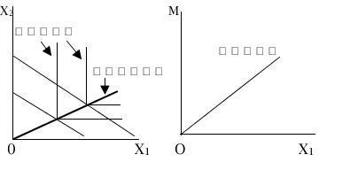
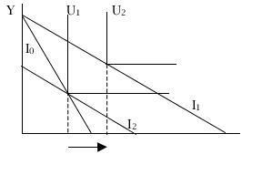
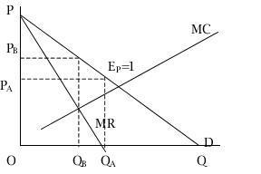
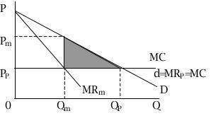

# 《微观经济学》模拟试卷（一）参考答案及解析

## 一、单项选择题

**1. 经济学家在实证经济学事件上意见不一，是由于：** `[ B ]`

* A. 一些经济学家侧重于宏观经济学，另一些侧重于微观经济学；
* B. 他们对经济的适当模型意见不一；
* C. 他们对公平与效率的相对重要性有不同看法；
* D. 他们有不同的背景和不同的利益；

**2. 对于商品 $X$ 和 $Y$，如果 $X$ 的价格发生变动时，$X$ 和 $Y$ 的需求量同时增加或减少，则 $X$ 和 $Y$ 的需求交叉弹性系数为：** `[ B ]`

* A. 正；
* B. 负；
* C. $0$；
* D. $1$；

**3. 如果某一商品的价格下跌 $10\%$ 导致买者的总支出增加 $2\%$，则需求曲线这一部分的需求价格弹性为：** `[ B ]`

* A. 缺乏弹性。
* B. 富有弹性。
* C. 单位弹性。
* D. 完全无弹性。

**4. 如果某一商品的价格下跌 $10\%$ 导致人们对该商品的购买量增加 $2\%$，则需求曲线这一部分的需求价格弹性为：** `[ A ]`

* A. 缺乏弹性。
* B. 富有弹性。
* C. 单位弹性。
* D. 完全无弹性。

**5. 如果 $X$ 商品价格上升导致 $Y$ 商品需求曲线右移，则 $X$、$Y$ 之间是：** `[ A ]`

* A. 替代品；
* B. 互补品；
* C. 可能是替代品或者互补品；
* D. 既不是替代品也不是互补品；

---

**6. 已知商品 $X$ 的价格为 $1.5$ 元，$Y$ 的价格为 $1$ 元，如果消费者从这两种商品得到最大效用的时候，商品 $Y$ 的边际效用为 $30$，那么，$X$ 的边际效用应该是：** `[ C ]`

* A. $30$；
* B. $20$；
* C. $45$；
* D. $0$；

**7. 无差异曲线上任一点上商品 $X$、$Y$ 的边际替代率等于它们的：** `[ C ]`

* A. 价格之比；
* B. 数量之比；
* C. 边际效用之比；
* D. 边际成本之比；

**8. 需求曲线斜率为正值的充要条件是：** `[ D ]`

* A. 低档品；
* B. 替代效应超过收入效应；
* C. 收入效应超过替代效应；
* D. 低档品且收入效应超过替代效应；

**9. 在完全价格歧视条件下：** `[ A ]`

* A. 需求曲线与边际收益曲线重合；
* B. 需求曲线与总收益曲线重合；
* C. 边际收益曲线位于平均收益曲线下方；
* D. 边际收益曲线位于平均收益曲线上方；

**10. 垄断缺乏效率，意指：** `[ D ]`

* A. 垄断厂商在平均成本曲线的上升部分生产；
* B. 垄断厂商在边际成本曲线的上升部分生产；
* C. 垄断厂商的利润为零；
* D. 价格高于边际成本。

---

根据下表选择 11–14 题（企业甲和企业乙的支付矩阵）：

| 企业甲 \ 企业乙 | 策略 III | 策略 IV |
| :---: | :---: | :---: |
| **策略 I** | $50, 20$ | $-20, -20$ |
| **策略 II** | $-10, 40$ | $25, -10$ |

**11. 企业甲的占优策略是：** `[ B ]`

* A. 策略 I；
* B. 策略 II；
* C. 没有企业甲的占优策略；
* D. 策略 I 和策略 II；

> **【解析】**
> 注：原卷参考答案给的是 B（原卷序号 ②）；若严格按收益矩阵比较，当乙选 III 时甲选 I（$50 > -10$），当乙选 IV 时甲选 II（$25 > -20$），企业甲无严格占优策略（C）。

**12. 企业乙的占优策略是：** `[ C ]`

* A. 策略 III；
* B. 策略 IV；
* C. 没有企业乙的占优策略。

> **【解析】**
> 注：原卷参考答案给的是 C（原卷序号 ③）；若按收益矩阵比较，无论甲选 I 还是 II，乙选策略 III 的收益均高于策略 IV（$20 > -20$ 且 $40 > -10$）。

**13. 占优均衡是：** `[ E ]`

* A. $(\text{I}, \text{III})$；
* B. $(\text{I}, \text{IV})$；
* C. $(\text{II}, \text{III})$；
* D. $(\text{II}, \text{IV})$；
* E. 以上都不是。

**14. 纳什均衡是：** `[ C ]`

* A. $(\text{I}, \text{III})$；
* B. $(\text{II}, \text{III})$；
* C. $(\text{II}, \text{IV})$；
* D. $(\text{I}, \text{IV})$；
* E. 以上都不是。

> **【解析】**
> 注：原卷参考答案给的是 C（原卷序号 ③）；若按题干支付矩阵求解，纳什均衡应为 A $(\text{I}, \text{III})$。

**15. 工资率上升有替代效应和收入效应，如果一直上升到使收入效应起主要作用，则劳动供给曲线：** `[ D ]`

* A. 向上倾斜；
* B. 向下倾斜；
* C. 垂直；
* D. 向后弯曲。

---

**16. 当某种产品的生产存在外部不经济时：** `[ B ]`

* A. 社会边际成本小于私人边际成本；
* B. 社会边际成本大于私人边际成本；
* C. 产品供给不足；
* D. 太少资源被分配给该产品的生产。

**17. 按照科斯定理：** `[ C ]`

* A. 当市场不能产生有效率的结果时，政府应当配置资源；
* B. 市场结果总是有效率的；
* C. 界定和交易产权可以解决外部性问题；
* D. 对外部不经济的产品应该征税。

**18. 市场不能提供纯粹公共产品是由于：** `[ D ]`

* A. 公共产品不具有竞争性；
* B. 公共产品不具有排他性；
* C. 消费者都想免费搭车；
* D. 以上三种情况都是。

**19. 产品组合效率是指：** `[ B ]`

* A. 经济处于生产可能性曲线内部；
* B. 经济中所生产的产品组合反映消费者的偏好；
* C. 商品以不可能从进一步交易中获益的方式在所有人中加以分配；
* D. 厂商所使用的资源准确反映了所有可用的资源。

**20. 当经济是帕累托有效配置时：** `[ D ]`

* A. 收入分配是公平的；
* B. 存在一种重新配置资源的途径，能使每个人的境况变好；
* C. 存在一种重新配置资源的途径，能使一些人的境况变好而不使其他人变坏；
* D. 不存在一种重新配置资源的途径，能使一些人的境况变好而不使其他人变坏；

---

## 二、判断题（判断对错，简要说明理由。每小题 3 分，共 30 分）

**1. 陡峭的线性需求曲线的弹性小，平坦的线性需求曲线的弹性大。** `( × )`

> **【参考答案】**
> 曲线上某一点弹性的大小，取决于点的位置（$P/Q$）和所在曲线的斜率的倒数值（$dQ/dP$）两个因素。不能笼统地说陡峭的线性需求曲线的弹性小，平坦的线性需求曲线的弹性一定大。

**2. 当价格高于均衡价格时，市场存在超额需求。** `( × )`

> **【参考答案】**
> 当价格高于均衡价格时，供给量大于需求量，市场存在超额供给。

**3. 吉芬品是一种低档品，但低档品不一定是吉芬品。** `( √ )`

> **【参考答案】**
> 吉芬品的需求量与收入反方向变动，故吉芬品必定是低档品；吉芬品的需求量与价格同方向变动，故低档品不一定是吉芬品。

**4. 在短期内，高固定成本固然是厂商亏损的主要原因，但不是厂商停产的理由。** `( √ )`

> **【参考答案】**
> 在短期内，固定成本是一种沉没成本，只要价格高于（或等于）平均变动成本，厂商进行生产就可以使亏损最小。

**5. 完全垄断厂商在长期均衡时选择平均成本最低处的产量水平，意味着利润最大化。** `( × )`

> **【参考答案】**
> 垄断厂商选择边际收益等于长期边际成本之点所对应的产量和价格组合能够使其长期利润最大。

**6. 垄断厂商在任何情况下都不可能独立提供出有效率的产量水平。** `( × )`

> **【参考答案】**
> 当垄断厂商能够区分每一个消费者，实行完全价格歧视定价并销售其产品时，则能够独立提供有效率的产量水平。

**7. 任何占优均衡必定是纳什均衡；纳什均衡却不一定是占优均衡。** `( √ )`

> **【参考答案】**
> 纳什均衡是指在对手的策略给定时，每个对局者的策略都是最好的，占优均衡是指无论其对手采取什么策略，某对局者的策略是最好的。当每个对局者都有且采取占优策略时就会出现纳什均衡。因此，任何占优均衡必定是纳什均衡，纳什均衡却不一定是占优均衡。

**8. 政府提供的产品都是公共产品。** `( × )`

> **【参考答案】**
> 政府提供的产品包括纯公共产品、准公共产品甚至私人产品。

**9. 政府在一个具有垂直需求曲线和向右上方倾斜的供给曲线的市场上征税，税负完全由消费者负担。** `( √ )`

> **【参考答案】**
> 由于需求完全缺乏弹性，税负完全由消费者负担。

**10. 垄断者总能获得大量利润的原因是他们面对的是一条几乎完全无弹性的需求曲线，因此能够索取一个极高的价格。** `( × )`

> **【参考答案】**
> 如果一个垄断者面对其产品的需求曲线完全低于其平均总成本函数，则垄断厂商无论索取什么价格也不能获利。

---

## 三、概念题（共 10 分）

**1. 帕累托最优状态**

> **【参考答案】**
> 是指资源分配的一种理想状态，即假定固有的一群人和可分配的资源，从一种分配状态到另一种状态的变化中，在没有使任何人境况变坏的前提下，使得至少一个人变得更好（帕累托改进）；当不存在任何帕累托改进的余地时，即达到了帕累托最优状态。

**2. 消费者剩余**

> **【参考答案】**
> 消费者在购买一定数量的某种商品时愿意支付的最高总价格和实际支付的总价格之间的差额。

**3. 自然垄断**

> **【参考答案】**
> 由于一个企业能以低于两个或更多企业的成本为整个市场供给一种物品或劳务而产生的垄断，其基本特征是在整个相关产量范围内存在显著的规模经济（平均成本不断下降）。

**4. 边际收益产量（$\text{MRP}$）**

> **【参考答案】**
> 是指由于使用额外一单位投入品（生产要素）所带来的总收益的增加量，等于边际收益（$MR$）乘以边际产品（$MP$），即 $\text{MRP} = MR \cdot MP$。

**5. 科斯定理**

> **【参考答案】**
> 只要财产权是明确的，并且交易成本为零或者很小，那么，无论在开始时将财产权赋予谁，市场均衡的最终结果都是有效率的，能够实现资源配置的帕累托最优。

---

## 四、简答题（任选三题，共 15 分）

**1. 设某消费者的效用函数为 $U = \min(ax_1, x_2)$，$a$ 为大于 $0$ 的常数，$x_1$、$x_2$ 是两种商品，$x_1$ 的价格为 $P_1$，$x_2$ 的价格为 $P_2$，消费者的收入为 $M$。**

*(1)* 画出该消费者的无差异曲线。

*(2)* 试给出该消费者对商品 $x_1$ 的需求函数。

*(3)* 试说明 $x_1$ 的替代效应、收入效应和总效应。

*(4)* 画出收入扩展曲线以及对商品 $x_1$ 的恩格尔曲线。

> **【参考答案】**
> - (1) 与 (4) 该消费者对这两种商品的无差异曲线呈 L 形（直角折线，顶点位于射线 $x_2 = ax_1$ 上），收入扩展曲线与恩格尔曲线如下图所示：
>
> 

>   
>   
<em>图1：完全互补品的无差异曲线、收入扩展曲线与恩格尔曲线</em>

> 

>
> - (2) 该消费者在最优选择处满足 $ax_1 = x_2$，代入预算约束方程 $P_1 x_1 + P_2 x_2 = M$，可得对商品 $x_1$ 的需求函数为：
>
> $$
> x_1 = \frac{M}{P_1 + aP_2}
> $$
>
> - (3) 完全互补品的替代效应为零，需求变动完全取决于收入效应，收入效应等于总效应，如下图所示：
>
> 

>   
>   
<em>图2：完全互补品的替代效应与收入效应</em>

> 

**2. 假设编写大学教材的一位作者得到的版税为出版商总收益的 $15\%$。**

*(1)* 用图形表示在追求利润最大化的出版商和追求版税最大化的作者之间产生的一种内在矛盾。

*(2)* 作为学生购买者，你希望谁的利益会实现？

*(3)* 在需求曲线高度缺乏弹性的情况下，作者与出版商的这个矛盾是否会减小？

> **【参考答案】**
> - (1) 追求利润最大化的出版商会选择 $MR = MC$ 之点所对应的价格销量组合，即选择需求弹性大于 $1$ 的区域定价（如 $P_B$，对应销量 $Q_B$）；追求版税最大化的作者会选择总收益最大化（$MR = 0$，即 $E_P = 1$）处的价格销量组合（如 $P_A$，对应销量 $Q_A$）。出版商所索取的价格高于作者希望的价格（$P_B > P_A$），销量小于后者（$Q_B < Q_A$）。
>
> 

>   
>   
<em>图3：出版商利润最大化与作者版税最大化矛盾示意图</em>

> 

>
> - (2) 作为学生购买者，希望作者的利益会实现，因为作者追求总收益最大化时对应的教材价格 $P_A$ 较低、供给数量 $Q_A$ 较大。
> - (3) 在需求曲线高度缺乏弹性的情况下，作者与出版商的这个矛盾不会减小，反而会扩大。

**3. 什么是科斯定理，科斯定理能否解决外部不经济？**

> **【参考答案】**
> - 科斯认为，如果某种产权是明确定义的，并且交易成本为零，交易双方总能通过协商达到某一帕累托最优配置，法定权利的最初配置状态对于资源配置效率是无关紧要的。这就是科斯定理。
> - 按照科斯定理，如果外部性导致无效率的主要原因是产权不明确或缺少产权，那么，只要设计适当的产权，有效率的方案将由分配给权利的人独自完成。以钢铁厂和渔场为例：如果法律给予渔场拥有清洁河水的权利，那么渔场可以要求钢铁厂向他们付钱来获得排放废水的权利，使钢铁厂能够继续经营；同样，如果法律给予钢铁厂有向河里排放废水的权利，渔场可以同钢铁厂协商，由渔场为废水处理的设备安装付费，或赔偿钢铁厂减产的损失。通过共同交易，他们能够各获所得。所以，只要明确界定污染的权利，不管是给予钢铁厂污染的权利，还是给予渔场不受污染的权利，都可以通过钢铁厂与渔场之间的无成本自由交易使污染量符合帕累托效率条件，也就是使污染量符合社会最优标准。
> - 科斯定理有效性的条件是交易成本为零，而且外部性的价值或损害容易测定。否则当存在着数量较多的当事人时，这种谈判协商的成本可能会高到使谈判和交易成为不可行的程度。

**4. 商品生产和交换的帕累托条件是什么？为什么完全竞争市场的一般均衡能使生产和交换达到帕累托最优？**

> **【参考答案】**
> - 一个追求利润最大化的完全竞争厂商一定会把生产推进到使商品的价格等于商品的边际成本的那一点为止，即 $P_X = MC_X$，$P_Y = MC_Y$。由于产品的边际转换率可以表示为两种产品边际成本的比例：
>
> $$
> MRT_{XY} = \frac{MC_X}{MC_Y} = \frac{P_X}{P_Y}
> $$
>
> - 同时，由于每个消费者的最优选择必定符合两种商品的边际替代率等于它们的价格比率，即 $MRS_{XY}^A = MRS_{XY}^B = \frac{P_X}{P_Y}$，所以商品的边际转换率就必定等于商品的边际替代率：
>
> $$
> MRS_{XY}^A = MRS_{XY}^B = MRT_{XY} = \frac{P_X}{P_Y}
> $$
>
> - 这表明，在分散化的完全竞争市场上，如果所有的消费者都选择使自己的效用最大化的商品组合，且所有的厂商实行的是竞争性的利润最大化决策，由此所形成的竞争均衡必定是帕累托有效配置。

---

## 五、计算题（任选二题，共 20 分）

**1. 假定行业需求曲线为 $Q = 250 - P$，每家厂商的边际成本为 $4$。试求：**

*(1)* 两个厂商的古诺反应函数；

*(2)* 古诺双寡头厂商的价格和产量；

*(3)* 若厂商数目无限增大，古诺均衡价格和产量是多少？

> **【参考答案】**
> - (1) 厂商 1 的总收益与边际收益分别为：
>
> $$
> TR_1 = [250 - (Q_1 + Q_2)]Q_1, \quad MR_1 = 250 - 2Q_1 - Q_2
> $$
>
> 同理，厂商 2 的边际收益为：
>
> $$
> MR_2 = 250 - 2Q_2 - Q_1
> $$
>
> 根据利润最大化条件 $MR = MC = 4$，得到两个厂商的古诺反应函数：
>
> $$
> 250 - 2Q_1 - Q_2 = 4 \implies Q_1 = 123 - 0.5Q_2
> $$
>
> $$
> 250 - 2Q_2 - Q_1 = 4 \implies Q_2 = 123 - 0.5Q_1
> $$
>
> - (2) 联立两个反应函数解得：
>
> $$
> Q_1 = Q_2 = 82, \quad Q = Q_1 + Q_2 = 164, \quad P = 250 - (Q_1 + Q_2) = 86
> $$
>
> - (3) 若厂商数目无限增大，市场趋近于完全竞争市场，均衡时 $P = MC = 4$，均衡总产量为 $Q = 250 - 4 = 246$。

**2. 设生产函数为 $Q = L^{0.5}K^{0.5}$，$L$、$K$ 的价格分别为 $w$、$r$ 固定，试求成本函数 $C(w, r, Q)$。**

> **【参考答案】**
> 根据成本最小化最优化条件：
>
> $$
> \frac{w}{r} = \frac{MP_L}{MP_K} \implies \frac{w}{r} = \frac{0.5L^{-0.5}K^{0.5}}{0.5L^{0.5}K^{-0.5}} = \frac{K}{L} \implies K = \frac{w}{r}L
> $$
>
> 代入生产函数 $Q = L^{0.5}K^{0.5}$，解得条件要素需求函数为：
>
> $$
> L = Q\left(\frac{w}{r}\right)^{-0.5}, \quad K = Q\left(\frac{w}{r}\right)^{0.5}
> $$
>
> 代入总成本方程 $C(w, r, Q) = wL + rK$，得成本函数为：
>
> $$
> C(w, r, Q) = 2\sqrt{wr}Q
> $$
>
> （注：若原卷按 $Q = 2L^{0.5}K^{0.5}$ 计算，则 $L = \frac{Q}{2}\left(\frac{w}{r}\right)^{-0.5}$，$K = \frac{Q}{2}\left(\frac{w}{r}\right)^{0.5}$，从而 $C(w, r, Q) = \sqrt{wr}Q$。）

**3. 假设一个垄断厂商面临的需求函数为 $Q = 60 - 5P$。**

*(1)* 厂商收益最大时的产量、价格；

*(2)* 如果厂商的边际成本为 $2$，求厂商利润最大化的产量和价格。

> **【参考答案】**
> - (1) 由 $Q = 60 - 5P$ 得到反需求函数 $P = 12 - 0.2Q$，总收益函数为 $TR = 12Q - 0.2Q^2$。要使总收益最大，令总收益对 $Q$ 的一阶导数（即边际收益 $MR$）等于零：
>
> $$
> MR = 12 - 0.4Q = 0 \implies Q = 30, \quad P = 12 - 0.2 \times 30 = 6
> $$
>
> - (2) 利润最大化要求 $MR = MC$，当 $MC = 2$ 时：
>
> $$
> 12 - 0.4Q = 2 \implies Q = 25, \quad P = 12 - 0.2 \times 25 = 7
> $$

---

## 六、论述题（共 15 分）

**1. 试从价格、产量和社会总剩余方面讨论垄断市场和竞争市场的效率，以下例说明，市场需求函数为 $Q = 100 - 2P$，$AC = MC = 10$，比较垄断行为和竞争行为哪个更有效率？用图表示出来。**

> **【参考答案】**
> 根据题意，垄断厂商的市场需求曲线 $D$ 和边际收益曲线 $MR_m$、边际成本曲线 $MC$，以及竞争厂商的需求曲线 $d = MR_P = MC$ 如下图所示：
>
> 

>   
>   
<em>图4：垄断市场与完全竞争市场效率比较及无谓损失图</em>

> 

>
> 由市场需求函数 $Q = 100 - 2P$，得反需求函数 $P = 50 - 0.5Q$，垄断厂商边际收益函数为 $MR_m = 50 - Q$。
> - **垄断市场均衡**：按照利润最大化原则 $MR_m = MC$，有 $50 - Q_m = 10$，决定的最优产量为 $Q_m = 40$（注：原卷答案笔误写为 $Q_m = 10$），对应垄断价格为 $P_m = 50 - 0.5 \times 40 = 30$（若按 $Q_m = 10$ 代入则为 $P_m = 45$）。
> - **完全竞争市场均衡**：完全竞争厂商按照 $P = MC$ 原则确定产出水平，由 $50 - 0.5Q_P = 10$ 解得 $Q_P = 80$，并按照 $P_P = 10$ 的价格销售产品。
> - **效率对比结论**：
>     - 显然，完全竞争厂商产品的价格低于完全垄断厂商产品的价格（$P_P < P_m$）；完全竞争厂商的产量水平高于完全垄断厂商的产量水平（$Q_P > Q_m$）。
>     - 完全竞争厂商长期均衡时只能获得正常利润，不可能获得经济利润，而完全垄断厂商则获得超额经济利润。
>     - 完全竞争市场是一种经济效率最高的市场类型，而完全垄断市场是一种经济效率最低的市场类型。图中的阴影三角形区域就是垄断所造成的社会福利的净损失（即无谓损失）。
