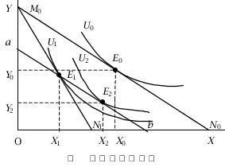
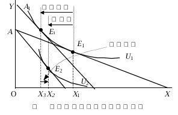
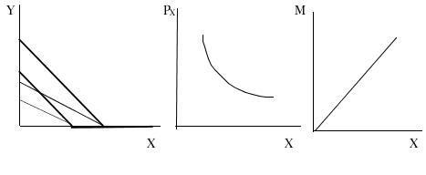
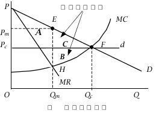

# 《微观经济学》模拟试卷（三）参考答案及解析

## 一、单项选择题

**1. 上大学的机会成本不包括：** `[ A ]`

* A. 食宿费；
* B. 学费；
* C. 书费；
* D. 如果从事工作可能会得到的工资；

**2. 供给的变动引起：** `[ B ]`

* A. 均衡价格和均衡数量同方向变动；
* B. 均衡价格反方向变动，均衡数量同方向变动；
* C. 均衡价格与均衡数量反方向变动；
* D. 均衡价格同方向变动，均衡数量反方向变动；

**3. 商品价格变化时，连结消费者诸均衡点的线称为：** `[ C ]`

* A. 收入-消费曲线；
* B. 需求曲线；
* C. 价格-消费曲线；
* D. 恩格尔曲线；

**4. 需求量和价格之所以呈反方向变化，是因为：** `[ C ]`

* A. 替代效应的作用；
* B. 收入效应的作用；
* C. 上述两种效应同时发生作用；
* D. 以上都不正确。

**5. 若 $X$ 和 $Y$ 两商品的交叉弹性是 $-2$，则 $X$ 和 $Y$ 是：** `[ B ]`

* A. 替代品；
* B. 互补品；
* C. 正常品；
* D. 低劣品。

---

**6. 已知某种商品的市场需求函数为 $D = 30 - P$，市场供给函数为 $S = 3P - 10$，如果对该商品实行减税，则减税后的市场均衡价格：** `[ B ]`

* A. 等于 $10$；
* B. 小于 $10$；
* C. 大于 $10$；
* D. 小于或等于 $10$；

**7. 在同一条需求曲线上，价格与需求量的组合从一点移动到另一点是** `[ C ]`

* A. 需求的变动；
* B. 收入的变动；
* C. 需求量的变动；
* D. 偏好的改变；

**8. 需求曲线斜率为正的充要条件是：** `[ D ]`

* A. 低档商品；
* B. 替代效应超过收入效应；
* C. 收入效应超过替代效应；
* D. 低档商品且收入效应超过替代效应；

**9. 无差异曲线的形状取决于：** `[ B ]`

* A. 消费者收入；
* B. 消费者偏好；
* C. 所购商品的价格；
* D. 商品效用水平的大小；

**10. 已知消费者的收入为 $50$ 元，商品 $X$ 的价格为 $5$ 元，商品 $Y$ 的价格为 $4$ 元。假定该消费者计划购买 $6$ 单位 $X$ 商品和 $5$ 单位 $Y$ 商品，商品 $X$ 和 $Y$ 的边际效用分别为 $60$ 和 $30$。如果要得到最大效用，他应该：** `[ A ]`

* A. 增购 $X$ 和减少 $Y$ 的数量；
* B. 增加 $Y$ 和减少 $X$ 的数量；
* C. 同时减少 $X$、$Y$ 的数量；
* D. 同时增加 $X$、$Y$ 的数量；

---

**11. 稀缺性意味着** `[ A ]`

* A. 决策者必须作出选择；
* B. 政府必须干预经济；
* C. 不能让自由市场来作重要的决策；
* D. 消费者必须抑制他们的贪婪；

**12. 互补品价格上升将会导致** `[ B ]`

* A. 需求量沿着需求曲线减少；
* B. 需求曲线左移；
* C. 个人增加他所消费的所有商品的数量；
* D. 需求量沿着需求曲线增加；

**13. 假如增加一单位产量所带来的边际成本大于产量增加前的平均变动成本，那么在产量增加后平均变动成本：** `[ B ]`

* A. 减少；
* B. 增加；
* C. 不变；
* D. 都有可能；

**14. 如果一条商品的恩格尔曲线是通过原点的一条直线，则这种商品的需求收入弹性** `[ C ]`

* A. 大于 $1$；
* B. 小于 $1$；
* C. 等于 $1$；
* D. 等于零；

**15. 如果在厂商的短期均衡产量上，$AR$ 小于 $SAC$，但大于 $AVC$，则厂商：** `[ B ]`

* A. 亏损，立即停产；
* B. 亏损，但继续生产；
* C. 亏损，生产或不生产都可以；
* D. 获得正常利润，继续生产；

---

**16. 在自然垄断中，边际成本：** `[ C ]`

* A. 等于价格；
* B. 等于平均成本；
* C. 小于平均成本；
* D. 大于平均成本；

**17. 若管理机构对垄断厂商的限价正好使其经济利润消失，价格要等于：** `[ C ]`

* A. 边际收益；
* B. 边际成本；
* C. 平均成本；
* D. 平均可变成本；

**18. 当某种产品的生产存在外部不经济时：** `[ B ]`

* A. 社会边际成本小于私人边际成本；
* B. 社会边际成本大于私人边际成本；
* C. 产品供给不足；
* D. 太少资源被分配给该产品的生产；

**19. 在完全竞争市场上，厂商对生产要素的需求量取决于：** `[ D ]`

* A. 消费者对该要素生产的产品的需求；
* B. 产品市场的价格；
* C. 要素的边际产量；
* D. 生产要素的价格；

**20. 某种产品是以不变的边际成本 $120$ 元被供给，同时它还排放污染，每单位造成 $5$ 元的危害。如果经济是完全有效率的，产品的市场价格应该是：** `[ C ]`

* A. $120$ 元；
* B. $115$ 元；
* C. $125$ 元；
* D. $5$ 元。

---

## 二、判断题（每小题 1 分，共 10 分）

**21. 市场体系能够提供人们所要的一切物品。** `( × )`

**22. 如果商品的需求价格弹性（绝对值）小于供给弹性，则销售税主要由购买者负担。** `( √ )`

**23. 商品的价格越高，无差异曲线就越向原点移动。** `( × )`

**24. 无论什么商品，其替代效应总是负数（价格和数量的关系）。** `( √ )`

**25. 需求的变化都会引起需求量变化，需求量的变化不一定引起需求变化。** `( √ )`

**26. 只要边际产量上升，平均产量也一定上升。** `( √ )`

> **【解析】**
> 在标准短期生产函数中，边际产量上升阶段始终位于平均产量曲线上方，故边际产量上升时平均产量一定上升。

**27. 只要总产量是下降的，那么边际产量必然是负数。** `( √ )`

**28. 在长期中所有的成本都是可变成本。** `( √ )`

**29. 现代经济学中所说的最有经济效率状态，一般是指收入分配公平。** `( × )`

**30. 所有垄断行业都必须引入竞争机制。** `( × )`

---

## 三、名词解释（每小题 2 分，共 10 分）

**31. 生产者剩余**

> **【参考答案】**
> 厂商在提供一定数量的某种产品时实际接受的总支付和愿意接受的最小总支付之间的差额。

**32. 生产可能性曲线**

> **【参考答案】**
> 又称生产可能性边界，是指在既定的资源数量和技术水平条件下，一个经济社会所能生产的两种产品的最大产量组合点的轨迹。

**33. 边际技术替代率**

> **【参考答案】**
> 在维持产量水平不变的条件下，增加一单位某种生产要素投入量时所减少的另一种生产要素的投入数量。

**34. 规模经济**

> **【参考答案】**
> 随着生产规模的扩大，厂商的长期平均成本随产量增加而下降的现象。

**35. 替代效应**

> **【参考答案】**
> 由商品的价格变动所引起的商品相对价格的变动，进而由商品的相对价格变动所引起的商品需求量的变动（保持消费者实际效用水平不变）。

---

## 四、简答题（35 分）

**36. “规模报酬递增的厂商不可能面临边际报酬递减的现象”这个命题是否正确？为什么？**

> **【参考答案】**
> 不正确。规模报酬阐述的是按相同比例增加所有投入要素时产量将如何变动（属于长期生产概念），而边际报酬递减指的是增加一种可变投入要素、而其他投入要素固定不变时产量将如何变动（属于短期生产概念）。一种生产技术既显示出递增（不变或递减）的规模报酬，又显示每种生产要素的边际报酬递减是完全可能的（例如生产函数 $Q = L^{0.8}K^{0.8}$ 满足规模报酬递增，但对单一要素的二阶偏导数小于零，满足边际报酬递减）。

**37. 完全竞争市场达到长期均衡时，零利润的含义是什么？**

> **【参考答案】**
> 在一个自由进入的竞争行业中，只要经济利润是正数，就会刺激新的厂商进入该行业竞争，以获取一部分经济利润。当经济利润为零时并不意味着该行业消失，而是意味着该行业厂商数量不再增加，因为不再具有进入该行业的超额利润吸引力。在经济利润为零的长期均衡情况下，一切生产要素费用均以市场价格支付——这些要素在其他地方也可以得到同样的市场价格（机会成本）。该行业中每种生产要素（包括企业家才能）所得到的报酬与它在其他行业所得到的报酬一样（即获得了全部正常利润），不存在额外的超额报酬来吸引新的生产要素进入该行业，但也没有理由使现有厂商离开该行业。经济利润为零的长期均衡行业是成熟的行业。

**38. 请比较税收收入都是 $R^*$ 的数量税（对某种消费品的数量征税）和所得税（对消费者的收入征税），征收哪一种税对消费者的经济情况相对会更好些？用无差异曲线图表示出来。**

> **【参考答案】**
> 政府征收数量税的预算方程为：$(P_X + t)X + P_Y Y = I$；政府征收等额所得税的预算方程为：$P_X X + P_Y Y = I - tX_1$（其中 $R^* = tX_1$）。无论哪种税收形式，都会使商品的消费量下降，但在数量税下，该商品消费量下降得更多；无论哪种税收形式都使消费者的实际收入下降，从而降低了消费者能够达到的最高消费效用水平，但如果数量税和所得税给政府带来相同税收收入的话，数量税给消费者带来的效用损失更大（如下图所示，数量税均衡点 $E_1$ 位于较低的无差异曲线 $U_1$ 上，而等额所得税均衡点 $E_2$ 位于较高的无差异曲线 $U_2$ 上）。由此可见，征收所得税要优于数量税。归根到底，数量税造成了相对价格的扭曲，使生产者或消费者接收错误的价格引导，因而带来了超额负担（低效率）。
>
> 

>   
>   
<em>图1：数量税与所得税对消费者效用影响的比较图</em>

> 

**39. 请用图形标示：当吉芬品价格下降时，人们对该商品需求的替代效应、收入效应和总效应各是多少？**

> **【参考答案】**
> 当吉芬品价格下降时（或价格变动时），替代效应、收入效应和总效应的图示如下（注：图中 $E_1 \to E_3$ 对应替代效应 $X_1 X_3$，$E_3 \to E_2$ 对应收入效应 $X_3 X_2$，$E_1 \to E_2$ 对应总效应 $X_1 X_2$）：
>
> 

>   
>   
<em>图2：吉芬品的替代效应、收入效应和总效应图</em>

> 

**40. 某消费者对 $X$、$Y$ 商品的效用函数为 $U = 2X + Y$。商品 $X$、$Y$ 的价格分别为 $P_X$、$P_Y$ 给定，消费者的收入 $M$ 亦给定。**

*(1)* 请绘出该消费者对这两种商品的无差异曲线。

*(2)* 当消费者收入增加时，如果 $X$ 商品的价格小于 $Y$ 商品的价格：$P_X < P_Y$，请画出该消费者对商品 $X$ 的收入消费曲线和恩格尔曲线。

*(3)* 当消费者的收入 $M$ 给定时，如果 $X$ 商品的价格小于 $Y$ 商品的价格：$P_X < P_Y$，试求该消费者对商品 $X$ 的需求函数。

> **【参考答案】**
> - (1) 无差异曲线为一条斜率为 $-2$ 的直线（$2X + Y = U$）。
> - (2) 当 $P_X < P_Y$ 时，由于 $\frac{MU_X}{MU_Y} = 2 > \frac{P_X}{P_Y}$，消费者会将全部收入用于购买商品 $X$（角点解 $Y = 0$），因此收入消费曲线就是横轴（$X$ 轴），恩格尔曲线为过原点的直线 $M = P_X X$。
> - (3) 对商品 $X$ 的需求函数为 $X = \frac{M}{P_X}$。如下图所示：
>
> 

>   
>   
<em>图3：完全替代品的无差异曲线、需求曲线与恩格尔曲线图</em>

> 

---

## 五、计算题（30 分）

**41. 假定在某成本不变的完全竞争行业中，每个厂商的长期总成本函数均为：$LTC = q^3 - 50q^2 + 750q$，市场需求函数为 $Q = 2000 - 4P$。**

*(1)* 试求该行业的长期供给曲线；

*(2)* 在该市场达到长期均衡时，行业中有多少家厂商？

*(3)* 假定政府征收产品价格 $20\%$ 的营业税，在达到新的均衡时，行业中有多少家厂商？

> **【参考答案】**
> - (1) 成本不变行业的长期均衡满足 $P = LAC_{\min} = LMC$。由长期总成本函数可得长期平均成本函数：
>
> $$
> LAC = \frac{LTC}{q} = q^2 - 50q + 750
> $$
>
> 令 $LAC$ 对 $q$ 的一阶导数等于零，即 $2q - 50 = 0$，得到 $q = 25$。将其代入 $LAC$，得到：
>
> $$
> LAC_{\min} = LMC = 25^2 - 50 \times 25 + 750 = 125
> $$
>
> 故该行业的长期供给曲线是 $P = 125$ 的一条水平线。
> - (2) 将 $P = 125$ 代入市场需求函数 $Q = 2000 - 4P$，得到市场均衡总产量 $Q = 2000 - 4 \times 125 = 1500$。行业中厂商数目为：
>
> $$
> N = \frac{Q}{q} = \frac{1500}{25} = 60 \text{（家）}
> $$
>
> - (3) 政府征收产品价格 $20\%$ 的营业税，意味着长期供给曲线上移至 $P = 125 \times (1 + 20\%) = 150$。代入市场需求函数 $Q = 2000 - 4P$ 得到新的行业均衡总产量为：
>
> $$
> Q = 2000 - 4 \times 150 = 1400
> $$
>
> 单个厂商最优规模仍为 $q = 25$，故新的均衡时行业中厂商数目为：
>
> $$
> N = \frac{1400}{25} = 56 \text{（家）}
> $$

**42. 假设一个垄断厂商面临的需求函数为 $P = 14 - 2Q$，成本函数为 $TC = Q^2 + 2Q$。**

*(1)* 求利润极大时的产量、价格。

*(2)* 如果政府对该厂商采取限价措施，迫使其达到竞争行业所能达到的产量水平，则其产量该是多少？

> **【参考答案】**
> - (1) 由需求函数 $P = 14 - 2Q$ 和成本函数 $TC = Q^2 + 2Q$，可得：
>
> $$
> TR = 14Q - 2Q^2, \quad MR = 14 - 4Q, \quad MC = 2Q + 2
> $$
>
> 根据利润最大化条件 $MR = MC$，有：
>
> $$
> 14 - 4Q = 2Q + 2 \implies Q = 2, \quad P = 14 - 2 \times 2 = 10
> $$
>
> - (2) 迫使其达到完全竞争行业所能达到的产量水平，即按 $P = MC$ 原则定价：
>
> $$
> 14 - 2Q = 2Q + 2 \implies Q = 3, \quad P = 8
> $$
>
> 故其产量应为 $Q = 3$。

---

## 六、论述题（15 分）

**43. 试从资源配置、价格、产量、社会净福利等方面比较完全竞争与完全垄断条件下的长期均衡。如何解决垄断的低效率问题？**

> **【参考答案】**
> - **完全竞争与完全垄断条件下长期均衡的比较**：
>     - **长期均衡的条件不同**：完全竞争厂商的长期均衡条件是 $P = AR = MR = SMC = LMC = SAC = LAC$；完全垄断厂商长期均衡的条件是 $MR = SMC = LMC$（且 $P = AR \ge LAC$）。
>     - **长期均衡点的位置不同**：完全竞争厂商的长期均衡必然产生于 $LAC$ 曲线的最低点，生产达到最优规模；完全垄断厂商的长期均衡则一般不产生于 $LAC$ 曲线的最低点。
>     - **价格高低不同**：完全竞争厂商产品的价格一般低于完全垄断厂商产品的价格（$P_c < P_m$）。
>     - **产量水平不同**：完全竞争厂商的产量水平一般高于完全垄断厂商（$Q_c > Q_m$）。
>     - **获得利润不同**：完全竞争厂商在长期均衡时，只能获得正常利润，不可能获得超额经济利润；完全垄断厂商则通常可以获得超额经济利润。
>     - **经济效率与社会净福利不同**：完全竞争市场是一种经济效率最高的市场类型，社会总剩余达到最大；完全垄断市场是一种经济效率最低的市场类型。如下图所示，区域 $B + C$ 就是垄断所造成的社会福利净损失（无谓垄断损失）。
>
> 

>   
>   
<em>图4：完全竞争与完全垄断长期均衡效率对比及无谓损失图</em>

> 

>
> - **解决垄断低效率问题的方法**：
>     - **制定和贯彻反垄断法**：防止企业串谋、限制排他性协议和恶性兼并，必要时拆分垄断企业。
>     - **引入竞争机制**：降低行业准入壁垒，让更多的厂商参与市场竞争以提高经济效率。
>     - **政府价格管制与税收调节**：对不易引入竞争的自然垄断行业，采取政府管制的方法，包括政府限价（按边际成本定价 $P = MC$ 结合政府补贴，或按平均成本定价 $P = AC$）以及征税、特许经营权拍卖等。
