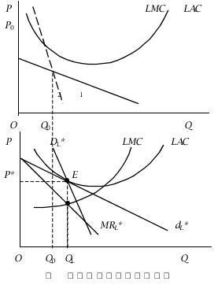
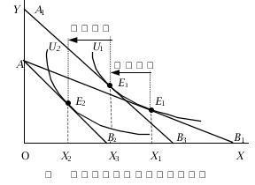
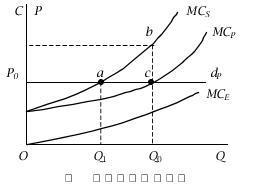

# 《微观经济学》模拟试卷（二）参考答案及解析

## 一、名词解释（每小题 2 分，共 10 分）

**1. 委托-代理问题**

> **【参考答案】**
> 由于信息不对称，委托人（如企业所有者）无法完全监督代理人（如企业经理或员工）的行为，代理人可能为了追求自身效用最大化而采取有损于委托人利益的机会主义行为，由此产生的利益冲突和效率损失称为委托-代理问题。

**2. 边际要素成本**

> **【参考答案】**
> 边际要素成本（$\text{MFC}$）是指厂商增加一单位某种生产要素的投入所带来的总成本的增加量，即 $\text{MFC} = \frac{d(TC)}{dL}$。

**3. 价格效应**

> **【参考答案】**
> 当某商品的价格发生变动而消费者货币收入和其他商品价格保持不变时，引起的该商品需求量的总变动，等于替代效应与收入效应之和。

**4. 吉芬品**

> **【参考答案】**
> 是指需求量与价格呈同方向变动的特殊低档商品，其负向的收入效应绝对值大于正向的替代效应，导致需求曲线向右上方倾斜。

**5. 生产扩展线**

> **【参考答案】**
> 在生产要素价格、生产技术和其他条件不变的情况下，当生产的成本或产量发生变化时，厂商必然会沿着等产量曲线与等成本曲线的切点进行生产要素投入量的调整，这些切点连接而成的轨迹称为生产扩展线。

---

## 二、选择题（以下各题的备选答案中，至少有一项是正确的。每小题 1 分，共 15 分）

**1. 如果商品的需求弹性为 $1.2$，供给弹性为 $1.5$，则销售税：** `[ A ]`

* A. 主要由消费者负担；
* B. 主要由生产者负担；
* C. 由消费者和生产者均等分担；
* D. 全部由生产者负担；

**2. 供给的变动引起：** `[ B, C ]`

* A. 均衡价格和均衡数量同方向变动；
* B. 均衡价格反方向变动，均衡数量同方向变动；
* C. 均衡价格与均衡数量反方向变动；
* D. 均衡价格同方向变动，均衡数量反方向变动；

**3. 如果商品的需求弹性为 $1.2$，供给弹性为 $1.5$，则蛛网形状是：** `[ B ]`

* A. 收敛型；
* B. 发散型；
* C. 封闭型；
* D. 无法确定；

**4. 等成本线平行向外移动，表明：** `[ B ]`

* A. 产量提高了；
* B. 成本增加了；
* C. 生产要素价格按相同比例提高了；
* D. 生产要素价格按不同比例下降了；

**5. 下列可以称为固定成本的是：** `[ A, C ]`

* A. 管理人员的工资；
* B. 生产工人的工资；
* C. 厂房、机器设备的折旧；
* D. 原材料费用；

---

**6. 小麦歉收导致小麦价格上升，准确地说，在这个过程中：** `[ C ]`

* A. 小麦供给量的减少引起需求量下降；
* B. 小麦供给的减少引起需求减少；
* C. 小麦供给的减少引起需求量下降；
* D. 小麦供给量的减少引起需求减少；

**7. 完全竞争市场厂商总收益曲线的斜率：** `[ A ]`

* A. 固定不变；
* B. 经常变动；
* C. 先增加后减少；
* D. 先减少后增加；

**8. 在差别定价的条件下，如果 A 市场的价格高于 B 市场，并且用 $E_a$ 和 $E_b$ 表示 A 市场和 B 市场的需求弹性，则：** `[ B ]`

* A. $E_a > E_b$；
* B. $E_a < E_b$；
* C. $E_a = E_b = -1$；
* D. $E_a = E_b = 0$；

**9. 假定某人消费两种物品 $X$、$Y$，当 $X$ 物品价格下降时，对 $X$ 物品的消费量的替代效应为 $4$，收入效应为 $3$：** `[ A ]`

* A. $X$ 是正常商品；
* B. $X$ 是低档物品；
* C. $X$ 是吉芬品；
* D. $X$ 是独立品；

**10. 已知消费者的收入为 $50$ 元，商品 $X$ 的价格为 $5$ 元，商品 $Y$ 的价格为 $4$ 元。假定该消费者计划购买 $6$ 单位 $X$ 商品和 $5$ 单位 $Y$ 商品，商品 $X$ 和 $Y$ 的边际效用分别为 $60$ 和 $30$。如果要得到最大效用，他应该：** `[ A ]`

* A. 增购 $X$ 和减少 $Y$ 的数量；
* B. 增加 $Y$ 和减少 $X$ 的数量；
* C. 同时减少 $X$、$Y$ 的数量；
* D. 同时增加 $X$、$Y$ 的数量；

---

**11. 商品 $X$、$Y$ 的价格按相同的比率上升，而收入不变，预算线：** `[ A ]`

* A. 向左下方平行移动；
* B. 向右上方平行移动；
* C. 不变动；
* D. 向左下方或右上方平行移动；

**12. 完全垄断厂商达到长期均衡时：** `[ A, C, D ]`

* A. $MR = LMC = SMC$；
* B. $MR = LMC = LAC$；
* C. $P > MC$；
* D. $P = MC / (1 - 1/E_d)$；

**13. 下面两种商品之间的需求交叉价格弹性可能为正值的是：** `[ B, D ]`

* A. 汽车和汽油；
* B. 木制网球拍和金属网球拍；
* C. 钓鱼竿和钓鱼许可证；
* D. 猪肉和牛肉；

**14. 如果一条商品的恩格尔曲线是通过原点的一条直线，则这种商品的需求收入弹性：** `[ C ]`

* A. 大于 $1$；
* B. 小于 $1$；
* C. 等于 $1$；
* D. 等于零；

**15. 如果在厂商的短期均衡产量上，$AR$ 小于 $SAC$，但大于 $AVC$，则厂商：** `[ B ]`

* A. 亏损，立即停产；
* B. 亏损，但继续生产；
* C. 亏损，生产或不生产都可以；
* D. 获得正常利润，继续生产；

---

## 三、简答题（30 分）

**1. 经济成本与会计成本的联系与区别。**

> **【参考答案】**
> 厂商的经济成本包括显性成本和隐性成本两部分。显性成本是指厂商为购买或租用各种生产要素而支付的一切费用，它包括工资支出、原材料和燃料及电力的费用、借贷利息和租金等。由于它要反映在会计账册上，因而是一种会计成本。显性成本仅仅是厂商成本中的一部分，其中的另一部分是隐性成本。所谓隐性成本是厂商所使用的与自有资源相联系的机会成本。因此，经济成本等于会计成本（显性成本）加上隐性成本，一般大于会计成本。

**2. 垄断竞争市场的长期均衡条件是什么？并在图形中表示出来。**

> **【参考答案】**
> 垄断竞争市场的长期均衡条件是：$MR = LMC = SMC$，且 $AR = P = LAC = SAC$。如下图所示：
>
> 

>   
>   
<em>图1：垄断竞争厂商的长期均衡图</em>

> 

**3. 设商品 $X$ 的需求函数为 $Q_X = 100 - 3P_X + 0.01M + 0.4P_Y$。$M$ 为收入，$P_X$、$P_Y$ 分别为商品 $X$ 和 $Y$ 的价格。**

*(1)* $X$ 商品是正常品还是低劣品，为什么？

*(2)* 商品 $X$ 和 $Y$ 是互替品还是互补品，为什么？

> **【参考答案】**
> - (1) $X$ 商品是正常品。因为 $\frac{\partial Q_X}{\partial P_X} = -3 < 0$（原卷笔误写为 $-2 < 0$），且 $\frac{\partial Q_X}{\partial M} = 0.01 > 0$，需求量与收入呈同方向变动。
> - (2) $X$、$Y$ 是互替品（替代品）。因为 $\frac{\partial Q_X}{\partial P_Y} = 0.4 > 0$，$X$ 的需求量与 $Y$ 的价格呈同方向变动。

**4. 以正常品（$X$）为例，在几何图形上标出：当商品 $X$ 价格上升时，对商品 $X$ 需求的替代效应、收入效应和总效应。**

> **【参考答案】**
> 正常品 $X$ 价格上升时的替代效应（$X_1 \to X_3$）、收入效应（$X_3 \to X_2$）和总效应（$X_1 \to X_2$）如下图所示：
>
> 

>   
>   
<em>图2：正常品价格上升时的替代效应、收入效应和总效应图</em>

> 

**5. 举一个例子，并用图说明外部效应是如何导致资源的帕累托无效率的？**

> **【参考答案】**
> 资源的有效配置要求市场的价格等于社会边际成本。当存在外部不经济时，私人边际成本等于价格，但小于社会边际成本 $MC_S$，即 $MC_S > MC_P$。这种情况不符合价格等于社会边际成本的要求，造成了不合理的资源配置。
> 以钢铁市场为例，假定生产的钢铁数量与导致的污染数量之间的关系是固定的，如下图所示。曲线 $d_P$ 和 $MC_P$ 分别表示钢铁的需求和私人供给（私人边际成本 $MC_P$），生产每一产量所造成的外部边际成本为 $MC_E$，$MC_S = MC_P + MC_E$ 为生产钢铁的社会边际成本。在竞争性市场上，私人边际成本曲线 $MC_P$ 和需求曲线 $d_P$ 的交点 $c$ 决定的均衡产量为 $Q_0$。从整个社会来看，符合社会最优的产量水平为 $Q_1$（对应交点 $a$），因为在 $Q_1$ 的产量水平上，社会边际成本等于价格。与社会最优标准相比，存在外部不经济时的竞争市场价格过低，产量过多（$Q_0 > Q_1$），资源配置效率低。
>
> 

>   
>   
<em>图3：外部不经济导致资源配置帕累托无效率图</em>

> 

---

## 四、计算题（30 分）

**1. 已知某厂商的短期生产函数为 $Q = -0.1L^3 + 6L^2 + 12L$，求：**

*(1)* 劳动的平均产量为极大时雇佣的劳动人数；

*(2)* 劳动的边际产量极大时雇佣的劳动人数；

*(3)* 平均可变成本极小时的产量（或雇佣的劳动人数）；

*(4)* 假定每人工资 $W = 360$ 元，产品价格 $P = 30$ 元，求利润极大时雇佣的劳动人数。

> **【参考答案】**
> - (1) 劳动的平均产量函数为：
>
> $$
> AP = \frac{Q}{L} = -0.1L^2 + 6L + 12
> $$
>
> 令 $AP$ 对 $L$ 的一阶导数等于零，即 $\frac{d(AP)}{dL} = -0.2L + 6 = 0$，求得 $L = 30$。
> - (2) 劳动的边际产量函数为：
>
> $$
> MP = \frac{dQ}{dL} = -0.3L^2 + 12L + 12
> $$
>
> 令 $MP$ 对 $L$ 的一阶导数等于零，即 $\frac{d(MP)}{dL} = -0.6L + 12 = 0$，求得 $L = 20$。
> - (3) 当平均可变成本极小时，意味着平均产量 $AP$ 极大，故雇佣劳动人数 $L = 30$，代入生产函数得对应产量为 $Q = -0.1 \times 30^3 + 6 \times 30^2 + 12 \times 30 = 3060$。
> - (4) 利润函数为：
>
> $$
> \pi = PQ - WL = 30(-0.1L^3 + 6L^2 + 12L) - 360L = -3L^3 + 180L^2
> $$
>
> 令 $\pi$ 对 $L$ 的一阶导数等于零，即 $\frac{d\pi}{dL} = -9L^2 + 360L = 0$，求得 $L_1 = 40$，$L_2 = 0$（舍去）。故利润极大时雇佣的劳动人数为 $L = 40$。

**2. 某完全竞争厂商的短期成本函数为：**

$$
STC = 0.04Q^3 - 0.8Q^2 + 10Q + 5
$$

**试求厂商的短期供给函数。**

> **【参考答案】**
> 由成本函数 $STC = 0.04Q^3 - 0.8Q^2 + 10Q + 5$ 得到：
>
> $$
> MC = 0.12Q^2 - 1.6Q + 10, \quad AVC = 0.04Q^2 - 0.8Q + 10
> $$
>
> 令 $AVC$ 对 $Q$ 的一阶导数等于零，即 $0.08Q - 0.8 = 0$，解得 $Q = 10$。将 $Q = 10$ 代入 $AVC$ 函数得最小值：
>
> $$
> AVC_{\min} = 0.04 \times 10^2 - 0.8 \times 10 + 10 = 6
> $$
>
> 完全竞争厂商短期供给函数可由边际成本曲线位于平均可变成本曲线最低点及以上的部分 $P = MC$ 来表示，即：
>
> $$
> \begin{cases}
> P = 0.12Q^2 - 1.6Q + 10 & (P \ge 6, Q \ge 10) \\
> Q = 0 & (P < 6)
> \end{cases}
> $$

**3. 垄断厂商所面临的需求函数为 $P = 100 - 2Q$，该厂商的边际成本固定为 $20$ 元。**

*(1)* 如果该厂商统一定价，求利润极大时的价格和销售量；

*(2)* 如果该厂商能够对所有消费者实行完全价格歧视，则它的销售量将是多少？

> **【参考答案】**
> - (1) 由题意得到总收益 $TR = 100Q - 2Q^2$，边际收益 $MR = 100 - 4Q$。根据利润极大化要求 $MR = MC$：
>
> $$
> 100 - 4Q = 20 \implies Q = 20, \quad P = 100 - 2 \times 20 = 60
> $$
>
> - (2) 完全价格歧视时，边际收益曲线与需求曲线重合，即 $MR = P = 100 - 2Q$。由 $MR = MC$ 得：
>
> $$
> 100 - 2Q = 20 \implies Q = 40
> $$

---

## 五、论述题（15 分）

**1. 用替代效应和收入效应说明劳动供给曲线为什么向后弯曲？在劳动市场上，劳动供给曲线是否一定向后弯曲？**

> **【参考答案】**
> - **个人劳动供给曲线向后弯曲的原因**：
>     - 工资率的变化就是闲暇的机会成本（价格）的变化。工资率上升时，闲暇的价格提高了，闲暇就变得更昂贵了，导致人们对闲暇的需求减少，即以消费（收入）替代闲暇，换言之，就是劳动供给增加（替代效应）。另一方面，工资率的提高增加了消费者的实际收入。同样工作 8 小时，工资率高了，收入也就多了。根据收入效应，由于闲暇是一种正常商品，收入增加时人们会购买更多的闲暇，对闲暇的需求就会增加，于是劳动供给就减少了（收入效应）。
>     - 因此，工资率上升带来的替代效应和收入效应对劳动供给的作用是相反方向的。工资率上升的替代效应鼓励多工作少休闲，而收入效应则是鼓励多休闲少工作。工资率的提高究竟将增加还是减少劳动供给，取决于替代效应和收入效应的相对强度。
>     - 一般情况下，在工资率比较低的阶段，替代效应大于收入效应，因为低工资带来的收入变化不会太大，所以劳动供给随着工资率的上升而增加（曲线向右上方倾斜）。但当工资率达到一定较高水平后，工资进一步提高带来的收入效应占了上风（超过替代效应），劳动者觉得收入已经颇为可观，宁可少工作、多休息和娱乐，所以劳动供给随工资上升而下降，从而使个人劳动供给曲线向后弯曲。
> - **整个劳动市场的供给曲线是否一定向后弯曲**：
>     - 在整个劳动市场上，在较高的工资水平上，虽然现有的部分工人也许提供较少的劳动，但高工资也会吸引新的劳动者进入该劳动市场，因而总的市场劳动供给量一般还是随着工资率的上升而增加，从而市场劳动供给曲线仍然是向右上方倾斜的。
