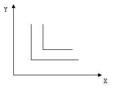
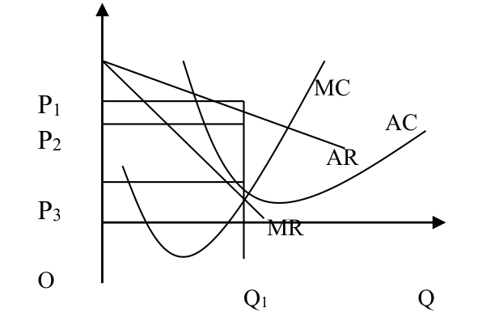

# 《微观经济学（本）》章节练习题参考答案及解析

## 第二章 需求、供给与市场均衡

### 一、单项选择题

**1. 需求曲线是一条倾斜的曲线，其倾斜的方向为（ A ）**

* A. 右下方
* B. 右上方
* C. 左下方
* D. 左上方

**2. 下列体现了需求规律的是（ D ）**

* A. 药品的价格上涨，使药品质量得到了提高
* B. 汽油的价格提高，小汽车的销售量减少
* C. 丝绸价格提高，游览公园的人数增加
* D. 照相机价格下降，导致销售量增加

**3. 其他因素保持不变，只是某种商品的价格下降，将产生什么样的结果（ C ）**

* A. 需求增加
* B. 需求减少
* C. 需求量增加
* D. 需求量减少

**4. 下列变化中，哪种变化不会导致需求曲线的位移（ B ）**

* A. 人们的偏好和爱好
* B. 产品的价格
* C. 消费者的收入
* D. 相关产品的价格

**5. 当汽油的价格上升时，在其他条件不变的情况下，对小汽车的需求量将（ A ）**

* A. 减少
* B. 不变
* C. 增加
* D. 难以确定

**6. 当咖啡价格急剧升高时，在其他条件不变的情况下，对茶叶的需求量将（ C ）**

* A. 减少
* B. 不变
* C. 增加
* D. 难以确定

**7. 消费者预期某种物品将来价格要上升，则对该物品当前的需求会（ C ）**

* A. 减少
* B. 不变
* C. 增加
* D. 难以确定

**8. 需求的变动与需求量的变动（ B ）**

* A. 都是由于一种原因引起的
* B. 需求的变动由价格以外的其他因素的变动所引起的，而需求量的变动由价格的变动引起的
* C. 需求量的变动是由一种因素引起的，需求变动是两种及两种以上的因素引起的
* D. 是一回事

**9. 整个需求曲线向右上方移动，表明（ A ）**

* A. 需求增加
* B. 需求减少
* C. 价格提高
* D. 价格下降

**10. 对化妆品的需求减少是指（ A ）**

* A. 收入减少引起的减少
* B. 价格上升而引起的减少
* C. 需求量的减少
* D. 价格下降

**11. 在同一条曲线上，价格与需求量的组合从 A 点移动到 B 点是（ D ）**

* A. 需求的变动
* B. 收入的变动
* C. 偏好的改变
* D. 需求量的变动

**12. 导致需求曲线发生位移的原因是（ C ）**

* A. 因价格变动，引起了需求量的变动
* B. 因供给曲线发生了位移，引起了需求量的变动
* C. 因影响需求量的非价格因素发生变动，而引起需求关系发生了变动
* D. 因社会经济因素发生变动引起产品价格的变动

**13. 下列因素中哪一种因素不会使需求曲线移动（ B ）**

* A. 消费者收入变化
* B. 商品价格下降
* C. 其他商品价格下降
* D. 消费者偏好变化

**14. 供给曲线是一条倾斜的曲线，其倾斜的方向为（ B ）**

* A. 右下方
* B. 右上方
* C. 左下方
* D. 左上方

**15. 鸡蛋的供给量增加是指供给量由于（ C ）**

* A. 鸡蛋的需求量增加而引起的增加
* B. 人们对鸡蛋偏好的增加
* C. 鸡蛋的价格提高而引起的增加
* D. 由于收入的增加而引起的增加

**16. 如果某种商品供给曲线的斜率为正，保持其他条件不变的情况下，该商品价格上升，导致（ C ）**

* A. 供给增加
* B. 供给减少
* C. 供给量增加
* D. 供给量减少

**17. 建筑工人工资提高将使（ A ）**

* A. 新房子供给曲线左移并使房子价格上升
* B. 新房子供给曲线左移并使房子价格下降
* C. 新房子供给曲线右移并使房子价格上升
* D. 新房子供给曲线左移并使房子价格下降

**18. 假如生产某种商品所需原材料的价格上升，则这种商品（ B ）**

* A. 需求曲线向左方移动
* B. 供给曲线向左方移动
* C. 需求曲线向右方移动
* D. 供给曲线向右方移动

**19. 供给规律中可以反映在（ D ）**

* A. 消费者不再喜欢消费某商品，使该商品的价格下降
* B. 政策鼓励某商品的生产，因而该商品的供给量增加
* C. 生产技术提高会使商品的供给量增加
* D. 某商品价格上升将导致对该商品的供给量增加

**20. 当供求原理发生作用时，粮食减产在市场上的作用是（ B ）**

* A. 政府规定个人购买粮食的数量
* B. 粮食价格上升
* C. 粮食价格下降
* D. 粮食交易量增加

**21. 关于均衡价格的正确说法是（ C ）**

* A. 均衡价格是需求等于供给时的价格
* B. 供给量等于需求量时的价格
* C. 供给曲线与需求曲线交点上的价格
* D. 供给价格等于需求价格时的价格

**22. 均衡价格随着（ D ）**

* A. 供给和需求的增加而上升
* B. 供给和需求的减少而上升
* C. 需求的减少和供给的增加而上升
* D. 需求的增加和供给的减少而上升

**23. 当某种商品的需求和供给出现同时减少的情况时，那么（ C ）**

* A. 均衡价格下降，均衡产量减少
* B. 均衡价格下降，均衡产量无法确定
* C. 均衡价格无法确定，均衡产量减少
* D. 均衡价格上升，均衡产量减少

**24. 已知某商品的需求函数和供给函数分别为：$Q_D = 14 - 3P$，$Q_S = 2 + 6P$，该商品的均衡价格是（ A ）**

* A. $4/3$
* B. $4/5$
* C. $2/5$
* D. $5/2$

> **【解析】** 令 $Q_D = Q_S$，即 $14 - 3P = 2 + 6P$，解得 $9P = 12$，故均衡价格 $P = 4/3$。

**25. 假设某商品的需求曲线为 $Q = 3 - 2P$，市场上该商品的均衡价格为 $4$，那么，当需求曲线变为 $Q = 5 - 2P$ 后，均衡价格将（ A ）**

* A. 大于 $4$
* B. 小于 $4$
* C. 等于 $4$
* D. 小于或等于 $4$

**26. 需求的变动引起（ A ）**

* A. 均衡价格和均衡数量同方向变动
* B. 均衡价格反方向变动，均衡数量同方向变动
* C. 均衡价格与均衡数量反方向变动
* D. 均衡价格同方向变动，均衡数量反方向变动

**27. 供给的变动引起（ B ）**

* A. 均衡价格和均衡数量同方向变动
* B. 均衡价格反方向变动，均衡数量同方向变动
* C. 均衡价格与均衡数量反方向变动
* D. 均衡价格同方向变动，均衡数量反方向变动

**28. 政府为了扶植农产品，规定了高于均衡价格的支持价格。为此政府应采取的措施是（ C ）**

* A. 增加农产品的税收
* B. 实行农产品配给制
* C. 收购过剩的农产品
* D. 对农产品生产者给予补贴

**29. 政府把价格限制在均衡价格以下，可能导致（ A ）**

* A. 黑市交易
* B. 大量积压
* C. 买者按低价买到希望购买的商品数量
* D. A 和 C

**30. 假定 $A$ 为自变量，$B$ 为因变量，弹性的数学表达式为（ A ）**

* A. $E = (\Delta B / \Delta A) \cdot (A / B)$
* B. $E = (\Delta A / \Delta B) \cdot (B / A)$
* C. $E = (\Delta B / B) \cdot (\Delta A / A)$
* D. $E = (B / \Delta B) \cdot (A / \Delta A)$

**31. 在下列价格弹性的表达中，正确的是（ A ）**

* A. 需求量变动对价格变动的反应程度
* B. 价格变动的绝对值对需求量变动的绝对值的影响
* C. 价格的变动量除以需求的变动量
* D. 需求的变动量除以价格的变动量

**32. 需求完全无弹性可以用（ C ）**

* A. 一条与横轴平行的线表示
* B. 一条向右下方倾斜的直线表示
* C. 一条与纵轴平行的线表示
* D. 一条向右上方倾斜的直线表示

**33. 哪一种商品的价格弹性最大（ D ）**

* A. 面粉
* B. 大白菜
* C. 手表
* D. 化妆品

**34. 若某商品价格上升 $2\%$，其需求量下降 $10\%$，则该商品的需求的价格弹性是（ B ）**

* A. 缺乏弹性
* B. 富有弹性
* C. 单位弹性
* D. 无限弹性

**35. 如果某商品是富有需求的价格弹性，则该商品价格上升（ C ）**

* A. 销售收益增加
* B. 销售收益不变
* C. 销售收益下降
* D. 销售收益可能上升也可能下降

**36. 一般来说，某种商品的需求价格弹性与购买该种商品的支出占全部收入的比例关系是（ A ）**

* A. 购买该种商品的支出占全部收入的比例越大，其需求价格弹性就越大
* B. 购买该种商品的支出占全部收入的比例越大，其需求价格弹性就越小
* C. 购买该种商品的支出占全部收入的比例越小，其需求价格弹性就越大
* D. 购买该种商品的支出占全部收入的比例与价格弹性没有关系

**37. 如果价格下降 $20\%$ 能使买者总支出增加 $2\%$，则该商品的需求量对价格（ A ）**

* A. 富有弹性
* B. 具有单位弹性
* C. 缺乏弹性
* D. 无法确定

**38. 如果人们收入水平提高，则食物支出在总支出中的比重将会（ C ）**

* A. 大大增加
* B. 稍有增加
* C. 下降
* D. 不变

**39. 假定某商品的价格从 $5$ 元降到 $4$ 元，需求量从 $9$ 个上升到 $11$ 个，则该商品的总收益将（ C ）**

* A. 不变
* B. 增加
* C. 减少
* D. 无法判断

> **【解析】** 降价前总收益 $TR_1 = 5 \times 9 = 45$ 元，降价后总收益 $TR_2 = 4 \times 11 = 44$ 元，总收益减少。

**40. 两种商品中如果其中的一种商品价格发生下降或上升时，这两种商品的购买量同时增加或同时减少，请问二者的交叉弹性系数是（ A ）**

* A. 负
* B. 正
* C. $0$
* D. $1$

**41. 某类电影现行平均票价为 $4$ 元，对该类电影需求的价格弹性为 $1.5$，经常出现许多观众买不到票的现象，这些观众大约占可买到票的观众的 $15\%$，要想使所有想看电影而又能买得起票的观众都买得到票，可以采取的办法是（ D ）**

* A. 电影票降价 $10\%$
* B. 电影票提价 $15\%$
* C. 电影票降价 $15\%$
* D. 电影票提价 $10\%$

> **【解析】** 由 $E_d = -\frac{\Delta Q / Q}{\Delta P / P} = 1.5$，要使需求量减少 $15\%$，价格应提高 $\frac{15\%}{1.5} = 10\%$。

**42. 什么情况下应采取薄利多销政策（ B ）**

* A. 价格弹性小于 $1$ 时
* B. 价格弹性大于 $1$ 时
* C. 收入弹性大于 $1$ 时
* D. 任何时候都应薄利多销

**43. 所有产品的收入弹性（ D ）**

* A. 都是负值
* B. 都是正值
* C. 绝对值总大于 $1$
* D. 不一定

**44. 下列产品中，哪种产品的交叉弹性为负值（ A ）**

* A. 汽车和轮胎
* B. 花生油和豆油
* C. 棉布和化纤布
* D. 大米和面粉

**45. 对于一个不吃猪肉的人来说，猪肉的需求量和牛肉价格之间的交叉弹性是（ A ）**

* A. $0$
* B. 负值
* C. 非弹性
* D. 弹性大小不一定

**46. 如果 Y 的价格上升，对替代品 X 的影响是（ C ）**

* A. 需求量增加
* B. 需求量减少
* C. 需求增加
* D. 需求减少

**47. 已知需求方程为：$Q = 50 - 2P$，在 $P = 10$ 处的点价格弹性是（ B ）**

* A. $6$
* B. $0.67$
* C. $0.33$
* D. $0$

> **【解析】** 当 $P = 10$ 时，$Q = 50 - 2 \times 10 = 30$。点价格弹性 $E_d = -\frac{\mathrm{d}Q}{\mathrm{d}P} \cdot \frac{P}{Q} = 2 \times \frac{10}{30} \approx 0.67$。

**48. 假如 $Q = 200 + 0.1M$，$M = 2000$ 元，其点收入弹性为（ D ）**

* A. $2$
* B. $-2$
* C. $0.1$
* D. $0.5$

> **【解析】** 当 $M = 2000$ 时，$Q = 200 + 0.1 \times 2000 = 400$。点收入弹性 $E_m = \frac{\mathrm{d}Q}{\mathrm{d}M} \cdot \frac{M}{Q} = 0.1 \times \frac{2000}{400} = 0.5$。

**49. 如果说两种商品 A 和 B 的交叉弹性是 $-3$，则（ D ）**

* A. A 和 B 是替代品
* B. A 和 B 是正常商品
* C. A 和 B 是劣质品
* D. A 和 B 是互补品

**50. 劣质品需求的收入弹性为（ B ）**

* A. 正
* B. 负
* C. 零
* D. 难以确定

**51. 蛛网理论主要是针对（ B ）**

* A. 正常商品
* B. 周期性商品
* C. 任何商品
* D. 吉芬商品

**52. 已知某商品的需求弹性与供给弹性均等于 $1.5$，则蛛网的形状是（ C ）**

* A. 收敛型
* B. 发散型
* C. 封闭型
* D. 圆圈型

**53. 已知某商品的需求弹性等于 $0.5$，供给弹性等于 $1.8$，则蛛网的形状是（ B ）**

* A. 收敛型
* B. 发散型
* C. 封闭型
* D. 圆圈型

**54. 已知某商品的需求弹性等于 $1.5$，供给弹性等于 $0.8$，则蛛网的形状是（ A ）**

* A. 收敛型
* B. 发散型
* C. 封闭型
* D. 圆圈型

**55. 一般来说，香烟的蛛网的形状是（ B ）**

* A. 收敛型
* B. 发散型
* C. 封闭型
* D. 圆圈型

**56. 一般认为，农产品的蛛网的形状是（ B ）**

* A. 收敛型
* B. 发散型
* C. 封闭型
* D. 圆圈型

**57. 目前我国私家车的蛛网形状是（ A ）**

* A. 收敛型
* B. 发散型
* C. 封闭型
* D. 圆圈型

### 二、多项选择题

**1. 满足需求的条件包括（ BD ）**

* A. 满足全家人的欲望
* B. 愿意购买
* C. 满足心理要求
* D. 有能力购买
* E. 满足自我实现的要求

**2. 影响需求量的因素包括（ ACDE ）**

* A. 价格
* B. 质量
* C. 收入
* D. 个人偏好
* E. 未来的预期

**3. 需求定理是指（ ACE ）**

* A. 商品价格提高，对该商品的需求量减少
* B. 商品价格提高，对该商品的需求量增加
* C. 商品价格下降，对该商品的需求量增加
* D. 商品价格下降，对该商品的需求量减少
* E. 商品与价格成反向变化

**4. 影响供给量的因素有（ ACDE ）**

* A. 价格
* B. 质量
* C. 成本
* D. 自然条件
* E. 政府的政策

**5. 供给定理是指（ BDE ）**

* A. 商品价格提高，对该商品的供给量减少
* B. 商品价格提高，对该商品的供给量增加
* C. 商品价格下降，对该商品的供给量增加
* D. 商品价格下降，对该商品的供给量减少
* E. 商品与价格成同向变化

**6. 某种商品的供给曲线的移动是由于（ BCE ）**

* A. 商品价格的变化
* B. 互补品价格的变化
* C. 生产技术条件的变化
* D. 产量的变化
* E. 生产这种商品的成本的变化

**7. 均衡价格就是（ BC ）**

* A. 供给量等于需求量时的价格
* B. 供给价格等于需求价格，同时供给量也等于需求量时的价格
* C. 供给曲线与需求曲线交点时的价格
* D. 供给等于需求时的价格
* E. 需求等于供给时的价格

**8. 政府对商品的调节通过价格进行，其对价格实施（ CE ）**

* A. 政府直接定价
* B. 指导价
* C. 支持价格
* D. 建议价
* E. 限制价格

**9. 需求的变动引起（ AC ）**

* A. 均衡价格同方向变动
* B. 均衡价格反方向变动
* C. 均衡数量同方向变动
* D. 均衡数量反方向变动
* E. 供给同方向变动

**10. 供给的变动引起（ BC ）**

* A. 均衡价格同方向变动
* B. 均衡价格反方向变动
* C. 均衡数量同方向变动
* D. 均衡数量反方向变动
* E. 需求同方向变动

**11. 需求的价格弹性的种类有（ ABCD ）**

* A. $E_d > 1$
* B. $E_d = 1$
* C. $E_d = 0$
* D. $E_d < 1$
* E. $E_d < 0$

**12. 影响需求价格弹性的因素有（ ABCE ）**

* A. 购买欲望
* B. 商品的可替代程度
* C. 用途的广泛性
* D. 商品的价格
* E. 商品的使用时间

**13. 需求收入弹性的种类有（ ABCDE ）**

* A. $E_m > 1$
* B. $E_m = 1$
* C. $E_m = 0$
* D. $E_m < 1$
* E. $E_m < 0$

**14. 供给的价格弹性的种类有（ ABDE ）**

* A. $E_s > 1$
* B. $E_s = 1$
* C. $E_s < 0$
* D. $E_s < 1$
* E. $E_s = 0$

**15. 影响供给弹性的因素有（ ABCE ）**

* A. 生产的难易程度
* B. 生产要素的供给弹性
* C. 生产技术
* D. 商品的价格
* E. 难易保管

**16. 下列弹性的表达中，正确的是（ ADE ）**

* A. 需求价格弹性是需求量变动对价格变动的敏感程度
* B. 需求价格弹性等于需求的变动量除以价格的变动量
* C. 收入弹性描述的是收入与价格的关系
* D. 收入弹性描述的是收入与需求量的关系
* E. 交叉弹性就是一种商品的价格变化对另一种商品需求量的影响

**17. 以下关于需求价格弹性大小的论述，正确的是（ BC ）**

* A. 如果需求曲线是一条直线，则直线上各点的需求弹性相等
* B. 如果需求曲线是一条直线，则直线上各点的需求弹性不相等
* C. 如果需求曲线是一条直线，则直线上越往左上方的点需求弹性越大
* D. 如果需求曲线是一条曲线，则曲线上各点的需求弹性相等
* E. 如果需求曲线是一条曲线，则曲线上不可能存在需求弹性相等的两点

**18. 以下关于需求价格弹性大小与销售收入的论述中，正确的是（ BE ）**

* A. 需求弹性越大，销售收入越大
* B. 如果商品富有弹性，则降价可以扩大销售收入
* C. 如果商品缺乏弹性，则降价可以扩大销售收入
* D. 如果商品富有弹性，则降价可以提高利润
* E. 如果商品为单位弹性，则价格对销售收入没有影响

**19. 关于收入弹性的论述中，正确的是（ ACDE ）**

* A. 收入弹性就是消费者收入变化对某种商品需求量的影响
* B. 所有商品的收入弹性都是正值
* C. 如果收入弹性小于零，表示这种商品是低档商品
* D. 从宏观上来说，如果某类商品收入弹性小于 $1$，说明人们对这类商品需求的增长速度小于他们收入的增长速度
* E. 从微观上说，企业提供的产品如果收入弹性较大，则经济繁荣时期企业可以获得较多的收益

**20. 关于交叉弹性，正确的是（ ACD ）**

* A. 交叉弹性可能是正值，也可能是负值
* B. 如果交叉弹性是正值，说明这两种商品是互补品
* C. 如果交叉弹性是正值，说明这两种商品是替代品
* D. 如果交叉弹性是负值，说明这两种商品是互补品
* E. 如果交叉弹性是负值，说明这两种商品是替代品

### 三、判断题

1. 需求量变化与需求变化的含义是相同的。( × )
2. 需求的变动是指商品本身价格变动所引起的该商品的需求数量的变动。( × )
3. 当消费者的收入发生变化时，会引起需求曲线的移动。( √ )
4. 生产者预期某商品未来价格要下降，就会减少该商品当前的供给。( × )
5. 在几何图形上，供给量的变动表现为商品的价格-供给量组合点沿着同一条既定的供给曲线运动。( √ )
6. 任何情况下商品的需求量与价格都是反方向变化的。( × )
7. 均衡价格就是供给量等于需求量时的价格。( × )
8. 均衡价格一定是供给曲线与需求曲线交点时的价格。( √ )
9. 限制价格应高于市场价格，支持价格应低于市场价格。( × )
10. 如果一般性商品的价格高于均衡价格，那该价格一定会下跌并向均衡价格靠拢。( √ )
11. 假定其他条件不变，某种商品价格的变化将导致它的供给量变化，但不会引起供给的变化。( √ )
12. 供给曲线右移表示生产者在每一种价格上提供更多的产品。( √ )
13. 如果价格和总收益呈同方向变化，则需求是缺乏弹性的。( √ )
14. 富有弹性的商品涨价总收益增加。( × )
15. 如果商品缺乏弹性，如果要扩大销售收入，则要提高价格。( √ )
16. 已知某商品的收入弹性大于 $0$ 小于 $1$，则这种商品是低档商品。( × )
17. 已知某商品的收入弹性小于 $1$，则这种商品是奢侈品。( × )
18. 已知某商品的收入弹性小于零，则这种商品是一般的正常商品。( × )
19. 已知某两种商品的交叉弹性小于零，则这两种商品是独立品。( × )
20. 已知某两种商品的交叉弹性大于 $0$，则这两种商品是替代品。( √ )
21. 当某种商品的价格上升时，其互补商品的需求将上升。( × )
22. 一般来说，农产品的蛛网形状为封闭型。( × )
23. 如果某种商品的需求曲线的斜率绝对值大于供给曲线斜率绝对值，则蛛网的形状是收敛型的。( × )
24. 如果某种商品的需求曲线的斜率绝对值大于供给曲线斜率绝对值，则蛛网的形状是发散型的。( √ )

### 四、概念联线（名词解释）

**1. 需求**

> **【参考答案】**
> 是指个人或所有消费者在一定时间内，在一定价格条件下，对某一商品愿意并且有能力购买的数量。

**2. 需求规律**

> **【参考答案】**
> 也称需求定理，是指商品价格提高，对该商品的需求量减少，反之，商品价格下降，则对该商品的需求量增加，这种需求数量和商品价格成反方向变化的关系称需求规律或需求定理。

**3. 供给**

> **【参考答案】**
> 是指某个厂商或全部厂商在一定时间内，在一定价格条件下，对某一商品愿意并且有商品出售的数量。

**4. 供给规律**

> **【参考答案】**
> 也称供给定理，是指商品价格提高，对该商品的供给量增加，反之，商品价格下降，则对该商品的供给量减少，这种供给数量和商品价格成同方向变化的关系称供给规律或供给定理。

**5. 均衡价格**

> **【参考答案】**
> 是指一种商品需求价格和供给价格相等，同时需求量和供给量相等的价格，是由需求曲线和供给曲线的交点决定的。

**6. 供求规律**

> **【参考答案】**
> 是指当需求量大于供给量时，价格上升；当需求量小于供给量时，价格下降，这就是市场价格变化的具体规律，一般称之为供求规律。

**7. 支持价格**

> **【参考答案】**
> 亦称最低价格，是指政府对某些商品规定价格的下限，防止价格过低，以示对该商品生产的支持。

**8. 限制价格**

> **【参考答案】**
> 亦称最高价格，是指政府对某些商品规定最高上限，防止价格过高，控制通货膨胀。

**9. 需求价格弹性**

> **【参考答案】**
> 是指需求量相对价格变化作出的反应程度，即某商品价格下降或上升百分之一时所引起的对该商品需求量的增加或减少百分比。

**10. 需求收入弹性**

> **【参考答案】**
> 是指需求量相对收入变化作出的反应程度，即消费者收入增加或减少百分之一所引起对该商品需求量的增加或减少的百分比。

**11. 需求的交叉弹性**

> **【参考答案】**
> 是指相关的两种商品中，一种商品需求量相对另一种商品价格变化作出的反应程度，即商品 A 价格下降或上升百分之一时，引起对商品 B 需求量的增加或减少的百分比。

**12. 供给价格弹性**

> **【参考答案】**
> 是指供给量相对价格变化作出的反应程度，即某种商品价格上升或下降百分之一时，对该商品供给量增加或减少的百分比。

**13. 蛛网理论**

> **【参考答案】**
> 是指用弹性理论考察价格波动对下一周期生产的影响及由此产生的均衡变动情况，是一种动态分析。按照这种理论绘制出来的供求曲线图，形状近似蛛网，故名为“蛛网理论”。

**14. 发散型蛛网**

> **【参考答案】**
> 当供给弹性的绝对值大于需求弹性绝对值的条件下，价格和产量波动越来越大，离开均衡点越来越远，称为发散型蛛网。

**15. 封闭型蛛网**

> **【参考答案】**
> 当供给弹性的绝对值等于需求弹性的绝对值的条件下，价格和产量波动始终按同一幅度进行，称为封闭型蛛网。

**16. 收敛型蛛网**

> **【参考答案】**
> 当供给弹性的绝对值小于需求弹性绝对值的条件下，价格和产量的波动越来越小，最后恢复均衡，称为收敛型蛛网。

## 第三章 效用论与消费者行为理论

### 一、单项选择题

**1. 某消费者偏好 A 商品甚于 B 商品，原因是（ D ）**

* A. 商品 A 的价格最低
* B. 商品 A 紧俏
* C. 商品 A 有多种用途
* D. 对其而言，商品 A 的效用最大

**2. 下列对物品边际效用的不正确理解是（ C ）**

* A. 每增加（减少）一个单位的对物品的消费所引起的总效用的增（减）量
* B. 最后增加的那个单位的消费所提供的效用
* C. 消费一定数量的某种物品所获得总效用
* D. 数学表达式为 $MU = \Delta TU / \Delta Q$（$TU$ 表示总效用，$Q$ 表示物品数量）

**3. 关于基数效用论，不正确的是（ C ）**

* A. 基数效用论中效用可以以确定的数字表达出来
* B. 基数效用论中效用可以加总
* C. 基数效用论和序数效用论使用的分析工具完全相同
* D. 基数效用论认为消费一定量的某物的总效用可以由每增加一个单位的消费所增加的效用加总得出

**4. 某消费者逐渐增加某种商品的消费量，直到达到了效用最大化，在这个过程中，该商品的（ C ）**

* A. 总效用和边际效用不断增加
* B. 总效用不断下降，边际效用不断增加
* C. 总效用不断增加，边际效用不断下降
* D. 总效用和边际效用不断下降

**5. 总效用曲线达到顶点时（ B ）**

* A. 边际效用曲线达到最大点
* B. 边际效用为零
* C. 边际效用为正
* D. 边际效用为负

**6. 边际效用随着消费量的增加而（ A ）**

* A. 递减
* B. 递增
* C. 不变
* D. 先增后减

**7. 序数效用论认为，商品效用的大小（ D ）**

* A. 取决于它的使用价值
* B. 取决于它的价格
* C. 不可比较
* D. 可以比较

**8. 如果消费者消费 $15$ 个面包获得的总效用是 $100$ 个效用单位，消费 $16$ 个面包获得的总效用是 $106$ 个效用单位，则第 $16$ 个面包的边际效用是（ D ）**

* A. $108$ 个
* B. $100$ 个
* C. $106$ 个
* D. $6$ 个

**9. 已知商品 X 的价格为 $8$ 元，Y 的价格为 $3$ 元，若某消费者买了 $5$ 个单位 X 和 $3$ 个单位 Y，此时 X、Y 的边际效用分别为 $20$、$14$，那么为获得效用最大化，该消费者应该（ C ）**

* A. 停止购买两种商品
* B. 增加 X 的购买，减少 Y 的购买
* C. 增加 Y 的购买，减少 X 的购买
* D. 同时增加对两种商品的购买

> **【解析】** 此时 $\frac{MU_X}{P_X} = \frac{20}{8} = 2.5 < \frac{MU_Y}{P_Y} = \frac{14}{3} \approx 4.67$，故应增加 Y 的购买，减少 X 的购买。

**10. 消费者剩余是指消费者购买某种商品时，从消费中得到的（ B ）**

* A. 满足程度
* B. 满足程度超过他实际支付的价格部分
* C. 边际效用
* D. 满足程度小于他实际支付的价格部分

**11. 消费者剩余是消费者的（ B ）**

* A. 实际所得
* B. 主观感受
* C. 没有购买的部分
* D. 消费剩余部分

**12. 实现了消费者均衡的是（ C ）**

* A. $MU_A / P_A < MU_B / P_B$
* B. $MU_A / P_A > MU_B / P_B$
* C. $MU_A / P_A = MU_B / P_B$
* D. 以上三个公式都不对

**13. 已知某家庭的总效用方程为 $TU = 14Q - Q^2$，$Q$ 为消费商品数量，该家庭获得最大效用时的商品数量为（ B ）**

* A. $49$
* B. $7$
* C. $14$
* D. $2$

> **【解析】** 令 $MU = \frac{\mathrm{d}TU}{\mathrm{d}Q} = 14 - 2Q = 0$，解得 $Q = 7$。

**14. 已知商品 X 的价格为 $2$ 元，商品 Y 的价格为 $1$ 元，如果消费者在获得最大满足时，商品 Y 的边际效用是 $30$ 元，那么，商品 X 的边际效用是（ D ）**

* A. $20$
* B. $30$
* C. $45$
* D. $60$

> **【解析】** 由消费者均衡条件 $\frac{MU_X}{P_X} = \frac{MU_Y}{P_Y}$，得 $MU_X = \frac{P_X}{P_Y} \cdot MU_Y = \frac{2}{1} \times 30 = 60$。

**15. 一般来说，无差异曲线的形状是（ B ）**

* A. 向右上方倾斜的曲线
* B. 向右下方倾斜的曲线
* C. 是一条垂线
* D. 是一条水平线

**16. 无差异曲线为斜率不变的直线时，表示相结合的两种商品是（ B ）**

* A. 可以替代的
* B. 完全替代的
* C. 互补的
* D. 互不相关的

**17. 在同一个平面图上有（ B ）**

* A. 三条无差异曲线
* B. 无数条无差异曲线
* C. 许多但数量有限的无差异曲线
* D. 二条无差异曲线

**18. 在一条无差异曲线上（ D ）**

* A. 消费 X 获得的总效用等于消费 Y 获得的总效用
* B. 消费 X 获得的边际效用等于消费 Y 获得的边际效用
* C. 曲线上任两点对应的消费品组合所能带来的边际效用相等
* D. 曲线上任两点对应的消费品组合所能带来的总效用相等

**19. 无差异曲线上任一点上商品 X 和 Y 的边际替代率等于它们的（ C ）**

* A. 价格之比
* B. 数量之比
* C. 边际效用之比
* D. 边际成本之比

**20. 如图所示的无差异曲线表明 X 和 Y 的关系为（ A ）**

  
  
<em>图1：完全互补品的无差异曲线</em>

* A. 完全互补品
* B. 完全替代品
* C. 没有关系
* D. 互不相关

**21. 同一条无差异曲线上的不同点表示（ B ）**

* A. 效用水平不同，但所消费的两种商品组合比例相同
* B. 效用水平相同，但所消费的两种商品的组合比例不同
* C. 效用水平不同，两种商品的组合比例也不相同
* D. 效用水平相同，两种商品的组合比例也相同

**22. 预算线上的表明（ C ）**

* A. 没有用完预算支出
* B. 处于均衡状态
* C. 预算支出条件下的最大可能数量组合
* D. 状态不可能确定

**23. 预算线的位置和斜率取决于（ C ）**

* A. 消费者的收入
* B. 商品的价格
* C. 消费者的收入和商品的价格
* D. 以上都不正确

**24. 商品 X 和 Y 的价格按相同的比率上升，而收入不变，预算线（ A ）**

* A. 向左下方平行移动
* B. 向右上方平行移动
* C. 向左下方或右上方平行移动
* D. 不变动

**25. $M = P_x \cdot X + P_y \cdot Y$ 是消费者的（ C ）**

* A. 需求函数
* B. 效用函数
* C. 预算约束条件方程
* D. 不确定函数

**26. 商品 X 和 Y 的价格以及消费者的预算收入都按同一比率同方向变化，预算线（ D ）**

* A. 向左下方平行移动
* B. 向右上方平行移动
* C. 向左下方或右上方平行移动
* D. 不变动

**27. 商品的收入不变，其中一种商品价格变动，消费可能线（ C ）**

* A. 向左下方移动
* B. 向右上方移动
* C. 沿着横轴或纵轴移动
* D. 不动

**28. 消费者效用最大化的点必定落在（ C ）**

* A. 预算线右侧区域
* B. 预算线左侧区域
* C. 预算线上
* D. 预算线上和左侧区域

**29. 关于实现消费者均衡的条件，不正确的是（ D ）**

* A. 在基数效用论下，商品的边际效用之比等于其价格之比
* B. 在基数效用论下，两种商品的边际替代率等于其价格之比
* C. 基数效用论与序数效用论的均衡条件实质上是相同的
* D. 均衡状态下，消费者增加一种商品的数量所带来的效用增加量必定大于减少的另一种商品所带来的效用减少量

**30. 根据无差异曲线分析，消费者均衡是（ A ）**

* A. 无差异曲线与预算线的相切之点
* B. 无差异曲线与预算线的相交之点
* C. 离原点最远的无差异曲线上的任何一点
* D. 离原点最近的预算线上的任何一点

**31. 已知某人的效用函数为 $TU = 4X + Y$，如果消费者消费 $16$ 单位 X 和 $14$ 单位 Y，则该消费者的总效用是（ A ）**

* A. $78$
* B. $14$
* C. $62$
* D. $16$

> **【解析】** 代入效用函数得 $TU = 4 \times 16 + 14 = 64 + 14 = 78$。

**32. 假设消费者张某对 X 和 Y 两种商品的效用函数为 $U = XY$，张某收入为 $500$ 元，X 和 Y 的价格分别为 $P_X = 2$ 元，$P_Y = 5$ 元，张某对 X 和 Y 两种商品的最佳组合是（ C ）**

* A. $X = 25, Y = 50$
* B. $X = 125, Y = 25$
* C. $X = 125, Y = 50$
* D. $X = 50, Y = 125$

> **【解析】** 由 $\frac{MU_X}{P_X} = \frac{MU_Y}{P_Y}$ 得 $\frac{Y}{2} = \frac{X}{5}$，结合预算约束 $2X + 5Y = 500$，解得 $X = 125, Y = 50$。

**33. 由于收入变化所引起的最佳购买均衡点的连线，称为（ D ）**

* A. 需求曲线
* B. 价格——消费曲线
* C. 恩格尔曲线
* D. 收入——消费曲线

**34. 当 X 商品的价格下降时，替代效应增加，收入效应也增加，则商品是（ A ）**

* A. 正常商品
* B. 低档商品
* C. 吉芬商品
* D. 独立商品

**35. 已知某吉芬商品的价格下降时，替代效应增加，则收入效应（ B ）**

* A. 不变
* B. 下降
* C. 增加
* D. $\infty$

**36. 当 X 商品的价格下降时，替代效应增加，收入效应下降，但总效应是增加的，则商品是（ A ）**

* A. 低档商品
* B. 正常商品
* C. 吉芬商品
* D. 独立商品

**37. 某低档商品的价格下降，在其他情况不变时，（ C ）**

* A. 替代效应和收入效应相互加强导致该商品需求量增加
* B. 替代效应和收入效应相互加强导致该商品需求量减少
* C. 替代效应倾向于增加该商品的需求量，而收入效应倾向于减少其需求量
* D. 替代效应倾向于减少该商品的需求量，而收入效应倾向于增加其需求量

### 二、多项选择题

**1. 效用是（ ABC ）**

* A. 指商品满足人的欲望和需要的能力和程度
* B. 一种主观感受
* C. 客观存在的
* D. 使用价值
* E. 价值

**2. 随着消费商品数量的增加（ AC ）**

* A. 边际效用递减
* B. 边际效用总大于零
* C. 边际效用会小于零
* D. 每单位商品增加的总效用减少
* E. 总效用不断减少

**3. 以下关于边际效用说法正确的有（ CDE ）**

* A. 边际效用不可能为负值
* B. 边际效用与总效用呈同方向变动
* C. 对于通常情况来说，消费者消费商品服从边际效用递减规律
* D. 在边际效用大于等于零时，边际效用与总效用反方向变动
* E. 每增加（减少）一个单位的对物品的消费所引起的总效用的增（减）量

**4. 总效用和边际效用的关系（ ACE ）**

* A. 当边际效用为零时，总效用最大
* B. 当边际效用为零时，总效用递增
* C. 当边际效用为负时，总效用递减
* D. 当边际效用为负时，总效用不变
* E. 当边际效用为正时，总效用递增

**5. 消费者剩余是指（ CE ）**

* A. 需求曲线之上，价格线以下部分
* B. 供给曲线之上，均衡价格以下部分
* C. 需求曲线之下，价格线以上部分
* D. 消费者的最大满足程度
* E. 消费者从商品的消费中得到的满足程度大于他实际支付的价格部分

**6. 无差异曲线的特征包括（ BDE ）**

* A. 任意两条无差异曲线可以相交
* B. 一般来说无差异曲线具有负斜率
* C. 一般来说无差异曲线具有正斜率
* D. 任意两条无差异曲线不能相交
* E. 在坐标图上有许多条无差异曲线

**7. 商品的边际替代率（ BCDE ）**

* A. 是正的
* B. 是负的
* C. 具有递减的趋势
* D. 等于该两种商品的边际效用之比
* E. 是指消费者为保持原有的效用水平或满足程度不变的前提下，增加一单位某种商品的消费时，而需放弃另一种商品消费数量

**8. 关于消费者均衡点的下列看法正确的有（ AC ）**

* A. 均衡点位于预算线上
* B. 消费者均衡点在理论上可以脱离预算线而存在
* C. 均衡点由预算线和无差异曲线的切点决定
* D. 在消费者均衡点上，预算线与无差异曲线斜率相等但符号相反
* E. 均衡点可以是无差异曲线上的任意一点

**9. 下列属于低档商品的是（ AC ）**

* A. 收入效应 $X_1 X^\ast = -2$，替代效应 $X^\ast X_2 = +3$
* B. 收入效应 $X_1 X^\ast = -5$，替代效应 $X^\ast X_2 = +2$
* C. 收入效应 $X_1 X^\ast = -5$，替代效应 $X^\ast X_2 = +8$
* D. 收入效应 $X_1 X^\ast = +5$，替代效应 $X^\ast X_2 = +2$
* E. 收入效应 $X_1 X^\ast = +5$，替代效应 $X_1 X^\ast = -5$

**10. 下面属于正常商品的是（ ABD ）**

* A. 消费者的收入增加 $80\%$ 时，某商品的需求量增加 $40\%$
* B. 消费者的收入增加 $80\%$ 时，某商品的需求量增加 $90\%$
* C. 已知某商品价格下降时，替代效应增加，收入效应减少
* D. 已知某商品价格下降时，替代效应增加，收入效应增加
* E. 消费者的收入增加 $80\%$，某商品的需求量减少 $20\%$

**11. 消费者对风险的态度大体上可分为（ ABCDE ）**

* A. 风险回避者
* B. 风险爱好者
* C. 风险中立者
* D. 厌恶风险者
* E. 喜欢风险者

### 三、判断题

1. 因为边际效用递减，所以一般商品的需求曲线向右下方倾斜。( √ )
2. 当消费某种物品的边际效用为负时，则总效用达极大值。( × )
3. 当边际效用减少时，总效用也是减少的。( × )
4. 基数效用论的分析方法包括边际效用分析和无差异曲线分析方法。( × )
5. 序数效用论采用的是边际效用分析法。( × )
6. 需求量和商品的价格成反方向变化是由边际效用递减规律决定的。( √ )
7. 消费者均衡就是消费者获得了最大边际效用。( × )
8. 消费者剩余是指消费者所获得的边际效用最大。( × )
9. 按序数效用理论，消费者均衡点应该是无差异曲线与预算线的交点。( × )
10. 在同一条无差异曲线上，任意两点对应的两种商品不同数量组合所能带来的边际效用相等。( × )
11. 确定条件下的消费者选择是指商品的价格和收入是确定的。( √ )
12. 替代效应是指当消费者购买两种商品时，由于一种商品名义价格下降，可使现有货币收入购买力增强，可以购买更多的商品达到更高的效用水平。( × )
13. 价格下降时，任何商品的替代效应都是正数。( √ )
14. 价格下降时，低档商品的收入效应都是正数。( × )
15. 已知某吉芬商品的价格下降时，收入效应减少，替代效应也一定减少。( × )
16. 吉芬物品是一种需求量与价格同方向变化的特殊商品。( √ )
17. 吉芬商品的需求曲线向右上方倾斜。( √ )

### 四、概念联线（名词解释）

**1. 效用**

> **【参考答案】**
> 是指商品满足人的欲望和需要的能力和程度。

**2. 基数效用**

> **【参考答案】**
> 是指按 $1, 2, 3, \cdots$ 基数来衡量效用的大小，这是一种按绝对数衡量效用的方法。

**3. 总效用**

> **【参考答案】**
> 是指消费者在一定时间内，消费一种或几种商品所获得的效用总和。

**4. 边际效用**

> **【参考答案】**
> 是指消费者在一定时间内增加单位商品消费所引起的总效用增加量。

**5. 消费者剩余**

> **【参考答案】**
> 是指消费者购买商品时愿意支付的最高价格和实际支付价格之差，是消费者购买商品时所得好处的总和。

**6. 消费者均衡**

> **【参考答案】**
> 是研究消费者把有限的货币收入用于购买何种商品、购买多少能达到效用最大，即研究消费者的最佳购买行为问题。

**7. 序数效用**

> **【参考答案】**
> 是指按第一、第二和第三等序数来反映效用的序数或等级，这是一种按偏好程度进行排序的方法。

**8. 无差异曲线**

> **【参考答案】**
> 是用来表示给消费者带来相同效用水平或相同满足程度的两种商品不同数量的组合。

**9. 商品的边际替代率**

> **【参考答案】**
> 是指消费者为保持原有的效用水平或满足程度不变的前提下，增加一单位某种商品的消费时，而需放弃另一种商品消费数量。

**10. 预算线（消费者可能线）**

> **【参考答案】**
> 是在消费者收入和商品价格既定的条件下，消费者的全部收入所能购买到的各种商品的数量组合。

**11. 替代效应**

> **【参考答案】**
> 是指当消费者购买两种商品时，由于一种商品价格下降，一种商品价格不变，消费者会多购买价格便宜的商品，少买价格高的商品。

**12. 收入效应**

> **【参考答案】**
> 是指当消费者购买两种商品时，由于一种商品名义价格下降，可使现有货币收入购买力增强，可以购买更多的商品达到更高的效用水平。

## 第四章 生产与成本理论

### 一、单项选择题

**1. 生产者为了生产一定数量的产品所放弃的使用相同的生产要素在其它生产用途中所得到的最高收入，这一成本定义是指（ C ）**

* A. 会计成本
* B. 隐成本
* C. 机会成本
* D. 边际成本

**2. 反映生产要素投入量和产出水平之间的关系称作（ B ）**

* A. 总成本曲线
* B. 生产函数
* C. 生产可能性曲线
* D. 成本函数

**3. 正常利润（ A ）**

* A. 是经济成本的一部分
* B. 是经济利润的一部分
* C. 不是经济成本的一部分
* D. 与企业决策不相关

**4. 不随着产量变动而变动的成本称为（ B ）**

* A. 平均成本
* B. 固定成本
* C. 长期成本
* D. 总成本

**5. 在长期中，下列成本中哪一项是不存在的（ A ）**

* A. 固定成本
* B. 机会成本
* C. 平均成本
* D. 隐成本

**6. 随着产量的增加，平均固定成本（ B ）**

* A. 在开始时减少，然后趋于增加
* B. 一直趋于减少
* C. 一直趋于增加
* D. 在开始时增加，然后趋于减少

**7. 固定成本是指（ A ）**

* A. 厂商在短期内必须支付的不能调整的生产要素的费用
* B. 厂商要增加产量所要增加的费用
* C. 厂商购进生产要素时所要支付的费用
* D. 厂商在短期内必须支付的可能调整的生产要素的费用

**8. 下列有关厂商的利润、收益和成本的关系的描述正确的是（ C ）**

* A. 收益多、成本高，则利润就大
* B. 收益多、成本高，则利润就小
* C. 收益多、成本低，则利润就大
* D. 收益多、成本低，则利润就小

**9. 收益是指（ A ）**

* A. 成本加利润
* B. 成本
* C. 利润
* D. 利润减成本

**10. 平均收益是指（ C ）**

* A. 厂商销售一定产品所得的全部收入
* B. 每增加一单位产品所增加的销售收入
* C. 厂商销售单位产品所获得的收入
* D. 总收益与边际收益的差额

**11. 利润最大化的原则是（ C ）**

* A. 边际收益大于边际成本
* B. 边际收益小于边际成本
* C. 边际收益等于边际成本
* D. 边际收益与边际成本没有关系

**12. 如果边际收益大于边际成本，那么减少产量就会使（ A ）**

* A. 总利润减少
* B. 总利润增加
* C. 对利润无影响
* D. 使单位利润减少

**13. 在经济学中，短期是指（ D ）**

* A. 一年或一年以内的时期
* B. 在这一时期内所有投入要素均是固定不变的
* C. 在这一时期内所有投入要素均是可以变动的
* D. 在这一时期内，生产者来不及调整全部生产要素的数量，至少有一种生产要素的数量是固定不变的

**14. 经济学中短期与长期的划分取决于（ D ）**

* A. 时间长短
* B. 可否调整产品价格
* C. 可否调整产量
* D. 可否调整生产规模

**15. 对于一种可变生产要素的生产函数而言，当总产量达到最大值而开始递减时，边际产量处于（ A ）**

* A. 递减且边际产量小于零
* B. 递减但是边际产量大于零
* C. 边际产量等于零
* D. 无法确定边际产量值

**16. 当平均产量达到最大值时（ B ）**

* A. 总产量达到最大值
* B. 总产量仍处于上升阶段，还未达到最大值
* C. 边际产量达到最大值
* D. 边际产量等于零

**17. 当边际产量达到最大时，下列各项中正确的是（ C ）**

* A. 总产量达到最大值
* B. 平均产量处于递减阶段
* C. 平均产量处于递增阶段
* D. 总产量处于递减阶段

**18. 产量为 $4$ 时，总收益为 $100$；当产量为 $5$ 时，总收益为 $120$，此时边际收益为（ A ）**

* A. $20$
* B. $100$
* C. $120$
* D. $25$

**19. 当劳动的总产量达到最大值时（ C ）**

* A. 平均产量是递减的
* B. 平均产量为零
* C. 边际产量为零
* D. 边际产量为负

**20. 如果连续地增加某种生产要素，在总产量达到最大时，边际产量曲线（ C ）**

* A. 与纵轴相交
* B. 经过原点
* C. 与横轴相交
* D. 与平均产量曲线相交

**21. 当边际产量大于平均产量时，（ A ）**

* A. 平均产量增加
* B. 生产技术水平不变
* C. 平均产量不变
* D. 平均产量达到最低点

**22. 下列说法中错误的一种说法是（ B ）**

* A. 只要总产量减少，边际产量一定是负数
* B. 只要边际产量减少，总产量一定也减少
* C. 边际产量曲线一定在平均产量曲线的最高点与之相交
* D. 随着某种生产要素投入量的增加，边际产量和平均产量增加到一定程度将趋于下降，其中边际产量的下降一定先于平均产量

**24. 当劳动的边际产量为负时，生产处于（ C ）**

* A. 劳动投入的第 I 阶段
* B. 劳动投入的第 II 阶段
* C. 劳动投入的第 III 阶段
* D. 资本投入的第 I 阶段

**25. 根据边际收益递减规律，如果技术不变，其他投入要素的投入量不变，一种投入要素如果过量使用（ A ）**

* A. 最终会使总产量下降
* B. 会使边际产量减少，直到等于零时为止
* C. 最终会使总产量下降，但不会等于零
* D. 总产量能继续保持增长，不过增长的幅度会越来越小

**26. 边际收益递减规律只是在下列情况下起作用（ C ）**

* A. 所有投入要素的投入量都按同一比例变化
* B. 生产函数中只有一种投入要素
* C. 生产函数中至少有一种投入要素的投入量是不变
* D. 在科布—道格拉斯生产函数中诸变量的指数之和小于 $1$

**27. 在生产技术水平不变的条件下，生产同一产量的两种不同的生产要素的不同组合构成的曲线是（ C ）**

* A. 无差异曲线
* B. 等成本曲线
* C. 等产量曲线
* D. 生产可能线

**28. 等产量曲线是指在这条曲线上的各点代表（ B ）**

* A. 为生产同等产量投入要素的各种组合比例是不能变化的
* B. 投入要素的各种组合所能生产的产量都是相等的
* C. 为生产同等产量投入要素的价格是不变的
* D. 不管投入各种要素量如何，产量总是相等的

**29. 边际技术替代率是指（ D ）**

* A. 两种要素投入的比率
* B. 一种要素投入替代另一种要素投入的比率
* C. 一种要素投入的边际产品替代另一种要素投入的边际产品的比率
* D. 在保持原有产出不变的条件下用一种要素投入替代另一种要素投入的比率

**30. 等成本曲线平行向外移动表明（ B ）**

* A. 产量提高了
* B. 成本增加了
* C. 生产要素的价格按不同比例提高了
* D. 生产要素的价格按相同比例提高了

**31. 如果等成本曲线围绕它与纵轴 Y 的交点逆时针转动，那么将意味着（ A ）**

* A. 生产要素 X 的价格下降了
* B. 生产要素 Y 的价格上升了
* C. 生产要素 X 的价格上升了
* D. 生产要素 Y 的价格下降了

**32. 如果价格不变，只是改变企业在投入要素上的总支出，就会使等成本曲线（ C ）**

* A. 向顺时针方向转动
* B. 向逆时针方向转动
* C. 发生平行移动
* D. 发生移动，但不一定是平行移动

**33. 生产要素的最佳组合点，一定是（ C ）**

* A. 等成本曲线与生产可能性曲线的切点
* B. 等产量曲线与等利润曲线的切点
* C. 等产量曲线与等成本曲线的切点
* D. 等产量曲线与等收入曲线的切点

**34. 生产要素最适组合的条件是（ C ）**

* A. $MP_A / P_A < MP_B / P_B$
* B. $MP_A / P_A > MP_B / P_B$
* C. $MP_A / P_A = MP_B / P_B$
* D. $MP_A = MP_B$

**35. 无数条等产量曲线与等成本曲线的切点连接起来的曲线是（ D ）**

* A. 无差异曲线
* B. 消费可能线
* C. 收入消费曲线
* D. 生产扩展路线

**36. 在短期，全部总成本等于（ C ）**

* A. 固定成本与平均成本之和
* B. 可变成本与平均成本之和
* C. 固定成本与可变成本之和
* D. 平均成本与边际成本之和

**37. 平均成本等于（ C ）**

* A. 平均固定成本与平均边际成本之和
* B. 平均固定成本与平均总成本之和
* C. 平均固定成本与平均可变成本之和
* D. 平均可变成本与平均总成本之和

**38. 边际成本曲线与平均成本曲线的相交点是（ B ）**

* A. 边际成本曲线的最低点
* B. 平均成本曲线的最低点
* C. 平均成本曲线下降阶段的任何一点
* D. 边际成本曲线的最高点

**39. 边际成本与平均成本的关系是（ C ）**

* A. 边际成本大于平均成本，边际成本下降
* B. 边际成本小于平均成本，边际成本下降
* C. 边际成本大于平均成本，平均成本上升
* D. 边际成本小于平均成本，平均成本上升

**40. 当边际成本曲线达到最低点时（ A ）**

* A. 平均成本曲线呈现递减状态
* B. 平均可变成本曲线呈现递增状态
* C. 平均产量曲线达到最大值
* D. 总产量曲线达到最大值

**41. 当边际成本曲线上升时，其对应的平均可变成本曲线一定是（ D ）**

* A. 上升
* B. 既不上升，也不下降
* C. 下降
* D. 既可能上升，也可能下降

**42. 假定某企业全部成本函数为 $TC = 30000 + 5Q - Q^2$，$Q$ 为产出数量。那么 $TVC$（总可变成本）为（ B ）**

* A. $30000$
* B. $5Q - Q^2$
* C. $5 - Q$
* D. $30000 / Q$

**43. 假定某企业全部成本函数为 $TC = 30000 + 5Q - Q^2$，$Q$ 为产出数量。那么 $TFC$（总不变成本）为（ A ）**

* A. $30000$
* B. $5Q - Q^2$
* C. $5 - Q$
* D. $30000 / Q$

**44. 假定某企业全部成本函数为 $TC = 30000 + 5Q - Q^2$，$Q$ 为产出数量。那么 $AVC$（平均可变成本）为（ C ）**

* A. $30000$
* B. $5Q - Q^2$
* C. $5 - Q$
* D. $30000 / Q$

**45. 假定某企业全部成本函数为 $TC = 30000 + 5Q - Q^2$，$Q$ 为产出数量。那么 $AFC$（平均不变成本）为（ D ）**

* A. $30000$
* B. $5Q - Q^2$
* C. $5 - Q$
* D. $30000 / Q$

**46. 某厂商生产 $5$ 件衣服的总成本为 $1500$ 元，其中厂商的机器折旧为 $500$ 元，工人工资及原材料费用为 $1000$ 元，那么平均可变成本为（ C ）**

* A. $300$
* B. $100$
* C. $200$
* D. $500$

> **【解析】** 总可变成本 $TVC = 1000$ 元，故平均可变成本 $AVC = \frac{TVC}{Q} = \frac{1000}{5} = 200$ 元。

**47. 假定总成本函数为 $TC = 16 + 5Q + Q^2$，说明这是一条（ A ）**

* A. 短期成本曲线
* B. 长期成本曲线
* C. A、B 都对
* D. 无法确定

**48. 在长期平均成本线的递增阶段，长期平均成本曲线切于短期平均成本曲线的（ A ）**

* A. 右端
* B. 左端
* C. 最低点
* D. 无法确定

**49. 已知产量为 $500$ 时，平均成本为 $2$ 元，当产量增加到 $550$ 时，平均成本等于 $2.5$ 元。在这一产量变化范围内，边际成本（ D ）**

* A. 随着产量的增加而增加，并小于平均成本
* B. 随着产量的增加而减少，并大于平均成本
* C. 随着产量的增加而减少，并小于平均成本
* D. 随着产量的增加而增加，并大于平均成本

**50. 如果某厂商的产量为 $9$ 单位时，总成本为 $95$ 元，产量增加到 $10$ 单位时，平均成本为 $10$ 元，由此可知边际成本为（ A ）**

* A. $5$ 元
* B. $15$ 元
* C. $10$ 元
* D. $20$ 元

> **【解析】** 当 $Q = 10$ 时，$TC_{10} = 10 \times 10 = 100$ 元，故边际成本 $MC = TC_{10} - TC_9 = 100 - 95 = 5$ 元。

### 二、多项选择题

**1. 厂商在生产过程中投入的生产要素主要有（ ABCD ）**

* A. 劳动
* B. 资本
* C. 土地
* D. 企业家才能
* E. 利润

**2. 总收益大于总成本的部分叫（ ACD ）**

* A. 经济利润
* B. 贡献利润
* C. 超额利润
* D. 利润
* E. 正常利润

**3. 固定成本是指厂商（ BCE ）**

* A. 在短期内必须支付的生产要素的费用
* B. 在短期内不能调整的生产要素的支出
* C. 厂房及设备折旧等不变生产要素引起的费用
* D. 长期固定不变的成本
* E. 在短期内不随产量变动的那部分生产要素的支出

**4. 由于总产量等于所有边际产量之和，所以（ BD ）**

* A. 在边际产量曲线上升时，总产量曲线以越来越慢的速度上升
* B. 在边际产量曲线上升时，总产量曲线以越来越快的速度上升
* C. 在边际产量曲线下降时，总产量曲线以越来越快的速度上升
* D. 在边际产量曲线下降时，总产量曲线以越来越慢的速度上升
* E. 在边际产量曲线下降时，总产量曲线以越来越慢的速度下降

**5. 边际收益递减规律成立的条件是（ ACD ）**

* A. 生产技术水平保持不变
* B. 扩大固定资本的存量
* C. 保持其他生产要素投入数量的不变，只改变一种生产要素的投入量
* D. 边际产量递减发生在可变投入增加到一定程度之后
* E. 以上说法都对

**6. 边际技术替代率（ AC ）**

* A. 是在产出量保持不变的前提下，增加最后一个单位投入要素替代另一种投入要素的技术上的比率
* B. 是在产出量变动的前提下，增加最后一个单位投入要素替代另一种投入要素的技术上的比率
* C. 是负的，并且呈递减趋势
* D. 是正的，并且呈递减趋势
* E. 是负的，并且呈递增趋势

**7. 属于等产量曲线的特征的有（ BCD ）**

* A. 等产量曲线凹向原点
* B. 等产量曲线向右下方倾斜
* C. 等产量曲线有无数多条，其中每一条代表一个产值，并且离原点越远，代表的产量越大
* D. 等产量曲线互不相交
* E. 等产量曲线与等成本线相交

**8. 下列说法正确的有（ BC ）**

* A. 等产量曲线上某点的边际技术替代率等于等产量曲线上该点斜率值
* B. 等产量曲线上某点的边际技术替代率等于等产量曲线上该点斜率的绝对值
* C. 边际技术替代率等于两种生产要素的边际产量之比
* D. 边际技术替代率等于两种商品的边际效用之比
* E. 以上说法都对

**9. 总成本分为（ CD ）**

* A. 平均成本
* B. 边际成本
* C. 固定成本
* D. 变动成本
* E. 平均变动成本

**10. 短期成本分为（ ACD ）**

* A. 短期平均成本
* B. 短期机会成本
* C. 短期总成本
* D. 短期边际成本
* E. 短期生产成本

**11. 边际成本与平均成本的关系是（ ACE ）**

* A. 边际成本大于平均成本，边际成本上升
* B. 边际成本小于平均成本，边际成本下降
* C. 边际成本大于平均成本，平均成本上升
* D. 边际成本小于平均成本，平均成本上升
* E. 边际成本小于平均成本，平均成本下降

**12. 随着产量的增加，厂商的平均固定成本（ ADE ）**

* A. 大于 $0$
* B. 等于 $0$
* C. 先减后增
* D. 递减
* E. 趋向于零

**13. 在下列几种曲线中，属于 U 形曲线的有（ ACE ）**

* A. 平均成本
* B. 平均固定成本
* C. 平均变动成本
* D. 长期总成本
* E. 边际成本

**14. 长期平均成本曲线与短期平均成本曲线的关系是（ ACD ）**

* A. 长期平均成本曲线是短期平均成本曲线的包络曲线
* B. 长期平均成本曲线是所有短期成本曲线最低点的连线
* C. 长期平均成本曲线的每一点都对应着一个短期平均成本曲线上的点
* D. 长期平均成本在各短期平均成本曲线的下方
* E. 所有的短期成本都与长期平均成本曲线相切

**15. 在长期平均成本曲线下降的区域（ AE ）**

* A. 长期平均成本小于等于短期平均成本
* B. 无法确定
* C. 长期平均成本是短期平均成本最低点的连线
* D. 短期平均成本的最低点在长期平均成本上
* E. 长期平均成本与各条短期平均成本相切于短期平均成本最低点的左侧

**16. 以下说法中正确的是（ BD ）**

* A. $MC$ 大于 $AC$ 时，$AC$ 下降
* B. $MC$ 小于 $AC$ 时，$AC$ 下降
* C. $MC$ 等于 $AC$ 时，$AC$ 下降
* D. $MC$ 等于 $AC$ 时，$AC$ 达到最低点
* E. $MC$ 等于 $AC$ 时，$AC$ 达到最高点

**17. 下面何种情况发生时，企业的利润最大（ AB ）**

* A. $MR = MC$
* B. $TR$ 与 $TC$ 的差额最大
* C. 正常利润最大
* D. $TR = TC$
* E. $MR = AR$

**18. 已知 $Q = 6750 - 50P$，总成本函数为 $TC = 12000 + 0.025Q^2$，利润最大的产量和价格分别是（ BC ）**

* A. $Q = 105$
* B. $Q = 1500$
* C. $P = 105$
* D. $P = 1500$
* E. $P = 150$

> **【解析】** 反需求函数为 $P = 135 - 0.02Q$，总收益 $TR = 135Q - 0.02Q^2$，边际收益 $MR = 135 - 0.04Q$；边际成本 $MC = 0.05Q$。由 $MR = MC$ 得 $135 - 0.04Q = 0.05Q$，解得 $Q = 1500$，代入得 $P = 135 - 0.02 \times 1500 = 105$。

**19. 已知生产函数 $Q = LK$，当 $Q = 10$ 时，$P_L = 4$，$P_K = 1$，厂商最佳生产要素组合时资本和劳动的数量是（ BD ）**

* A. $K = 1.6$
* B. $K = 6.4$
* C. $L = 6.4$
* D. $L = 1.6$
* E. $K = 12.8$

> **【解析】** 由要素最优组合条件 $\frac{MP_L}{P_L} = \frac{MP_K}{P_K}$ 得 $\frac{K}{4} = \frac{L}{1}$，即 $K = 4L$。代入 $LK = 10$（或按原题近似取值），对应选项为 $L = 1.6, K = 6.4$。

### 三、判断题

1. 在一种可变投入生产函数条件下，可变要素合理投入区域应在 $AP > MP > 0$ 的阶段。( √ )
2. $AP$ 曲线与 $MP$ 曲线交于 $MP$ 曲线的最高点。( × )
3. 在一种可变投入的生产函数中，只要平均产量是上升的，就应增加可变要素的投入量。( √ )
4. 边际产量递减，平均产量也递减。( × )
5. 边际技术替代率是负的，并且呈递减趋势。( √ )
6. 生产扩展路线是在不同生产规模下，生产要素的最佳组合。( √ )
7. 随着成本的增加，等成本线向左下方倾斜。( × )
8. 预算线与无差异曲线的切点的连线形成生产扩展路线。( × )
9. 短期内，随着产量的增加，$AFC$ 会变得越来越小，于是，$AC$ 曲线和 $AVC$ 曲线之间的垂直距离越来越小，但决不会相交。( √ )
10. $MC$ 曲线与 $AC$ 曲线相交于 $MC$ 曲线的最低点。( × )
11. $AP$ 曲线的最高点和 $AC$ 曲线的最低点相对应。( × )
12. 在长期中无所谓固定成本和变动成本之分。( √ )
13. 厂商增加一单位产量时所增加的变动成本就是平均成本。( × )
14. 短期总成本曲线与长期总成本曲线都是从原点出发向右上方倾斜的一条曲线。( × )
15. 在 $AC$ 曲线最低点的左侧，$MC > AC$，在其右侧，$MC < AC$。( × )
16. 平均变动成本随着产量的增加越来越少。( × )
17. 经济学中长期和短期的划分是依据时间的长短划分的。( × )
18. $LAC$ 可划分成不变成本和可变成本。( × )
19. 当长期平均成本曲线处于递减阶段时，长期平均成本曲线切于短期平均成本曲线最低点的右端。( × )
20. 长期平均成本曲线一定是短期平均成本曲线最低点的连接。( × )
21. 长期平均成本曲线是根据短期平均成本曲线描绘出来的。( √ )

### 四、概念联线（名词解释）

**1. 生产函数**

> **【参考答案】**
> 是指在一定时期内，在技术水平不变的情况下，生产过程中投入的各种生产要素的数量与其所能生产的最大产量之间的关系。

**2. 机会成本**

> **【参考答案】**
> 是指生产者为了生产一定数量的产品所放弃的使用相同的生产要素在其他生产用途中所能得到的最高收入。

**3. 利润**

> **【参考答案】**
> 一般是指经济利润，也称超额利润，是指厂商总收益和总成本的差额。

**4. 总产量**

> **【参考答案】**
> 是指一定的生产要素投入量所提供的全部产量。

**5. 平均产量**

> **【参考答案】**
> 是指单位生产要素提供的产量。

**6. 边际产量**

> **【参考答案】**
> 是指增加一个单位可变要素投入量所增加的产量。

**7. 等产量曲线**

> **【参考答案】**
> 是指在技术水平不变的条件下，生产一定产量的两种生产要素投入量的各种不同组合所形成的曲线。

**8. 边际技术替代率**

> **【参考答案】**
> 是指在保持产量不变的条件下，增加一个单位的某种要素投入量时所减少的另一种要素的投入数量。

**9. 等成本线**

> **【参考答案】**
> 是指在生产要素的价格和厂商的成本既定的条件下，厂商可以购买的两种生产要素组合所形成的曲线。

**10. 生产扩展线**

> **【参考答案】**
> 是指每一条等成本曲线和等产量曲线的切点所形成的曲线。

**11. 规模报酬**

> **【参考答案】**
> 是指所有生产要素的变化与所引起的产量变化之间的关系。

**12. 短期成本**

> **【参考答案】**
> 是指厂商在短期内进行生产经营的开支。

**13. 长期成本**

> **【参考答案】**
> 是指厂商长期生产一定量产品所需要的成本总和。

**14. 边际成本**

> **【参考答案】**
> 指每增加一单位产品生产所增加的总成本。

## 第五章 市场结构与厂商均衡

### 一、单项选择题

**1. 在完全竞争市场上（ B ）**

* A. 产品有差别
* B. 产品无差别
* C. 有的有差别，有的无差别
* D. 以上说法都对

**2. 在完全竞争条件下，平均收益与边际收益的关系是（ C ）**

* A. 大于
* B. 小于
* C. 等于
* D. 没有关系

**3. 在完全竞争条件下，个别厂商的需求曲线是一条（ A ）**

* A. 与横轴平行的线
* B. 向右下方倾斜的曲线
* C. 向右上方倾斜的曲线
* D. 与横轴垂直的线

**4. 当价格大于平均成本时，此时存在（ B ）**

* A. 正常利润
* B. 超额利润
* C. 贡献利润
* D. 亏损

**5. 价格等于平均成本的点，叫（ A ）**

* A. 收支相抵点
* B. 亏损点
* C. 停止营业点
* D. 获取超额利润点

**6. 价格等于平均成本时，此时存在（ A ）**

* A. 正常利润
* B. 超额利润
* C. 贡献利润
* D. 亏损

**7. 在完全竞争市场上，厂商短期均衡的条件是（ C ）**

* A. $MR = SAC$
* B. $MR = STC$
* C. $MR = SMC$
* D. $AR = MC$

**8. 在完全竞争条件下，企业达到长期均衡的条件是（ B ）**

* A. $P = MC$
* B. $P = MC = AC$
* C. $P = MR = MC$
* D. $P = MR = AC$

**9. 在完全竞争的情况下，需求曲线与平均成本曲线相切点是（ B ）**

* A. 厂商在短期内要得到最大利润的充要条件
* B. 某行业的厂商数目不再变化的条件
* C. 厂商在长期内要得到最大利润的条件
* D. 厂商在长期内亏损最小的条件

**10. 在完全竞争市场，厂商短期内继续生产的条件是（ B ）**

* A. $AC = AR$
* B. $AVC < AR$ 或 $AVC = AR$
* C. $AVC > AR$ 或 $AVC = AR$
* D. $MC = MR$

**11. 下列行业中哪一个行业最接近于完全竞争模式（ C ）**

* A. 飞机
* B. 卷烟
* C. 种植业
* D. 汽车

**12. 已知某企业生产的商品价格为 $10$ 元，平均成本为 $11$ 元，平均可变成本为 $8$ 元，则该企业在短期内（ C ）**

* A. 停止生产且亏损
* B. 继续生产且存在利润
* C. 继续生产但亏损
* D. 停止生产且不亏损

**13. 某企业生产的商品价格为 $12$ 元，平均成本为 $11$ 元，平均可变成本为 $8$ 元，则该企业在短期内（ B ）**

* A. 停止生产且亏损
* B. 继续生产且存在利润
* C. 继续生产但亏损
* D. 停止生产且不亏损

**14. 某企业生产的商品价格为 $6$ 元，平均成本为 $11$ 元，平均可变成本为 $8$ 元，则该企业在短期内（ A ）**

* A. 停止生产且亏损
* B. 继续生产且存在利润
* C. 继续生产但亏损
* D. 停止生产且不亏损

**15. 完全竞争市场的厂商短期供给曲线是指（ C ）**

* A. $AVC > SMC$ 中的那部分 $AVC$ 曲线
* B. $AC > SMC$ 中的那部分 $AC$ 曲线
* C. $SMC \ge AVC$ 那部分 $SMC$ 曲线
* D. $SMC \ge AC$ 那部分 $SMC$ 曲线

**16. 某企业产品的价格为常数时，其属于的市场结构类型是（ A ）**

* A. 完全竞争
* B. 完全垄断
* C. 垄断竞争
* D. 寡头垄断

**17. 当长期均衡时，完全竞争厂商总是（ B ）**

* A. 正常利润为零
* B. 经济利润为零
* C. 经济利润大于零
* D. 利润多少不确定

**18. 假如一家完全竞争企业的边际收益、边际成本和平均变动成本分别为 $15$ 元、$15$ 元和 $12$ 元，企业就应当（ A ）**

* A. 继续生产
* B. 立即停产，退出市场
* C. 提高价格
* D. 降低价格

**19. 如果一家完全竞争企业的总成本为：$TC = 10 + 2Q + Q^2$，产品价格 $P = 10$ 元，从短期看，利润最大化产量应为（ D ）**

* A. $10$
* B. $8$
* C. $0$
* D. $4$

> **【解析】** 完全竞争厂商短期均衡条件为 $P = MC$。由 $MC = \frac{dTC}{dQ} = 2 + 2Q = 10$，解得 $Q = 4$。

**20. 一个市场只有一个厂商，这样的市场结构称为（ D ）**

* A. 垄断竞争
* B. 完全竞争
* C. 寡头垄断
* D. 完全垄断

**21. 垄断厂商面临的需求曲线是（ A ）**

* A. 向右下方倾斜的
* B. 向右上方倾斜的
* C. 垂直的
* D. 水平的

**22. 在完全垄断市场上，对于任何产量，厂商的平均收益总等于（ C ）**

* A. 边际收益
* B. 边际成本
* C. 市场价格
* D. 平均成本

**23. 在完全垄断市场上，厂商的边际收益与平均收益之间的关系是（ A ）**

* A. 边际收益小于平均收益
* B. 边际收益大于平均收益
* C. 边际收益等于平均收益
* D. 边际收益曲线交于平均收益曲线的最低点

**24. 完全垄断厂商定价的原则是（ A ）**

* A. 利润最大化
* B. 社会福利最大化
* C. 消费者均衡
* D. 随心所欲

**25. 完全垄断厂商在长期时均衡条件是（ B ）**

* A. $MR = MC$
* B. $MR = SMC = LMC$
* C. $MR = SMC = LMC = SAC$
* D. $MR = SMC = LMC = SAC = LAC$

**26. 在完全垄断市场上，厂商数量是（ A ）**

* A. 一家
* B. 二家
* C. 三家
* D. 无数家

**27. 形成垄断竞争市场最基本的条件是（ C ）**

* A. 国家赋予特权
* B. 只有几家厂商
* C. 产品差异
* D. 完全信息

**28. 最需要进行广告宣传的市场是（ C ）**

* A. 完全竞争市场
* B. 完全垄断市场
* C. 垄断竞争市场
* D. 寡头垄断市场

**29. 当一个行业由竞争演变成垄断行业时，那么（ B ）**

* A. 垄断市场的价格等于竞争市场的价格
* B. 垄断市场的价格大于竞争市场的价格
* C. 垄断市场的价格小于竞争市场的价格
* D. 垄断价格具有任意性

**30. 寡头垄断市场和完全垄断市场的主要区别是（ A ）**

* A. 企业数目不同
* B. 竞争策略不同
* C. 成本结构不同
* D. 从事开发和研究的力度不同

**31. 形成寡头垄断市场最基本的条件是（ C ）**

* A. 政府特许
* B. 产品差别
* C. 技术所需规模的要求
* D. 技术垄断

**32. 面临突点的需求曲线的寡头垄断企业，其生产成本稍有下降时，则最可能的结果是（ D ）**

* A. 降价销售
* B. 产量增加
* C. 利润不变
* D. 利润增加

**33. 寡头垄断的一个显著特征是（ A ）**

* A. 企业之间互相依存
* B. 有一条非弹性的需求曲线
* C. 不存在市场进入障碍
* D. 以上都是

**34. 面对突点的需求曲线的垄断企业有稳价的倾向，其主要原因是（ C ）**

* A. 企业受到政府的管制
* B. 企业放弃利润极大化的目标
* C. 企业的定价策略必须顾及对手企业的反应
* D. 企业的成本结构是常数成本

**35. 与突点的需求曲线上对应，它的边际收益曲线是（ D ）**

* A. 垂直的
* B. 水平的
* C. 连续的
* D. 在弯折点一分为二

### 二、多项选择题

**1. 在完全竞争条件下，与平均收益曲线重叠的是（ ABC ）**

* A. 价格曲线
* B. 需求曲线
* C. 边际收益曲线
* D. 总收益曲线
* E. 边际成本曲线

**2. 在亏损状态下，厂商继续生产的条件是（ BD ）**

* A. $P = SAFC$
* B. $P > SAVC$
* C. $P < SAVC$
* D. $P = SAVC$
* E. $P < SAFC$

**3. 在完全竞争市场上，厂商短期均衡的条件是（ ABC ）**

* A. $MR = MC$
* B. $P = MC$
* C. $AR = MC$
* D. $AR = AC$
* E. $TR = TC$

**4. 按竞争与垄断的程度，我们将市场分为（ ABCD ）**

* A. 完全垄断市场
* B. 垄断竞争市场
* C. 寡头垄断市场
* D. 完全竞争市场
* E. 营销市场

**5. 在完全竞争市场上，厂商处于长期均衡时（ CDE ）**

* A. $SMC = SMR = SAC = SAR$
* B. $MR = LMC = SMC$
* C. $MR = AR = MC = AC$
* D. $MR = LMC = SMC = LAC = SAC$
* E. $P = LMC = LAC = SMC = SAC$

**6. 厂商的停止生产点是（ ABD ）**

* A. $P = AVC$
* B. $TR = TVC$
* C. $TR = TC$
* D. 企业总亏损等于 $TFC$
* E. $P = AFC$

**7. 行业的长期供给曲线分为三种情况（ ABD ）**

* A. 成本不变的长期供给曲线
* B. 成本递减的长期供给曲线
* C. 成本先上升而后下降行业的长期供给曲线
* D. 成本递增的长期供给曲线
* E. 以上说法都对

**8. 厂商要获得经济利润，一定是（ AB ）**

* A. $TR > TC$
* B. $P > AC$
* C. $TR > TVC$
* D. $P > AVC$
* E. $TR = TC$

**9. 在短期，完全垄断厂商（ ABE ）**

* A. 有可能获得正常利润
* B. 也有可能发生亏损
* C. 永远获得超额利润
* D. 永远处于亏损状态
* E. 也可能获得超额利润

**10. 价格歧视分为（ ABD ）**

* A. 一级价格歧视
* B. 二级价格歧视
* C. 五级价格歧视
* D. 三级价格歧视
* E. 四级价格歧视

**11. 一个完全竞争的市场结构，必须具备下列条件（ ACDE ）**

* A. 市场上有很多生产者和消费者
* B. 行业中厂商生产的产品是有差别的
* C. 行业中厂商生产的产品是无差别的
* D. 厂商和生产要素可以自由流动
* E. 购买者和生产者对市场信息完全了解

**12. 一个垄断竞争的市场结构，必须具备的条件是（ ABD ）**

* A. 市场上有很多生产者和消费者
* B. 行业中厂商生产的产品是有差别的
* C. 行业中厂商生产的产品是无差别的
* D. 进入市场的障碍较少
* E. 购买者和生产者对市场信息完全了解

**13. 垄断厂商的均衡如图所示，在 $Q_1$ 点厂商（ ABD ）**

  
  
<em>图2：垄断厂商的短期均衡图</em>

* A. 获得最大利润
* B. 价格确定在 $P_1$
* C. 价格确定在 $P_2$
* D. 利润等于 $(P_1 - P_2)Q_1$
* E. 以上说法都正确

**14. 寡头垄断市场，必须具备的条件是（ BDE ）**

* A. 市场上有很多生产者和消费者
* B. 行业中厂商生产的产品可以是有差别的，也可以是无差别的
* C. 进入市场障碍较小
* D. 进入市场存在比较大的障碍
* E. 市场中厂商数量较少

**15. 在寡头垄断市场，突点的需求曲线表明（ ABD ）**

* A. 寡头垄断企业一般不轻易进行价格竞争
* B. 寡头垄断企业之间竞争的重点是改进技术、降低成本
* C. 寡头垄断企业之间不会发生价格冲突
* D. 成本略有下降，价格保持不变，利润增加
* E. 成本略有下降，价格也下降，利润不变

**16. 突点的需求曲线（ BCDE ）**

* A. 是指一个寡头垄断企业提价时，它的对手也提价；当其降低价格时，它的对手并不降价
* B. 是指一个寡头垄断企业提价时，它的对手并不提价；当其降低价格时，它的对手也降价
* C. 使边际收益曲线发生折断
* D. 表明寡头垄断企业一般不轻易进行价格竞争
* E. 表明成本略有下降，价格不变，而利润增加

**17. 已知一垄断企业成本函数为：$TC = 5Q^2 + 20Q + 1000$，产品的需求函数为：$Q = 140 - P$，利润最大化时的产量、价格分别是（ AC ）**

* A. $P = 130$
* B. $Q = 130$
* C. $Q = 10$
* D. $P = 10$
* E. $Q = 400$

> **【解析】** 反需求函数为 $P = 140 - Q$，总收益 $TR = 140Q - Q^2$，边际收益 $MR = 140 - 2Q$；边际成本 $MC = 10Q + 20$。由 $MR = MC$ 得 $140 - 2Q = 10Q + 20$，解得 $Q = 10$，代入得 $P = 140 - 10 = 130$。

### 三、判断题

1. 完全竞争厂商只能被动地接受既定的市场价格。( √ )
2. 完全竞争条件下，厂商所面临的需求曲线是一条水平线。( √ )
3. 完全竞争厂商的平均收益曲线和边际收益曲线与需求曲线是相同的。( √ )
4. 企业获得经济利润则一定获得正常利润。( √ )
5. 在完全竞争市场上，当企业实现长期均衡时，也就实现了正常利润，且经济利润都为零。( √ )
6. 生产者的行为目标是利润最大化原则。( √ )
7. 在完全竞争条件下，产品价格等于平均收益但不等于边际收益。( × )
8. 如果企业没有超额利润，就不应该生产。( × )
9. 在任何时候，只要商品价格高于平均变动成本，企业就应该生产。( √ )
10. 短期中的供给曲线就是整条 $MC$ 线。( × )
11. 长期供应曲线是长期边际成本线的一部分，并且比短期供应曲线平坦。( √ )
12. 超额利润就是价格与平均变动成本之差。( × )
13. 完全垄断企业是价格的制定者，所以它能随心所欲地决定价格。( × )
14. 三级价格歧视所获得的生产者剩余比一级价格歧视的大。( × )
15. 在完全垄断市场上，一家厂商就是一个行业。( √ )
16. 在市场经济中，完全垄断是普遍存在的。( × )
17. 垄断竞争市场就是指产品没有差别的市场。( × )
18. 垄断行业由于有规模经济存在，可以比竞争行业产量更高，价格更低。( × )
19. 经济学中的产品差别是指不同种产品之间的差别。( × )
20. 垄断竞争厂商的 $AR$ 曲线和 $MR$ 曲线相互重合。( × )
21. 对任何企业来说，如果边际成本降低，根据利润最大化原则，该企业应当降价销售。( × )
22. 突点的需求曲线是表示一个寡头垄断企业当它要提价时，对手企业也同时提价。( × )
23. 在突点需求曲线模式中，在突点左边的需求曲线价格弹性比右边的需求曲线弹性大。( √ )

### 四、概念联线（名词解释）

**1. 完全竞争**

> **【参考答案】**
> 是指竞争不受任何阻碍和干扰的市场结构。

**2. 完全垄断**

> **【参考答案】**
> 是指整个行业中只有一个生产者的市场结构。

**3. 价格歧视**

> **【参考答案】**
> 是指垄断者在同一时间、对同一产品的不同的消费者收取不同的价格。

**4. 一级价格歧视**

> **【参考答案】**
> 也称完全价格歧视，是指厂商按每一单位产品消费者愿意支付的最高价格，确定单位产品的价格。

**5. 二级价格歧视**

> **【参考答案】**
> 是指厂商按照消费者不同的购买量段收取不同的价格，购买量越小，厂商索价越高，购买量越大，厂商索价越低。

**6. 三级价格歧视**

> **【参考答案】**
> 是指厂商对同一产品在不同的消费群，不同市场上分别收取不同的价格。

**7. 垄断竞争**

> **【参考答案】**
> 是指许多厂商生产和销售有差别的同类产品，市场中既有竞争因素又有垄断因素存在的市场结构。

**8. 寡头垄断**

> **【参考答案】**
> 是指少数几个厂商控制着整个市场中的生产和销售的市场结构。

**9. 古诺模型**

> **【参考答案】**
> 是法国经济学家 A·古诺于 1838 年以天然矿泉水为例创立的，是最早的寡头垄断模型。

**10. 斯威齐模型**

> **【参考答案】**
> 美国经济学家 P·M·斯威齐于 1939 年提出弯折的需求曲线模型，用以解释寡头垄断市场上所存在的价格相对稳定的现象。

**11. 卡特尔协议**

> **【参考答案】**
> 是生产同类产品的垄断厂商就产品的市场价格、产量分配和市场份额而达成的一种公开协议，其目的是限制产量、提高价格、控制市场。

## 第六章 生产要素价格决定与收入分配

### 一、单项选择题

**1. 厂商每增加一单位生产要素投入所增加的生产力，是（ D ）**

* A. 边际产品价值
* B. 边际收益
* C. 边际产品
* D. 边际生产力

**2. 在完全竞争条件下，要素市场上的边际产品价值的公式是（ B ）**

* A. $\Delta Q / \Delta L$
* B. $MP \cdot P$
* C. $\Delta TR / \Delta Q$
* D. $MP \cdot MR$

**3. 厂商使用生产要素最优数量的原则是（ A ）**

* A. $VMP = W$
* B. $MRP = W$
* C. $MP = W$
* D. $MR = W$

**4. 在完全竞争的要素市场上，整个市场的供给曲线是一条（ C ）**

* A. 水平线
* B. 垂直线
* C. 向右上方倾斜的曲线
* D. 向右下方倾斜的曲线

**5. 劳动的供给曲线是一条（ B ）**

* A. 向右上方倾斜的曲线
* B. 向后弯曲的曲线
* C. 向右下方倾斜的曲线
* D. 与横轴平行的曲线

**6. 随着工资水平的提高（ C ）**

* A. 劳动的供给量会一直增加
* B. 劳动的供给量逐渐减少
* C. 劳动的供给量先增加，但工资提高到一定水平后，劳动的供给不仅不会增加反而减少
* D. 劳动的供给量增加到一定程度后就不会增加也不会减少

**7. 土地的供给曲线是一条（ D ）**

* A. 向右上方倾斜的曲线
* B. 向右下方倾斜的曲线
* C. 与横轴平行的线
* D. 与横轴垂直的线

**8. 就单个劳动者而言，一般情况下，在工资率较低的阶段，劳动供给量随工资率的上升而（ A ）**

* A. 上升
* B. 下降
* C. 不变
* D. 不能确定

**9. 在完全竞争市场上，土地的需求曲线与供给曲线分别是（ D ）**

* A. 水平，垂直
* B. 向左下方倾斜，向右下方倾斜
* C. 向右下方倾斜，向左下方倾斜
* D. 向右下方倾斜，垂直于数量轴
* E. 引致需求

**10. 素质较差的生产要素，在长期内由于需求增加而获得的一种超额收入，称为（ B ）**

* A. 一般准租金
* B. 经济租金
* C. 纯租金
* D. 地租

**11. 假设某歌唱演员的年薪为 $10$ 万元，但若他从事其他职业，最多只能得到 $3$ 万元，那么该歌唱演员所获得的经济地租为（ B ）**

* A. $10$ 万元
* B. $7$ 万元
* C. $3$ 万元
* D. 不可确定

**12. 收入分配绝对平均时，基尼系数（ A ）**

* A. 等于零
* B. 等于一
* C. 大于零小于一
* D. 小于一

**13. 根据基尼系数的大小，比较下列三个国家中哪一个国家的分配最为平均（ A ）**

* A. 甲国的基尼系数为 $0.1$
* B. 乙国的基尼系数为 $0.15$
* C. 丙国的基尼系数为 $0.2$
* D. 丁国的基尼系数为 $0.18$

**14. 基尼系数越小，收入分配越（ B ），基尼系数越大，收入分配越（   ）**

* A. 不平均，平均
* B. 平均，不平均
* C. 不平均，不平均
* D. 平均，平均

**15. 衡量社会收入分配公平程度的曲线是（ A ）**

* A. 洛伦兹曲线
* B. 菲利普斯曲线
* C. 契约线
* D. 工资曲线

**16. 如果收入分配不均等，洛伦兹曲线就会（ B ）**

* A. 越直
* B. 越弯曲
* C. 越小
* D. 越长

**17. 如果收入是平均分配的，则洛伦兹曲线将会（ C ）**

* A. 与纵轴重合
* B. 与横轴重合
* C. 与 $45^\circ$ 线重合
* D. 无法判断其位置

### 二、多项选择题

**1. 生产要素的价格形成与商品的价格形成不同点表现在（ ABE ）**

* A. 供求主体不同
* B. 需求性质不同
* C. 政府关注点不同
* D. 企业投入不同
* E. 需求特点不同

**2. 劳动、土地、资本和企业家才能等生产要素的价格分别是（ ABCE ）**

* A. 工资
* B. 利润
* C. 利息
* D. 税率
* E. 地租

**3. 生产要素的需求是一种（ ACE ）**

* A. 派生需求
* B. 直接需求
* C. 联合需求
* D. 最终产品的需求
* E. 引致需求

**4. 一般来说，在完全竞争要素市场上厂商的要素供给曲线是水平的，且与（ ABC ）是相等的。**

* A. $AC_L$
* B. $MC_L$
* C. $W_0$
* D. $MR_L$
* E. $AR_L$

**5. 影响劳动供给的因素有（ ABCDE ）**

* A. 工资率
* B. 闲暇
* C. 劳动者拥有的财富状况
* D. 社会习俗
* E. 人口总量及其构成

**6. 利息是（ ABC ）**

* A. 资本的报酬
* B. 资本这一生产要素的价格
* C. 由资本市场的供求双方决定的
* D. 由劳动市场的供求双方决定的
* E. 劳动的报酬

**7. 表示社会分配公平程度的分析工具是（ BC ）**

* A. 菲利普斯曲线
* B. 洛伦兹曲线
* C. 基尼系数
* D. 国民消费曲线
* E. 拉弗曲线

**8. 洛伦兹曲线与基尼系数的关系是（ AC ）**

* A. 洛伦兹曲线的弯度越大基尼系数越大
* B. 洛伦兹曲线的弯度越大基尼系数越小
* C. 洛伦兹曲线的弯度越小基尼系数越小
* D. 洛伦兹曲线的弯度越小基尼系数越大
* E. 洛伦兹曲线与基尼系数没关系

### 三、判断题

1. 在生产要素市场上，需求来自个人，供给来自厂商。( × )
2. 生产要素市场的需求是一种直接需求。( × )
3. 边际产品价值是生产要素的边际产品和产品价格的乘积。( √ )
4. 在完全竞争市场上，无论是产品市场还是要素市场，其价格都是一个常数。( √ )
5. 厂商使用生产要素最优数量的原则是边际产品价值等于生产要素的价格。( √ )
6. 劳动的市场需求曲线就是劳动的市场边际产品价值曲线。( √ )
7. 劳动的供给和其他商品的供给一样，价格越高，供给越多，因此，提高工资可以无限增加劳动的供给。( × )
8. 甲、乙两国的基尼系数分别为 $0.1$ 和 $0.2$，那么甲国的收入分配要比乙国平等。( √ )
9. 实际的基尼系数总是大于零而小于一。( √ )
10. 洛伦兹曲线弯曲程度越大，不平等的面积也就越大，基尼系数越大。( √ )

### 四、概念联线（名词解释）

**1. 边际生产力**

> **【参考答案】**
> 是指厂商每增加一单位生产要素投入所增加的生产力。

**2. 边际产品价值**

> **【参考答案】**
> 是生产要素的边际产品 $MP$ 和产品价格 $P$ 的乘积。

**3. 替代效应**

> **【参考答案】**
> 是指工资率越高，对牺牲闲暇的补偿越大，劳动者越愿意增加劳动供给以替代闲暇。

**4. 收入效应**

> **【参考答案】**
> 是指工资率提高，个人的经济实力得以增强，包括闲暇在内的正常需要相应增加。

**5. 经济租金**

> **【参考答案】**
> 是准租金的一种特殊形式。是指素质较差的生产要素，在长期内由于需求增加而获得的一种超额收入。

**6. 利率**

> **【参考答案】**
> 又称利息率，是指利息占借贷资本的比率。

**7. 洛伦兹曲线**

> **【参考答案】**
> 是美国统计学家洛伦兹提出的，是用以反映国民收入分配平均程度的一种曲线。

**8. 基尼系数**

> **【参考答案】**
> 是意大利统计学家基尼根据洛伦兹曲线提出的一个衡量分配不平等程度的指标。

## 第八章 市场失灵与微观经济政策

### 一、单项选择题

**1. 在不完全竞争市场中出现低效率的资源配置是因为产品价格（ B ）边际成本**

* A. 小于
* B. 大于
* C. 等于
* D. 可能不等于

**2. 为了提高资源配置效率，政府对竞争性行业厂商的垄断行为（ A ）**

* A. 是限制的
* B. 是提倡的
* C. 不管的
* D. 有条件地加以支持的

**3. 某个厂商的一项经济活动对其他厂商产生的有利影响，我们把这种行为称作（ C ）**

* A. 生产的外部不经济
* B. 消费的外部不经济
* C. 生产的外部经济
* D. 消费的外部经济

**4. 某人的吸烟行为属（ D ）**

* A. 生产的外部经济
* B. 消费的外部经济
* C. 生产的外部不经济
* D. 消费的外部不经济

**5. 公共产品的产权是属于社会，而不属于任何个人是指它的（ B ）**

* A. 排他性
* B. 非排他性
* C. 竞争性
* D. 非竞争性

**6. 当人们无偿地享有了额外收益时，称作（ D ）**

* A. 公共产品
* B. 外部不经济效果
* C. 交易成本
* D. 外部经济

**7. 只要交易成本为零，财产的法定所有权的分配就不影响经济运行的效率，这种观点称为（ C ）**

* A. 有效市场理论
* B. 看不见的手
* C. 科斯定理
* D. 逆向选择

**8. 如果上游工厂污染了下游居民的饮水，按照科斯定理，（ C ）问题可妥善解决**

* A. 不管产权是否明确，只要交易成本为零
* B. 不论产权是否明确，交易成本是否为零
* C. 只要产权明确，且交易成本为零
* D. 只要产权明确，不管交易成本有多大

### 二、多项选择题

**1. 形成市场失灵的主要原因有（ ABDE ）**

* A. 垄断
* B. 不完全信息
* C. 供求关系
* D. 外部性
* E. 公共物品

**2. 一般来说，垄断存在的缺点是（ ABC ）**

* A. 缺乏效率
* B. 缺乏公平
* C. 与完全竞争或垄断竞争相比，产品价格高，产量低
* D. 与完全竞争或垄断竞争相比，产品价格低，产量高
* E. 利润低

**3. 外部经济是指（ ACE ）**

* A. 私人成本高于社会成本
* B. 私人成本低于社会成本
* C. 私人利益低于社会利益
* D. 私人利益高于社会利益
* E. 某个家庭或厂商的一项经济活动能给其他家庭或厂商无偿地带来好处

**4. 外部不经济是指（ BDE ）**

* A. 私人成本高于社会成本
* B. 私人成本低于社会成本
* C. 私人利益低于社会利益
* D. 私人利益高于社会利益
* E. 某个家庭或厂商的一项经济活动能给其他家庭或厂商带来无人补偿的危害

**5. 外部性可以分为（ ABCD ）**

* A. 生产的外部经济
* B. 生产的外部不经济
* C. 消费的外部经济
* D. 消费的外部不经济
* E. 政府的外部经济

**6. 解决外部性的对策有（ ABCE ）**

* A. 征税
* B. 补贴
* C. 企业合并
* D. 提高利率
* E. 明确产权

**7. 私人物品的基本特征是（ AC ）**

* A. 竞争性
* B. 非竞争性
* C. 排他性
* D. 非排他性
* E. 竞争性与非竞争性

**8. 市场不能提供纯粹的公共物品是因为（ ABE ）**

* A. 公共物品不具有竞争性
* B. 公共物品不具有排他性
* C. 有的消费者不需要公共物品
* D. 公共物品具有排他性
* E. 消费者都想“免费搭车”

### 三、判断题

1. 市场经济在任何情况下都能充分有效地发挥资源的配置作用。( × )
2. 在垄断存在的情况下政府必须进行控制，其目标是实现帕累托最优，同时兼顾公平。( √ )
3. 在完全信息条件下，降低商品和要素价格一定会刺激消费者对该商品的需求。( √ )
4. 外部经济说明私人成本低于社会成本。( × )
5. 外部经济有利于资源配置。( × )
6. 外部不经济不利于资源优化配置。( √ )
7. 公共物品的生产决策与私人物品的生产决策一样由市场经济的运行规则决定。( × )
8. 公共物品必须同时具有非竞争性和非排他性。( √ )
9. 在一定条件下，增加公共物品消费者人数并不需要减少其他消费品的生产。( √ )
10. 完全竞争市场一定比垄断更能保证生产资源的有效利用。( × )

### 四、概念联线（名词解释）

**1. 非对称信息**

> **【参考答案】**
> 是指市场上买卖双方所掌握的信息是不对称的，一方掌握的信息多些，一方掌握的信息少些。

**2. 逆向选择**

> **【参考答案】**
> 是指在买卖双方信息不对称的情况下，差的商品总是将好的商品驱逐出市场。

**3. 委托代理问题**

> **【参考答案】**
> 由于经济不断发展引起所有权和经营权的分离，使厂商内部各经济行为主体之间产生目标差异，不把追求利润最大化作为目标，于是产生委托代理问题。

**4. 外部性**

> **【参考答案】**
> 是指单个家庭或厂商的经济活动对其他家庭或厂商的外部影响，亦称为外在效应或溢出效应。

**5. 外部经济**

> **【参考答案】**
> 是指某个家庭或厂商的一项经济活动给其他家庭或厂商无偿地带来好处，显然，这项经济活动的私人利益小于社会利益。

**6. 外部不经济**

> **【参考答案】**
> 是指某个家庭或厂商的一项经济活动能给其他家庭或厂商带来无法补偿的危害，显然，这项经济活动的私人利益大于社会利益。

**7. 科斯定理**

> **【参考答案】**
> 是一种产权理论，是解决经济活动外部性的重要理论和全新思路。其原理内容是指在市场交换中，若交易费用为零，那么产权对资源配置的效率就没有影响。

**8. 产权制度**

> **【参考答案】**
> 产权是指个人或单位使用资源或资产的权力。产权制度是指一系列用来确定每个人相对于稀缺资源使用时的地位的经济和社会关系。

**9. 交易费用**

> **【参考答案】**
> 是指个人交换他们对于经济资产的所有权和确定他们排他性权利的费用，是市场经济交换过程中产生的一些费用，包括运输费用、佣金、谈判所消耗的时间以及各种税收等等，亦称“转换费用”。

**10. 私人物品**

> **【参考答案】**
> 是指所有权属于个人的物品，是具备竞争性和排他性，能够通过市场机制达到资源优化配置的产品。

**11. 公共物品**

> **【参考答案】**
> 是指具有非竞争性和非排他性，不能依靠市场机制实现有效配置的产品。
