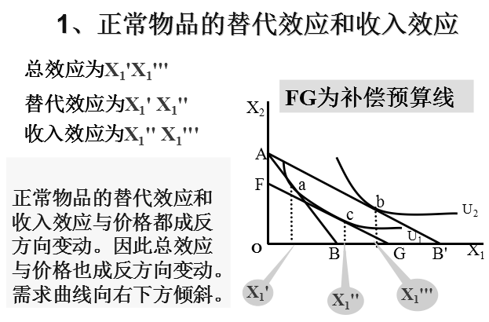
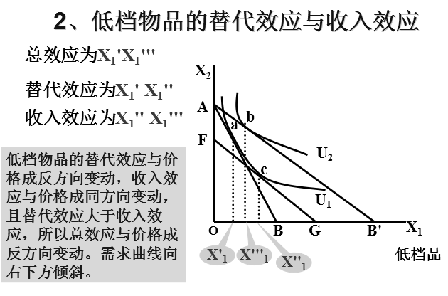
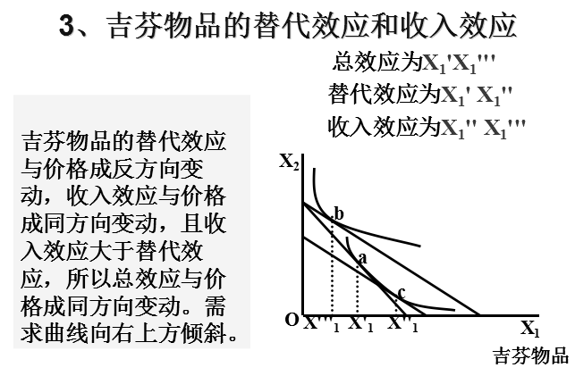
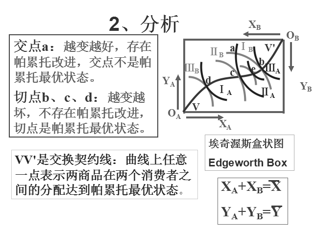
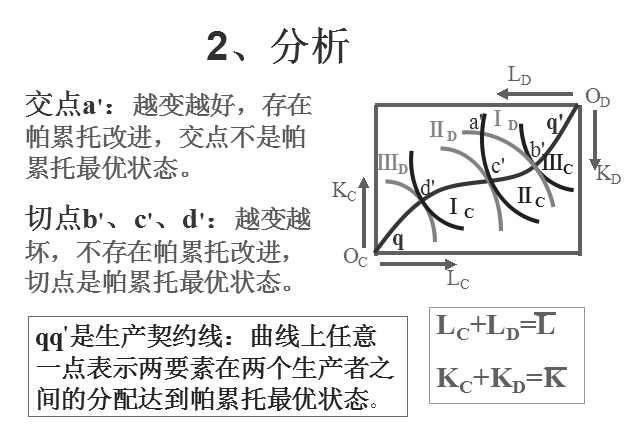

# 微观经济学名词解释与简答汇总

## 一、核心名词解释（38题）

* **1. 需求**：是指在一定时期内，对应于某种商品各种可能的价格，消费者愿意并且能够购买的该商品的数量，可分为个人需求与市场需求。
* **2. 需求规律**：又称需求法则或需求定律，表明在影响需求的其他因素不变的条件下，商品的需求量与其价格之间存在着反方向变化的关系。
* **3. 需求的价格弹性**：表示在一定时期内，一种商品的需求量对该商品价格变化的反应程度或敏感程度。需求的价格弹性系数 $E_d$ 等于商品需求量的变化率与其价格变化率的比值。
* **4. 需求的交叉价格弹性**：表示在一定时期内，一种商品的需求量变动对其相关商品价格变动的反应程度或敏感程度。其弹性系数等于商品需求量的变化率与引起这种变化的另一种商品价格变化率的比值。
* **5. 需求的收入弹性**：是指在一定时期内，某种商品需求量的变化对消费者收入变动的反应程度或敏感程度，其弹性系数等于需求量的变化率与相应的收入变化率的比值。
* **6. 边际效用**：是指在一定时间内，消费者每增加一个单位商品消费所得到的效用增加量，用 $MU$ 表示，即 $MU = \frac{dTU(q)}{dq}$。
* **7. 消费者剩余**：是消费者在购买商品时，愿意付出的代价与实际付出的代价的差额。既可以用消费者在消费商品时得到的总效用与实际付出的总效用的差额表示，也可以用消费者愿意付出的货币总额与实际付出的货币总额的差额表示。
* **8. 无差异曲线**：表示给消费者带来同等效用指数或满足程度的两种商品的各种不同组合的点的连线。无差异曲线上的任意两点，对消费者来说都是无差异的；沿着无差异曲线上下移动，对消费者来说总效用没有任何变化。
* **9. 边际替代率**：表示在保持消费者满足水平不变的前提下，增加一个单位的商品 $X$ 能够替代的商品 $Y$ 的数量，即 $MRS_{XY} = -\frac{\Delta Y}{\Delta X} = -\frac{dY}{dX}$。
* **10. 收入—消费曲线**：或称收入扩展线，表示在消费者偏好和商品价格不变的条件下，一系列最优商品组合随消费者收入变化而形成的轨迹。它反映了消费者对 $X$、$Y$ 两种商品的最优选择是如何随收入的变化而变化的。
* **11. 恩格尔曲线**：又称收入—需求曲线，表示一种商品的均衡购买量与消费者收入之间变化关系的曲线。（一般来说，生活必需品的需求量随着收入的提高而增加，但增加的速度越来越慢于收入的增长速度，因此恩格尔曲线向纵轴弯曲；而高档消费品和大部分工业品随收入的提高而增加，增长的速度越来越超过收入的增长速度，因此恩格尔曲线向横轴弯曲。）
* **12. 替代效应**：是指当商品价格变化时，在保持效用水平不变的条件下，由于商品相对价格变化对需求数量产生的影响。
* **13. 收入效应**：是指当商品价格变化时，在保持相对价格不变的条件下，由于消费者实际收入（货币购买力）变动对需求数量产生的影响。
* **14. 边际产量**：是指在其他投入要素不变时，增加一单位可变要素投入量所带来的总产量增加量，即 $MP_L = \frac{\Delta TP_L(L)}{\Delta L} = \frac{dTP_L(L)}{dL}$。
* **15. 边际报酬递减规律**：是指在一定的技术水平下，在其他投入要素不变时，随着一种可变要素投入的增加，其边际产量增加到一定点后最终会趋于递减。即在一定的技术条件下，在连续等量地追加一种可变要素到其他固定要素上去的过程中，起初该要素的边际产量是增加的，但达到一定点后，再增加可变要素的投入，其边际产量是递减的。
* **16. 边际技术替代率**：是指在保持产量水平不变的前提下，用一种投入要素替代另一种投入要素的比率。反映了厂商为保持原有的产量水平不变，增加一单位要素的使用量与放弃的另一种要素之间的数量比例关系，即 $MRTS_{LK} = -\frac{\Delta K}{\Delta L} = -\frac{dK}{dL}$。
* **17. 规模报酬**：分析的是厂商生产规模变动对产量的影响，即如果所有的投入要素都同时变动同样的倍数，产出将如何变动。分为规模报酬递增、规模报酬不变、规模报酬递减。
* **18. 机会成本**：是指把既定的稀缺资源用于某种特定生产时，必须放弃的该资源用于其他用途能够获得的最大收益，强调的是“有得必有失”。
* **19. 沉没成本**：即已经花费而无法收回或补偿的成本，其机会成本为零，不影响厂商当前的经济决策。
* **20. 边际收益**：是指厂商每增加一单位产品销售所得到的总收入的增量，即 $MR(Q) = \frac{\Delta TR}{\Delta Q} = \frac{dTR(Q)}{dQ}$。
* **21. 生产者剩余**：是指厂商生产并销售一定数量的商品，按照市场价格获得的总收入与其生产这些商品每一单位边际成本总和之间的差额。
* **22. 自然垄断**：面对一定规模的市场需求，如果厂商生产中的成本函数具有次可加性，即由一家厂商提供一定数量的产品和服务比由两家或两家以上的厂商提供的成本更低，这时便形成了自然垄断。
* **23. 勒纳指数**：若以 $L$ 表示勒纳指数，则 $L = \frac{P - MC}{P} = \frac{1}{E_d}$。用来测度市场的垄断程度，数值介于 $0 \sim 1$ 之间，数值越大垄断性越强。
* **24. 价格歧视**：为了获取更大的利润，垄断厂商有时会对生产成本相同的同一产品向不同的消费者收取不同的价格，这种情况称为价格歧视。按程度大小分为一级价格歧视、二级价格歧视、三级价格歧视。
* **25. 纳什均衡**：在博弈中，每一个参与人选择的战略必须是针对其他参与人所选战略的最优反应，没有任何参与人愿意单独放弃他所选择的战略。
* **26. 占优均衡**：是指参与人的最优战略不依赖于其他参与人的战略选择，不论其他参与人选择什么战略，他的最优战略是唯一的；所有参与人的占优战略组合即构成占优均衡。
* **27. 边际收益产品（$MRP_L$）**：厂商增加使用一单位要素（$L$）所增加的总收益，等于增加一单位要素（$L$）所增加的产量（$MP_L$）乘以增加一单位产量所增加的收益（$MR$），即 $MRP_L = MP_L \times MR$。
* **28. 边际产量价值（$VMP_L$）**：在完全竞争的产品市场条件下，由于厂商和消费者都不能影响商品的价格，厂商生产的产品将按同一价格出售，厂商增加一单位产量所增加的收益就是产品的价格，即 $MR = P$。在这种情况下，$MRP_L = MP_L \times P$，表示厂商增加一单位投入要素所增加的产量的市场价值，称为生产要素的边际产量价值，即 $VMP_L = MP_L \times P$。
* **29. 经济租金**：是指为生产要素所支付的报酬与为得到或使用该要素所必须支付的最小金额（转移收入）之间的差额。
* **30. 帕累托改进**：如果既定的资源配置状态的改变使得至少一个人的情况变好，而没有使任何人的情况变坏，则认为这种资源配置状态的变化是“好”的，否则就是“坏”的。这种以帕累托标准来衡量为“好”的状态变化就是帕累托改进。
* **31. 帕累托最优状态**：如果对于某种既定的资源配置状态，帕累托改进不存在，即在该状态上，任意改变都不可能使至少有一个人的情况变好而又不使任何人的情况变坏，则称这种资源配置状态为帕累托最优状态。
* **32. 生产可能性曲线**：也称作产品转换曲线，表示用既定数量的生产要素所能生产的商品 $X$ 和 $Y$ 的最大数量组合。
* **33. 福利经济学第一定理**：如果每个商品都有市场，而且市场是完全竞争的，即每个厂商和消费者都是价格接受者，他们都面对同一价格，那么这个竞争均衡时的资源配置是帕累托有效率的。帕累托最优的三个条件包括：
    - （1）交换的帕累托最优条件：各个消费者对任何两种商品的边际替代率都相等（$MRS_{XY}^A = MRS_{XY}^B$）。
    - （2）生产的帕累托最优条件：任何两种生产要素的边际技术替代率对所有商品的生产都必须相等（$MRTS_{LK}^X = MRTS_{LK}^Y$）。
    - （3）交换和生产的帕累托最优条件：消费者对任何两种商品的边际替代率，必须等于这两种商品对任何生产者的边际转换率（$MRS_{XY} = MRT_{XY}$）。
* **34. 外部性**：指一个经济主体的行为对另一个经济主体的福利产生了影响，而施加这种影响的主体却没有为此付出代价或因此而获得补偿。外部性亦可称为毗邻影响或外部效应，其实质是行为主体没有承担其行为所带来的全部后果。外部性可分为正外部性和负外部性两种。
* **35. 庇古税**：为矫正负外部性所征收的税，遵循“污染者付费”原则，对排污者征税，也称为“排放税”或“排污收费”。
* **36. 公共物品**：是同时具有消费的非排他性和非竞争性的物品。即很难禁止他人不付代价而消费该物品，且任何人对公共物品的消费不会影响其他人同时享受该公共物品的数量和质量。
* **37. 逆向选择**：是事前的信息不对称所导致的问题，指的是在买卖双方信息不对称的情况下，低质量的商品会将高质量的商品挤出市场。逆向选择问题使市场缩小甚至消失，干扰了市场的有效运行。
* **38. 道德风险**：是指契约达成后（事后），从事经济活动的人在最大限度地增进自身效用时利用信息优势做出不利于他人的行动。

## 二、简答与论述核心专题（含图示解析）

### 1. 掌握供求原理解释社会现象（例：谷贱伤农）

根据弹性理论，对于需求的价格弹性不同的商品，要想增加生产者的收益，必须实行不同的价格策略。需求的价格弹性 $E_d > 1$ 的商品，价格变化与收益的变化方向相反，即降价能够增加销售收入，所以对于富有弹性的商品可以通过降价实现“薄利多销”；需求的价格弹性 $E_d < 1$ 的商品（如农产品），价格变化与销售收入同方向变化，即提高价格能够增加销售收入，降低价格反而减少销售收入。当农产品因为大丰收而增加供给（供给曲线向右移动）时，由于农产品需求缺乏弹性，均衡价格大幅下降的幅度超过了均衡销售量增加的幅度，导致农民的总收益反而减少，这就是所谓的“谷贱伤农”。

### 2. 价格效应分解为替代效应和收入效应（希克斯分解与画图）

由价格变动所引起的商品需求量的变动（总效应/价格效应）可分解为两部分：替代效应和收入效应，即**总效应 $=$ 替代效应 $+$ 收入效应**。

* **替代效应**：由商品价格变化引起商品相对价格的变化，从而引起商品需求量的变化，它不改变消费者的效用水平（沿原无差异曲线移动）。
* **收入效应**：由商品价格变化引起消费者实际收入水平的变化，从而引起商品需求量的变化，它会改变消费者的效用水平（从原无差异曲线移动到新无差异曲线）。

#### （1）正常物品的替代效应和收入效应

  
  
<em>图1：正常物品的替代效应和收入效应（总效应为 X1'X1'''，替代效应为 X1'X1''，收入效应为 X1''X1'''，FG 为补偿预算线）</em>

对于正常物品，当商品 $X_1$ 价格下降时，总效应为 $X_1'X_1'''$，替代效应为 $X_1'X_1''$，收入效应为 $X_1''X_1'''$（图中 $FG$ 为与新预算线平行且与原无差异曲线相切的补偿预算线）。正常物品的替代效应和收入效应与价格都成反方向变动，因此总效应与价格也成反方向变动，其需求曲线必定向右下方倾斜。

#### （2）低档物品的替代效应与收入效应

  
  
<em>图2：低档物品的替代效应与收入效应（替代效应大于反向的收入效应）</em>

对于一般低档物品，总效应为 $X_1'X_1'''$，替代效应为 $X_1'X_1''$，收入效应为 $X_1''X_1'''$。低档物品的替代效应与价格成反方向变动，收入效应与价格成同方向变动，但由于替代效应的绝对值大于收入效应的绝对值，所以总效应与价格仍然成反方向变动，需求曲线依然向右下方倾斜。

#### （3）吉芬物品的替代效应和收入效应

  
  
<em>图3：吉芬物品的替代效应与收入效应（反向的收入效应超过替代效应）</em>

对于吉芬物品，总效应为 $X_1'X_1'''$，替代效应为 $X_1'X_1''$，收入效应为 $X_1''X_1'''$。吉芬物品的替代效应与价格成反方向变动，收入效应与价格成同方向变动，且收入效应的绝对值大于替代效应的绝对值，所以总效应与价格成同方向变动，其需求曲线向右上方倾斜。

#### （4）三种物品的替代效应和收入效应总结

| 商品类别 | 替代效应（与价格关系） | 收入效应（与价格关系） | 总效应（与价格关系） | 需求曲线倾斜方向 |
| :--- | :--- | :--- | :--- | :--- |
| **正常物品** | 反方向变动 | 反方向变动 | 反方向变动 | 向右下方倾斜 |
| **低档物品** | 反方向变动 | 同方向变动（$\vert \text{替代} \vert > \vert \text{收入} \vert$） | 反方向变动 | 向右下方倾斜 |
| **吉芬物品** | 反方向变动 | 同方向变动（$\vert \text{收入} \vert > \vert \text{替代} \vert$） | 同方向变动 | 向右上方倾斜 |

### 3. 生产理论：要素合理使用区域、产量关系与规模报酬

#### （1）短期要素合理使用区域的确定（一种可变要素下厂商如何组织生产）

  
  
<em>图4：短期生产的三个阶段与要素合理投入区域（第 II 阶段）</em>

短期生产的合理投入区域是平均产量最大（$MP_L = AP_L$）直到边际产量为零（$MP_L = 0$）的第 $\text{II}$ 阶段（图中 $L_3 \sim L_4$ 之间）：

* **第 $\text{I}$ 阶段（$L_3$ 之前）**：劳动的总产量 $TP$ 始终上升；平均产量 $AP$ 始终上升并达到最大值；边际产量 $MP$ 先上升达到最大值（对应 $TP$ 拐点）然后开始下降，但在该阶段始终有 $MP > AP$。这说明固定要素相对于可变要素劳动过多，生产者只要增加可变要素劳动的投入量就可以较大幅度地增加总产量并提高平均产量，因此任何理性的生产者都不会在这一阶段停止增加劳动投入，而是会继续扩大生产进入第 $\text{II}$ 阶段。
* **第 $\text{III}$ 阶段（$L_4$ 之后）**：劳动的平均产量 $AP$ 继续下降，边际产量 $MP$ 降为负值，总产量 $TP$ 也在下降。这说明可变要素劳动的投入过多，减少劳动投入反而有利于增加总产量，因此理性的生产者会减少劳动投入回到第 $\text{II}$ 阶段。
* **第 $\text{II}$ 阶段（$L_3 \sim L_4$ 之间）**：$TP$ 继续上升并达到最大值，$AP$ 递减，$MP$ 递减但保持非负（$0 \le MP \le AP$）。这是生产者进行短期生产的合理决策区间（起于 $MP$ 与 $AP$ 的交点即 $AP$ 最高点，止于 $MP$ 与横轴的交点即 $MP = 0$ 处），生产者既可以得到由第 $\text{I}$ 阶段增加可变投入所带来的全部好处，又可以避免将可变投入增加到第 $\text{III}$ 阶段而带来的不利影响。

#### （2）长期要素合理使用区域的确定（两种可变要素下厂商如何组织生产）

在两种（或两种以上）生产要素均可变的长期情况下，厂商的要素投入比例取决于要素的边际产量和各要素的价格。当各种要素的边际产量与其价格之比相等（即 $\frac{MP_L}{w} = \frac{MP_K}{r}$ 或 $MRTS_{LK} = \frac{w}{r}$）时，要素的投入组合最佳，生产最有效率。在等产量线和等成本线图上，二者相切处要素的投入比例最佳。随着成本或产量的变动，这样的切点有无数个，将等产量线和等成本线的无数个切点用平滑的曲线连接起来，就得到**生产的扩展线**。

理性的厂商究竟在扩展线的哪一点生产，取决于要素的规模收益（规模报酬）状况与市场条件：如果规模收益呈递增趋势，生产规模应继续扩大，增加使用各要素的数量；相反，如果规模收益呈递减趋势，生产规模应缩小，直到生产规模处于收益不变或最优阶段。厂商选择最优规模的基本原则仍然是边际收益等于边际成本，即 $MR = MC$。

#### （3）各种产量之间的关系

* **三种产量的定义**：
    - 总产量 $TP_L$：一定数量的一种可变要素投入所带来的最大产量。
    - 平均产量 $AP_L$（Average Product）：总产量与可变要素投入量之比，即 $AP_L = \frac{TP_L}{L}$。
    - 边际产量 $MP_L$：总产量的增量与可变要素投入量的增量之比，即 $MP_L = \frac{\Delta TP_L}{\Delta L} = \frac{dTP_L}{dL}$。
* **共同变化规律**：三种产量变化规律的共同点是先上升，达到最大值，再下降。
* **三种产量之间的几何与数量关系**：
    - $MP$ 和 $TP$ 的关系：$MP$ 值是 $TP$ 曲线上对应点切线的斜率；$MP$ 的最大值对应 $TP$ 曲线的拐点；$MP$ 的零点值对应 $TP$ 曲线的最高点（当 $MP > 0$ 时 $TP$ 上升，$MP < 0$ 时 $TP$ 下降）。
    - $MP$ 和 $AP$ 的关系：如果边际量大于平均量（$MP > AP$），则平均量 $AP$ 增加；如果边际量小于平均量（$MP < AP$），则平均量 $AP$ 减少；$MP$ 曲线必定自上而下穿过 $AP$ 曲线的最高点（在 $AP$ 最高点处 $MP = AP$）。
    - $AP$ 和 $TP$ 的关系：$AP$ 值是 $TP$ 曲线上任一点与坐标原点连线（射线）的斜率；当原点射线与 $TP$ 曲线相切时，$AP$ 达到最大值。

#### （4）规模报酬及类型

规模报酬指企业生产规模变化与由此所引起的产量变化之间的关系，生产规模变化指投入生产中的两种要素 $K$、$L$ 同比例变化。设 $\lambda > 1$ 为 $L$、$K$ 增加的倍数，$\alpha$ 为产量 $Q$ 增加的倍数，则有 $\alpha Q = f(\lambda L, \lambda K)$。规模报酬分为三种类型：

* **规模报酬递增**：$f(\lambda L, \lambda K) > \lambda f(L, K)$（即 $\alpha > \lambda$）。
* **规模报酬不变**：$f(\lambda L, \lambda K) = \lambda f(L, K)$（即 $\alpha = \lambda$）。
* **规模报酬递减**：$f(\lambda L, \lambda K) < \lambda f(L, K)$（即 $\alpha < \lambda$）。

### 4. 短期各成本曲线间的关系与各种利润之间的关系

#### （1）短期各成本曲线间的关系

- **1.** 可变成本曲线（$TVC$）从原点出发，随着产量的增加而递增，递增速度先减后增；不变成本曲线（$TFC$）不随产量变动而变动，因而是一条平行于产量横轴的水平直线；总成本（$TC$）与可变成本（$TVC$）之间的垂直距离为不变成本（$TFC$），$TC$ 曲线的形状及变动规律与 $TVC$ 曲线完全一样。
- **2.** 平均总成本曲线（$AC$）与平均可变成本曲线（$AVC$）随着产量的增加先递减后增加，均呈现 $\text{U}$ 型。
- **3.** 边际成本曲线（$MC$）随着产量的增加先递减后增加，也呈现 $\text{U}$ 型。
- **4.** 边际成本曲线（$MC$）与平均总成本曲线（$AC$）和平均可变成本曲线（$AVC$）都相交于后二者的最低点（自下而上穿过最低点）。
- **5.** 平均不变成本曲线（$AFC$）是一条向两坐标轴渐近的直角双曲线（随产量增加而单调递减）。
- **6.** 平均总成本曲线（$AC$）的最低点与平均可变成本曲线（$AVC$）的最低点不在同一条垂直线上（$AC$ 最低点对应的产量大于 $AVC$ 最低点对应的产量）。
- **7.** 平均总成本曲线（$AC$）始终位于平均可变成本曲线（$AVC$）上方，两者之差为 $AFC$，起初较大，后随产量的增大而逐渐减小、无限接近，但永不相交。
- **8.** 边际成本曲线（$MC$）只与可变成本曲线（$TVC$）有关，与不变成本曲线（$TFC$）无关。

#### （2）各种利润之间的关系（财务利润、正常利润与经济利润）

* **财务利润（会计利润）**：总收益与财务成本（会计成本/显性成本）的差额，即：

$$
\text{财务利润} = \text{总收益} - \text{财务成本（显性成本）}
$$

* **正常利润（Normal Profits）**：作为生产要素之一的企业家才能也有机会成本。要使企业家在这个企业继续经营下去，必须使他至少获得平均利润，称为正常利润。在经济学分析中，正常利润属于隐性成本的一部分，列入经济成本，不算作经济利润。
* **经济利润（超额利润，Excess Profits）**：总收益与经济成本（显性成本 $+$ 隐性成本，含正常利润）的差额，即：

$$
\text{经济利润} = \text{总收益} - \text{经济成本（含正常利润）} = \text{财务利润} - \text{隐性成本}
$$

当厂商的经济利润为零时，厂商仍然获得了全部正常利润。

### 5. 完全垄断市场中的三类价格歧视及实现条件

* **三类价格歧视的定义**：
    - **一级价格歧视**：完全垄断厂商按照每一位消费者购买每一单位商品愿意并能够支付的最高价格来逐个确定产品销售价格的定价方式。
    - **二级价格歧视**：垄断厂商按不同的价格出售不同单位（不同数量区间）的产品，每个购买相同数量商品的消费者支付相同的价格。
    - **三级价格歧视**：垄断厂商把消费者分组，按不同组别的分市场制定差别价格的方式。
* **价格歧视的实现条件**：
    - **1.** 厂商具有市场垄断势力（有一定的价格控制权）。
    - **2.** 市场可以有效分割（且消费者之间无法进行转售套利）。
    - **3.** 各个分市场或不同消费者群体对商品必须具有不同的需求价格弹性。

### 6. 帕累托最优条件（交换、生产及交换与生产的帕累托最优）

* **帕累托最优状态（经济效率）**：在某种资源配置状态上，任意改变都不可能使至少有一个人的状况变好而又不使任何人的状况变坏，则这种资源配置状态为帕累托最优状态。

#### （1）交换的帕累托最优条件

  
  
<em>图5：交换的埃奇沃思盒状图与交换契约线 VV'</em>

* **1. 假设条件**：（1）市场中只有 $A$、$B$ 两个消费者；（2）只有 $X$、$Y$ 两种消费品，且两种消费品的总数量既定为 $\overline{X}$、$\overline{Y}$（即 $X_A + X_B = \overline{X}, Y_A + Y_B = \overline{Y}$）。
* **2. 埃奇沃思盒状图分析**：图中两消费者无差异曲线的交点 $a$ 处，通过交换向透镜状区域内部移动可以使双方效用同时提高（越变越好），即存在帕累托改进，因此交点 $a$ 不是帕累托最优状态；而在两无差异曲线的切点 $b$、$c$、$d$ 处，任何偏离都会使至少一方境况变坏，不存在帕累托改进，因此切点是帕累托最优状态。连接所有无差异曲线切点的轨迹 $VV'$ 即为**交换契约线**（或冲突线），曲线上任意一点均表示两种商品在两个消费者之间的分配达到了帕累托最优状态。
* **3. 结论**：交换的帕累托最优条件是两消费者无差异曲线的斜率相等，即消费者的商品边际替代率相等：

$$
MRS_{XY}^A = MRS_{XY}^B
$$

#### （2）生产的帕累托最优条件

  
  
<em>图6：生产的埃奇沃思盒状图与生产契约线 qq'</em>

* **1. 假设条件**：（1）市场中只有 $C$、$D$ 两个生产者（或生产两种产品）；（2）只有 $L$、$K$ 两种生产要素，且两种生产要素的总数量既定为 $\overline{L}$、$\overline{K}$（即 $L_C + L_D = \overline{L}, K_C + K_D = \overline{K}$）。
* **2. 埃奇沃思盒状图分析**：图中两生产者等产量曲线的交点 $a'$ 处存在帕累托改进，交点不是帕累托最优状态；而等产量曲线的切点 $b'$、$c'$、$d'$ 处不存在帕累托改进，切点是帕累托最优状态。连接所有等产量曲线切点的轨迹 $qq'$ 即为**生产契约线**，曲线上任意一点均表示两种要素在两个生产者之间的分配达到了帕累托最优状态。
* **3. 结论**：生产的帕累托最优条件是两生产者等产量曲线的斜率相等，即生产者的边际技术替代率相等：

$$
MRTS_{LK}^C = MRTS_{LK}^D
$$

#### （3）交换和生产（配置）的帕累托最优条件

* **1. 假设条件**：（1）只有 $A$、$B$ 两个消费者，只有 $X$、$Y$ 两种商品；（2）只有 $C$、$D$ 两个生产者，只有两种生产要素 $K$、$L$；（3）生产者 $C$ 只生产产品 $X$，生产者 $D$ 只生产产品 $Y$；（4）消费者偏好不变，即无差异曲线不变；（5）生产者的生产技术即等产量曲线不变。
* **2. 结论**：当生产可能性曲线上点的斜率与交换契约线上对应点的无差异曲线斜率相等，即产品的边际转换率等于消费者的商品边际替代率时，就同时实现了交换和生产的帕累托最优条件：

$$
MRT_{XY} = MRS_{XY}^A = MRS_{XY}^B
$$

### 7. 不同市场结构类型下厂商长期均衡的实现及经济效益比较

根据不同的市场结构特征，市场可以分为完全竞争、垄断竞争、寡头和垄断四种类型：

* **（1）完全竞争市场上的长期均衡**：完全竞争厂商在短期内的均衡条件是 $MR = MC$。在长期中，厂商对全部生产要素的调整表现为对最优生产规模的选择和进入或退出一个行业的决策。这种调整虽然不会改变企业面对的水平需求曲线的性质，但会改变需求曲线的位置（即市场价格的高低），最终使价格水平达到使各个厂商既无超额利润又无亏损的状态。长期均衡出现在 $LAC$ 曲线的最低点，长期均衡的条件是：

$$
P = MR = LMC = SMC = LAC = SAC
$$

* **（2）垄断市场上的长期均衡**：垄断企业是行业中唯一的卖者，不仅在短期内可以获得超额利润，而且在长期中由于其它企业无法进入该行业，故仍可继续获得超额利润。在长期中，垄断企业可以通过调整全部生产要素的投入量即调整生产规模来实现最大利润，长期均衡的条件是边际收益与长期边际成本和短期边际成本都相等：

$$
MR = LMC = SMC
$$

* **（3）垄断竞争市场上的长期均衡**：在长期内，垄断竞争厂商不仅可以调整生产规模，还可以自由加入或退出生产集团。这就决定了垄断竞争厂商在长期均衡时的经济利润必定为零，即在垄断竞争厂商的长期均衡点上，主观需求曲线 $d$ 必定与 $LAC$ 曲线相切，长期均衡条件是：

$$
MR = LMC = SMC, \quad AR = LAC = SAC
$$

* **（4）寡头市场上的长期均衡**：由于寡头市场的情况非常复杂，没有形成一个统一的寡头厂商均衡模型（包括短期的和长期的）。一般认为，寡头市场是与垄断市场比较接近的市场组织，在长期均衡时，寡头厂商产品的均衡价格比较高，产品的均衡数量比较低。
* **（5）不同市场的经济效益比较**：在完全竞争、垄断竞争和完全垄断这三种市场类型中，**完全竞争市场的经济效益最高，垄断竞争市场的经济效益较高，完全垄断市场的经济效益最低**。可见，市场的竞争程度越高，则经济效益越高；反之，市场的垄断程度越高，则经济效益越低。此外，一个行业在长期均衡时是否实现了价格等于长期边际成本（$P = LMC$），也是判断该行业是否实现了有效资源配置的一个关键条件。完全竞争厂商在长期均衡时实现了 $P = LMC$，而其他类型市场的厂商在长期均衡时都是 $P > LMC$（由于价格高于边际成本，意味着这些行业的商品供给不足，存在社会福利净损失）。

## 三、微观经济学综合复习资料

### （一）判断题（在正确的命题后标“√”，错误的标“×”）

- **1.** 支持价格是政府规定的某种产品的最高价格。 `( × )`（注：支持价格是最低价格/价格下限，限制价格才是最高价格）
- **2.** 经济分析中一般假定消费者的目标是效用最大化。 `( √ )`
- **3.** 完全竞争市场的含义：指不受任何阻碍和干扰的市场结构。 `( √ )`
- **4.** 在一条直线型的需求曲线上每一点的需求弹性系数都不一样。 `( √ )`
- **5.** 消费者均衡的实现条件是消费者花在每一元钱上的商品的边际效用都相等。 `( √ )`
- **6.** 在同一平面内，两条无差异曲线是可以相交的。 `( × )`
- **7.** 需求规律的含义是，在其他条件不变的情况下，某商品的需求量与价格之间成反方向变动。 `( √ )`
- **8.** 规模经济和边际收益递减规律所研究的是同一个问题。 `( × )`（注：前者属长期生产所有要素变动，后者属短期生产单一可变要素变动）
- **9.** 基尼系数越大，收入分配越平均。 `( × )`（注：基尼系数越大，收入分配越不平均）
- **10.** 在一个国家或家庭中，食物支出在收入中所占比例随着收入的增加而减少。 `( √ )`（恩格尔定律）
- **11.** 边际成本曲线总是交于平均成本曲线的最低点。 `( √ )`
- **12.** 完全竞争市场中厂商所面对的需求曲线是一条水平线。 `( √ )`
- **13.** 一个博弈中存在纳什均衡，但不一定存在占优均衡。 `( √ )`
- **14.** 边际替代率是消费者在获得相同的满足程度时，每增加一种商品的数量与放弃的另一种商品的数量之比。 `( × )`（注：商品 $X$ 对 $Y$ 的边际替代率是放弃的商品 $Y$ 的数量与增加的商品 $X$ 的数量之比，即 $-\frac{\Delta Y}{\Delta X}$）
- **15.** 微观经济学的中心理论是价格理论。 `( √ )`
- **16.** 经济学按研究内容的不同可分为实证经济学和规范经济学。 `( × )`（注：按研究方法不同分为实证经济学和规范经济学；按研究内容/对象不同分为微观经济学和宏观经济学）
- **17.** 需求弹性这一概念表示的是需求变化对影响需求的因素变化反应程度。 `( √ )`
- **18.** 消费者均衡表示既定收入下效用最大化。 `( √ )`
- **19.** 经济学按研究方法（原题作内容）的不同可分为实证经济学和规范经济学。 `( × )`
- **20.** 平均产量曲线可以和边际产量曲线在任何一点上相交。 `( × )`（注：只能相交于平均产量曲线的最高点）
- **21.** 在长期分析中，固定成本与可变成本的划分是不存在的。 `( √ )`
- **22.** 吉芬商品的需求曲线与正常商品的需求曲线是不相同的。 `( √ )`
- **23.** 任何经济决策都必须考虑到机会成本。 `( √ )`
- **24.** 指经济变量之间存在函数关系时，弹性表示因变量的变动率对自变量的变动率的反应程度。需求价格弹性指价格变动的比率所引起的需求量变动的比率，即需求量变动对价格变动的反应程度。 `( √ )`
- **25.** 在完全竞争市场中每一厂商长期均衡时都没有超额利润。 `( √ )`
- **26.** 平均产量曲线可以和边际产量曲线在任何一点上相交。 `( × )`
- **27.** 寡头垄断市场的最大特征就是寡头厂商之间的相互依赖性。 `( √ )`

### （二）单项选择题

**1.** 在市场经济中，当鸡蛋的供给量小于需求量时，解决鸡蛋供求矛盾的下列办法中最有效的办法是（ ）。

* A. 实行定量供给
* B. 宣传吃鸡蛋会导致胆固醇升高
* C. 让鸡蛋的价格自由升高
* D. 进口鸡蛋

> **【参考答案】** C

**2.** 关于均衡价格的正确说法是（ ）。

* A. 均衡价格是需求等于供给时的价格
* B. 供给量等于需求量时的价格
* C. 供给曲线与需求曲线交点上的价格
* D. 供给价格等于需求价格时的价格

> **【参考答案】** C

**3.** 随着产量的增加，短期平均固定成本（ ）。

* A. 增加
* B. 不变
* C. 减少
* D. 不能确定

> **【参考答案】** C

**4.** 消费者剩余是指消费者从商品的消费中得到的（ ）。

* A. 满足程度
* B. 边际效用
* C. 满足程度超过他实际支出的价格部分
* D. 满足程度小于他实际支出的价格部分

> **【参考答案】** C

**5.** 当 $X$ 商品的价格下降时，替代效应 $X_1X^* = +5$，收入效应 $X^*X_2 = +3$，则该商品是（ ）。

* A. 正常商品
* B. 一般低档商品
* C. 吉芬商品
* D. 独立商品

> **【参考答案】** A

**6.** 最需要进行广告宣传的市场是（ ）。

* A. 完全竞争市场
* B. 完全垄断市场
* C. 垄断竞争市场
* D. 寡头垄断市场

> **【参考答案】** C

**7.** 在消费者均衡时，消费者购买商品的总效用与他所支付的货币的总效用的关系是（ ）。

* A. 前者小于后者
* B. 二者相等
* C. 前者大于后者
* D. 二者没有关系

> **【参考答案】** C（因为边际效用递减，消费者均衡时最后一单位商品的边际效用等于所支付货币的边际效用，故商品总效用大于支付货币的总效用，差额即为消费者剩余）

**8.** 当某厂商以最小成本生产出既定产量时，此厂商（ ）。

* A. 总收益为零
* B. 一定获得了最大利润
* C. 一定未获得最大利润
* D. 无法确定是否获得了最大利润

> **【参考答案】** D

**9.** 已知某两种商品的交叉弹性等于 $1.8$，则这两种商品是（ ）。

* A. 完全替代品
* B. 替代品
* C. 补充品（互补品）
* D. 完全补充品

> **【参考答案】** B

**10.** 随着产量的增加，短期平均成本（ ）。

* A. 增加
* B. 不变
* C. 减少
* D. 先减少，后增加

> **【参考答案】** D

**11.** 在完全垄断市场上，厂商数量是（ ）。

* A. 一家
* B. 二家
* C. 三家
* D. 无数家

> **【参考答案】** A

**12.** 下列哪一个不是完全竞争市场的特点（ ）。

* A. 大量的卖者和买者
* B. 存在产品差别
* C. 资源完全流动
* D. 完全信息

> **【参考答案】** B

**13.** 垄断竞争市场中厂商达到短期均衡的产量的条件是，在该产量处（ ）。

* A. 两条需求曲线相交
* B. $SMC = MR$
* C. 同时符合 A 和 B
* D. $LMC = MR$

> **【参考答案】** C

**14.** 下列行业中哪一个最接近于完全竞争模式（ ）。

* A. 飞机
* B. 卷烟
* C. 汽车
* D. 水稻

> **【参考答案】** D

**15.** 如果连续地增加某种生产要素，在总产量达到最大时，边际产量曲线（ ）。

* A. 与纵轴相交
* B. 经过原点
* C. 与平均产量曲线相交
* D. 与横轴相交

> **【参考答案】** D

**16.** 完全垄断市场中厂商的边际收益曲线（ ）。

* A. 和需求曲线重合
* B. 是一条水平线
* C. 在需求曲线上方
* D. 在需求曲线下方

> **【参考答案】** D

**17.** 在古诺双寡头垄断模型处于均衡时，每个厂商提供潜在市场容量的（ ）。

* A. $\frac{1}{3}$
* B. $\frac{1}{2}$
* C. $\frac{2}{3}$
* D. $1$

> **【参考答案】** A

**18.** 卡特尔制定统一价格的原则是（ ）。

* A. 使整个卡特尔产量最大
* B. 使整个卡特尔利润最大
* C. 使整个卡特尔的边际成本最小
* D. 使整个卡特尔中各厂商的利润最大

> **【参考答案】** B

**19.** 假定某企业全部成本函数为 $TC = 30000 + 5Q - Q^2$，$Q$ 为产出数量。那么 $TVC$ 为（ ）。

* A. $30000$
* B. $5Q - Q^2$
* C. $5 - Q$
* D. $\frac{30000}{Q}$

> **【参考答案】** B

**20.** 在下列行业中，企业规模应该最大的是（ ）。

* A. 服装业
* B. 钢铁业
* C. 饮食业
* D. 旅游业

> **【参考答案】** B

**21.** 边际成本曲线与平均成本曲线的相交点是（ ）。

* A. 边际成本曲线的最低点
* B. 平均成本曲线的最低点
* C. 平均成本曲线下降阶段的任何一点
* D. 边际成本曲线的最高点

> **【参考答案】** B

**22.** 如果连续地增加某种生产要素，在总产量达到最大时，边际产量曲线（ ）。

* A. 与纵轴相交
* B. 经过原点
* C. 与平均产量曲线相交
* D. 与横轴相交

> **【参考答案】** D

**23.** 在一般情况下，厂商得到的价格若低于以下哪种成本就停止营业（ ）。

* A. 平均成本
* B. 平均可变成本
* C. 边际成本
* D. 平均固定成本

> **【参考答案】** B

**24.** 在完全垄断市场上，垄断生产厂商能获得超额利润主要是因为（ ）。

* A. 实行了卖方垄断
* B. 实行了买方垄断
* C. 对产品进行了创新
* D. 都不对

> **【参考答案】** A

**25.** 在下列商品中，不可以采用“薄利多销”、通过降价来增加收益的商品是（ ）。

* A. 大米
* B. 补药
* C. 旅游服务
* D. 时装

> **【参考答案】** A（大米属于生活必需品，需求缺乏价格弹性，降价会减少总收益）

**26.** 固定成本是指（ ）。

* A. 厂商在短期内必须支付的不能调整的生产要素的费用
* B. 厂商要增加产量所要增加的费用
* C. 厂商购进生产要素时所要支付的费用
* D. 厂商在短期内必须支付的可能调整的生产要素的费用

> **【参考答案】** A

**27.** 当某厂商以最小成本生产出既定产量时，此厂商（ ）。

* A. 总收益为零
* B. 一定获得了最大利润
* C. 一定未获得最大利润
* D. 无法确定是否获得了最大利润

> **【参考答案】** D

**28.** 下列各种成本中，哪个成本的变动规律是向右下方倾斜（单调递减）（ ）。

* A. 平均固定成本
* B. 平均可变成本
* C. 短期边际成本
* D. 短期总成本

> **【参考答案】** A

**29.** 卖方实施价格歧视需要符合以下条件（ ）。

* A. 市场有不完善之处（具有垄断力量）
* B. 各市场弹性不同
* C. 市场能够被分割
* D. 以上都是

> **【参考答案】** D

**30.** 边际技术替代率（ ）。

* A. 是正的，并且呈递减趋势
* B. 是正的，并且呈递增趋势
* C. 是负的，并且呈递增趋势
* D. 是负的，并且呈递减趋势

> **【参考答案】** A（定义中加了负号取正值，且服从边际技术替代率递减规律）

**31.** 垄断竞争市场的特点是（ ）。

* A. 较多的卖者和买者
* B. 存在产品差别
* C. 同时具有 A 和 B
* D. 以上都不对

> **【参考答案】** C

### （三）计算题

**1.** 商品 $X$ 的需求曲线为线性函数 $Q = 40 - 0.5 P_X$，正常商品 $Y$ 的需求曲线也为直线，$X$ 与 $Y$ 的需求曲线在 $P_X = 8$ 处相交，在交点处 $X$ 的需求弹性之绝对值为 $Y$ 的需求弹性之绝对值的一半。请按上述条件推导 $Y$ 的需求函数。

> **【参考答案与解析】**
> 设商品 $Y$ 的线性需求函数为 $Q = A - B P_Y$。
> 因为 $X$ 与 $Y$ 的需求曲线在 $P = 8$ 处相交，所以当 $P_X = P_Y = 8$ 时两者需求量相等：
>
> $$
> Q_{P_X=8} = Q_{P_Y=8} \implies A - 8B = 40 - 0.5 \times 8 = 36 \quad (1)
> $$
>
> 又商品 $X$ 的需求价格弹性公式为 $E_{P_X} = \frac{-0.5 P_X}{40 - 0.5 P_X}$，在 $P_X = 8$ 处有：
>
> $$
> E_{P_X=8} = \frac{-0.5 \times 8}{40 - 0.5 \times 8} = -\frac{4}{36} = -\frac{1}{9}
> $$
>
> 商品 $Y$ 在 $P_Y = 8$ 处的需求价格弹性为：
>
> $$
> E_{P_Y=8} = \frac{-8B}{A - 8B}
> $$
>
> 因为交点处 $X$ 的需求弹性之绝对值为 $Y$ 的需求弹性之绝对值的一半，即 $\vert E_{P_Y=8} \vert = 2 \vert E_{P_X=8} \vert = \frac{2}{9}$，故：
>
> $$
> \frac{8B}{A - 8B} = \frac{2}{9} \implies A = 44B \quad (2)
> $$
>
> 将 $(1)$、$(2)$ 两式联立解得：
>
> $$
> A = 44, \quad B = 1
> $$
>
> 所以商品 $Y$ 的需求函数为：
>
> $$
> Q = 44 - P_Y
> $$

**2.** 设某产品生产的边际成本函数是 $MC = 3Q^2 + 8Q + 100$，如果生产 $5$ 单位产品时总成本是 $955$，求总成本函数和可变成本函数（及平均可变成本函数）。

> **【参考答案与解析】**
> 设总成本为 $TC$，对边际成本函数求不定积分得：
>
> $$
> TC = \int (3Q^2 + 8Q + 100)\,dQ = Q^3 + 4Q^2 + 100Q + FC
> $$
>
> 已知当 $Q = 5$ 时 $TC = 955$，代入得：
>
> $$
> 955 = 5^3 + 4 \times 5^2 + 100 \times 5 + FC \implies 955 = 125 + 100 + 500 + FC \implies FC = 230
> $$
>
> 因此：
> - 总成本函数为：$TC = Q^3 + 4Q^2 + 100Q + 230$
> - 总可变成本函数为：$TVC = Q^3 + 4Q^2 + 100Q$
> - 平均可变成本函数为：$AVC = Q^2 + 4Q + 100$，平均总成本函数为：$AC = Q^2 + 4Q + 100 + \frac{230}{Q}$（注：原资料末行将 $AC$ 误写为 $VC$，此处一并列出）。

**3.** 若厂商面对的需求曲线是 $Q = -0.5P + 50$（原卷漏印系数 $0.5$，由反需求函数 $P = 100 - 2Q$ 还原），分别求出厂商的总收益曲线、边际收益曲线和平均收益曲线。

> **【参考答案与解析】**
> 由需求函数求反需求曲线：$P = 100 - 2Q$，则：
> - 总收益曲线：$TR = P \cdot Q = 100Q - 2Q^2$
> - 边际收益曲线：$MR = \frac{dTR}{dQ} = 100 - 4Q$
> - 平均收益曲线：$AR = \frac{TR}{Q} = 100 - 2Q$

**4.** 假定完全竞争市场的需求函数为 $Q_D = 50000 - 2000P$，供给函数为 $Q_S = 40000 + 3000P$。求：（1）市场均衡价格和均衡产量；（2）单个厂商的需求函数。

> **【参考答案与解析】**
> - **（1）** 市场均衡时 $Q_D = Q_S$，联立需求函数与供给函数：
>
> $$
> 50000 - 2000P = 40000 + 3000P \implies 5000P = 10000 \implies P = 2
> $$
>
> 代入得均衡产量：
>
> $$
> Q = 50000 - 2000 \times 2 = 46000
> $$
>
> - **（2）** 在完全竞争市场中，单个厂商是价格接受者，其需求曲线由市场的均衡价格决定，故厂商的需求函数（反需求曲线）为水平线 $P = 2$。

**5.** 假定某企业的短期成本函数是 $TC(Q) = Q^3 - 10Q^2 + 17Q + 66$。求：$TVC(Q)$、$AC(Q)$、$AVC(Q)$、$AFC(Q)$、$MC(Q)$。

> **【参考答案与解析】**
> 因为企业的短期总成本函数是 $TC(Q) = Q^3 - 10Q^2 + 17Q + 66$，所以：
> - $TVC(Q) = Q^3 - 10Q^2 + 17Q$
> - $AC(Q) = \frac{TC(Q)}{Q} = Q^2 - 10Q + 17 + \frac{66}{Q}$
> - $AVC(Q) = \frac{TVC(Q)}{Q} = Q^2 - 10Q + 17$
> - $AFC(Q) = \frac{TFC}{Q} = \frac{66}{Q}$
> - $MC(Q) = \frac{dTC(Q)}{dQ} = 3Q^2 - 20Q + 17$

**6.** 完全垄断企业成本函数为 $C = 10Q^2 + 400Q + 3000$，产品的需求函数为 $Q = 200 - 0.2P$（由反需求函数 $P = 1000 - 5Q$ 还原），求企业盈利最大化时的产量、价格和利润。

> **【参考答案与解析】**
> 求反需求曲线：$P = 1000 - 5Q$，则：
> - 总收益曲线：$TR = P \cdot Q = 1000Q - 5Q^2$
> - 边际收益曲线：$MR = 1000 - 10Q$
> - 边际成本曲线：$MC = \frac{dC}{dQ} = 20Q + 400$
>
> 根据边际收益等于边际成本（$MR = MC$）的利润最大化原理：
>
> $$
> 1000 - 10Q = 20Q + 400 \implies 30Q = 600 \implies Q = 20
> $$
>
> 代入反需求曲线得均衡价格：
>
> $$
> P = 1000 - 5 \times 20 = 900
> $$
>
> 最大利润为：
>
> $$
> \pi = TR - C = (1000 \times 20 - 5 \times 20^2) - (10 \times 20^2 + 400 \times 20 + 3000) = 18000 - 15000 = 3000
> $$

### （四）论述题

**1.** 试用边际收益递减规律说明我国农村剩余劳动力向第二、三产业转移的必要性。

> **【参考答案】**
> - **（1）边际收益递减规律的含义**：边际收益递减规律是指在技术水平给定和生产的其他要素投入不变的情况下，连续增加某种可变投入使其边际产量增加到某一点，超过该点后，继续增加可变投入会使其边际产量减少。技术给定和生产的其他要素投入不变是边际收益递减规律成立的前提条件，在既定的土地上不断增加劳动投入所引起的边际产出递减，经常作为边际收益递减规律的典型例证。
> - **（2）农村剩余劳动力滞留土地的弊端**：我国大部分人口居住在农村、从事农业，我国整体经济发展水平的提高有赖于农村的发展。建设社会主义新农村的目的是发展生产力，但我国农业人口基数大，耕地资源极其有限。根据边际收益递减规律，若大量农村剩余劳动力不能向第二、三产业转移而长期滞留在有限的土地上，劳动的边际产量极低甚至趋近于零，农民就不可能富裕起来。因此，农村剩余劳动力向第二、三产业转移有利于提高农业劳动边际生产率、增加农民收入、改善农村生活质量、提高农业劳动力素质，促进社会主义新农村建设。
> - **（3）对国民经济可持续发展的意义**：农村剩余劳动力向第二、三产业转移是我国农业与国民经济可持续发展的内在要求，有利于调整农业产业结构、提高农业集约化效率，同时为第二、三产业的发展提供充足的劳动力支持，促进我国产业结构的高级化和城乡劳动力市场一体化。

**2.** 论述需求规律的含义及其特例。

> **【参考答案】**
> - **（1）需求规律的含义**：在其他条件不变的情况下，某商品的需求量与价格之间成反方向变动，即需求量随着商品价格的上升而减少，随着商品价格的下降而增加。满足需求规律的需求曲线是一条向右下方倾斜的曲线。
> - **（2）需求规律的特例**（价格上升需求量反而增加，需求曲线向右上方倾斜的情形）：
>     - ① 炫耀性商品（凡勃伦效应），如古董、高档珠宝、奢侈品等；
>     - ② 投机性商品（“买涨不买落”心理预期），如股票、期货等；
>     - ③ 吉芬物品（特殊低档生活必需品，其负向收入效应大于替代效应）。

**3.** 外部影响是如何导致市场失灵的？政府应采取哪些措施矫正市场失灵？

> **【参考答案】**
> - **（1）外部性的含义与分类**：外部性是指一个经济活动的主体对它所处的经济环境或他人福利产生的影响，而未通过市场价格机制予以补偿或付费。外部性的影响会造成私人成本和社会成本、私人收益和社会收益之间的不一致。外部性的作用可以分为外部经济（正外部性）和外部不经济（负外部性）。福利经济学认为，如果外部经济效果不能与外部不经济效果抵消，那么外部性的存在使得帕累托最优状态不可能自动达到，从而也不能达到个人和社会的最大福利。
> - **（2）外部性导致市场失灵的机制**：市场失灵指市场机制在很多条件下不能导致资源的有效配置、不能达到帕累托最优状态（主要原因包括垄断、外部性、公共物品和非对称信息）。当一项经济活动存在外部经济时，人们从该项活动中得到的私人利益小于社会利益，导致私人供给不足；而当存在外部不经济时，人们从事该项活动所付出的私人成本小于社会成本，导致私人供给过度。在这两种情况下，资源配置都会偏离帕累托最优状态（社会边际收益不等于社会边际成本），所以外部性是造成市场失灵的重要原因。
> - **（3）政府矫正市场失灵的措施**：
>     - ① 课税与补贴（庇古税与庇古补贴），使外部性效果的产生者自行负担其外部成本或享有外部利益；
>     - ② 合并重组相关企业，使外部性问题内部化；
>     - ③ 明确界定并赋予财产权（科斯定理），或推行可交易的排污许可证制度，削减外部性，提高经济效率；
>     - ④ 政府直接行政管制，如制定排污标准、取缔高污染生产等。

**4.** 当商品的需求价格弹性 $E_d = 1$、$E_d > 1$、$E_d < 1$ 时，价格变动对生产者的收益有何影响？

> **【参考答案】**
> 商品的需求价格弹性同生产者总收益（$TR = P \cdot Q$）的关系如下：
> - 当 $E_d > 1$ 时，即需求富有弹性时，生产者的收益与价格反向变动：总收益随价格提高而减少，随价格降低而增加（适合“薄利多销”）。
> - 当 $E_d < 1$ 时，即需求缺乏弹性时，生产者的收益与价格同向变动：总收益随价格提高而增加，随价格降低而减少（如“谷贱伤农”）。
> - 当 $E_d = 1$ 时，即需求呈单位弹性时，价格变动幅度与需求量反向变动幅度正好抵消，生产者的总收益保持不变，与价格变动无关。
> - 举例应用：生产者为提高销售收益，对缺乏弹性的产品可以采用适当提价的方法；对富有弹性的产品可以采用降价促销的方法。

**5.** 简述完全竞争市场的条件。

> **【参考答案】**
> 完全竞争市场的具体条件如下：
> - **1.** 市场上有大量的买者和卖者，每个人都只是市场既定价格的接受者；
> - **2.** 商品具有同一性：所有厂商提供的产品是完全同质的、无差别的；
> - **3.** 厂商可自由进入或退出市场，不存在任何行政或技术壁垒；
> - **4.** 没有市场歧视，买卖双方自由交易；
> - **5.** 信息完全充分且对称（交易成本为零）；
> - **6.** 生产要素与资源在各行业间完全自由流动（自由缔约）。

## 四、微观经济学模拟试题 A（含参考答案）

### 一、名词解释（每题 3 分，共 15 分）

- **1. 需求（价格）弹性**
    - **答**：在其他条件不变的情况下，某种商品或劳务价格变动所引起的其本身需求量的相对变动程度（等于需求量变动百分比与价格变动百分比之比）。
- **2. 消费者剩余**
    - **答**：消费者愿意为某种商品或劳务支付的最高价格总额与其实际支付的价格总额之间的差额。
- **3. 边际产量**
    - **答**：在其他生产要素投入保持不变的情况下，增加一个单位某种可变生产要素投入所带来的总产量的增加量，又称为边际产品或边际产出。
- **4. 外在经济（外部经济）**
    - **答**：企业外在经济是由于厂商的生产活动所依赖的外界环境（如整个行业规模扩大、基础设施完善、信息与技术外溢等）得到改善而使单个厂商生产成本降低（长期平均成本曲线向下移动）的现象。
- **5. 价格歧视**
    - **答**：指垄断厂商在相同时间内以生产成本相同的同种产品向不同的购买者索取不同的价格，或在充分考虑生产、销售以及风险的变动后，相同产品的销售价格之比与其边际成本之比不相称的定价行为。

### 二、单项选择题（每题 1 分，共 15 题，共 15 分）

**1.** 经济学研究的基本问题是（ ）。

* A. 如何在股市上赚钱
* B. 证明市场可以配置资源
* C. 选择最公平的收入分配方式
* D. 稀缺资源的配置与利用问题

> **【参考答案】** D

**2.** 一国生产可能性曲线以内的一点表示（ ）。

* A. 通货膨胀
* B. 失业或者资源没有被充分利用
* C. 该国技术水平提高
* D. 产品供求平衡

> **【参考答案】** B

**3.** 正常物品价格上升导致需求量减少的原因在于（ ）。

* A. 替代效应使需求量增加，收入效应使需求量减少
* B. 替代效应使需求量增加，收入效应使需求量增加
* C. 替代效应使需求量减少，收入效应使需求量减少
* D. 替代效应使需求量减少，收入效应使需求量增加

> **【参考答案】** C

**4.** 已知一条线性需求曲线，$a$ 点为 $AB$ 线段（$A$ 为纵轴截距，$B$ 为横轴截距）的中点，点 $b$ 位于上半段 $Aa$ 上，点 $c$ 位于下半段 $aB$ 上，则（ ）。

* A. $b$ 点的需求价格弹性等于 $c$ 点的需求价格弹性
* B. $b$ 点的需求价格弹性大于 $1$
* C. $b$ 点的需求价格弹性小于 $1$
* D. $b$ 点的需求价格弹性等于 $1$

> **【参考答案】** B

**5.** 若无差异曲线上任何一点的斜率 $\frac{dY}{dX} = -\frac{1}{2}$，这意味着消费者有更多的 $X$ 时，他愿意放弃（ ）单位 $X$ 而获得 $1$ 单位 $Y$。

* A. $\frac{1}{2}$
* B. $2$
* C. $1$
* D. $1.5$

> **【参考答案】** B（因为 $\frac{\Delta Y}{\Delta X} = -\frac{1}{2}$，故获得 $\Delta Y = 1$ 单位 $Y$ 愿意放弃的 $X$ 数量为 $\vert \Delta X \vert = 2$）

**6.** 下列哪种情况不属于消费者均衡的条件（ ）。

* A. $\frac{MU_x}{P_x} = \frac{MU_y}{P_y} = \frac{MU_z}{P_z} = \dots = \lambda$
* B. 货币在每种用途上的边际效用相等
* C. $MU_n = \lambda P_n$
* D. 各种商品的边际效用相等

> **【参考答案】** D

**7.** 在总产量、平均产量和边际产量的变化过程中，下列何者首先发生（ ）。

* A. 边际产量下降
* B. 平均产量下降
* C. 总产量下降
* D. B 和 C

> **【参考答案】** A

**8.** 企业在生产中采用了最低成本的生产技术，劳动对资本的边际技术替代率为 $0.4$，资本的边际产量为 $5$，则劳动的边际产量为（ ）。

* A. $2$
* B. $1$
* C. $3$
* D. $5$

> **【参考答案】** A（由 $MRTS_{LK} = \frac{MP_L}{MP_K} = 0.4$，得 $MP_L = 0.4 \times 5 = 2$）

**9.** 从原点出发与 $TC$ 曲线相切的直线的斜率是（ ）。

* A. $AC$ 的最低点
* B. 等于 $MC$
* C. 是 $AVC$ 与 $AFC$ 之和
* D. 以上都成立

> **【参考答案】** D

**10.** 假如某厂商的平均收益曲线从水平线变为向右下方倾斜的曲线，这说明（ ）。

* A. 既有厂商进入也有厂商退出该行业
* B. 完全竞争被不完全竞争所取代
* C. 新的厂商进入了该行业
* D. 原有厂商退出了该行业

> **【参考答案】** B

**11.** 在完全竞争市场中行业的长期供给曲线取决于（ ）。

* A. $SAC$ 曲线最低点的轨迹
* B. $SMC$ 曲线最低点的轨迹
* C. $LAC$ 曲线最低点的轨迹
* D. $LMC$ 曲线最低点的轨迹

> **【参考答案】** C

**12.** 如果在需求曲线上有一点，$E_d = 2$，$P = 20$ 元，则 $MR$ 为（ ）。

* A. $30$ 元
* B. $10$ 元
* C. $60$ 元
* D. $-10$ 元

> **【参考答案】** B（由 $MR = P\left(1 - \frac{1}{E_d}\right) = 20 \times \left(1 - \frac{1}{2}\right) = 10$ 元）

**13.** 拐折的需求曲线（斯威齐模型）的假定有（ ）。

* A. 行业内寡头厂商们之间是有勾结的
* B. 行业内某个寡头厂商提价时，其他寡头厂商不会仿效
* C. 行业内某个寡头厂商降价时，其他寡头厂商都会仿效
* D. B 与 C

> **【参考答案】** D

**14.** 非完全竞争产品市场的厂商对某一生产要素 $A$ 的需求曲线，可以由该生产要素 $A$ 的（ ）曲线表示。

* A. $VMP$
* B. $MRP$
* C. $MFC$
* D. 以上都不是

> **【参考答案】** B

**15.** 产品转换曲线（生产可能性曲线）是从下列哪条曲线导出的？（ ）

* A. 消费契约曲线
* B. 效用可能性曲线
* C. 社会福利曲线
* D. 生产契约曲线

> **【参考答案】** D

### 三、判断题（每题 1 分，共 10 分）

- **1.** 一国生产可能性曲线以内一点表示该国可能利用的资源减少以及技术水平降低。 `( × )`（表示资源未充分利用或存在失业）
- **2.** 对于生产函数 $Q = f(L, K)$，当平均产量（$AP_L$）达到最大值时，总产量（$TP_L$）仍处于上升阶段，还未达到最大值。 `( √ )`
- **3.** 完全竞争厂商的短期供给曲线应该是 $SMC$ 曲线上超过停止营业点的部分。 `( √ )`
- **4.** 企业运用生产要素 $A$ 和 $B$ 生产商品 $X$，如果：$MP_a = 10$，$MP_b = 7$，$P_a = 4$，$P_b = 3$，企业就应该增加 $B$ 的使用量。 `( × )`（因为 $\frac{MP_a}{P_a} = \frac{10}{4} = 2.5 > \frac{MP_b}{P_b} = \frac{7}{3} \approx 2.33$，应增加要素 $A$ 的使用量）
- **5.** 在拐折需求曲线的模型中，拐点左右两边的需求弹性是左边的弹性大，右边的弹性小。 `( √ )`
- **6.** 在完全竞争市场条件下，某厂商生产一种产品的要素投入价格为 $20$ 元，其边际产量为 $5$，则根据利润最大化原则，出售该产品的边际收益应为 $20$ 元。 `( × )`（由 $VMP_L = MP_L \cdot P = w \implies 5P = 20 \implies P = MR = 4$ 元）
- **7.** 假如以生产要素 $X$ 代替 $Y$ 的边际技术替代率等于 $3$，这意味着这时增加 $1$ 个单位 $X$ 所增加的产量，等于减少 $3$ 个单位 $Y$ 所减少的产量。 `( √ )`
- **8.** 在 $P > AVC$ 时，完全竞争企业的供给曲线和 $MR$ 曲线相同。 `( × )`（供给曲线是 $SMC$ 曲线位于 $AVC$ 最低点以上的部分，而非水平的 $MR$ 曲线）
- **9.** 以利润最大化为目的的单一价格垄断者所生产的产量只能在其需求曲线富有弹性的区间之内。 `( √ )`
- **10.** 如果既考虑劳动的替代效应，又考虑劳动的收入效应，那么劳动的供给曲线先向右上方倾斜，再向左上方倾斜（向后弯曲）。 `( √ )`

### 四、计算题（每题 8 分，共 16 分）

**1.** 设无差异曲线为 $U = x^{0.4} y^{0.6} = 9$，$P_x = 2$，$P_y = 3$，求：

- （1）$X$、$Y$ 的均衡消费量；
- （2）效用等于 $9$ 时的最小支出。

> **【参考答案与解析】**
> - **（1）** 由效用函数 $U = x^{0.4} y^{0.6}$，分别对 $x$ 和 $y$ 求偏导得边际效用：
>
> $$
> MU_x = \frac{\partial U}{\partial x} = 0.4 x^{-0.6} y^{0.6} \quad \text{（1 分）}
> $$
>
> $$
> MU_y = \frac{\partial U}{\partial y} = 0.6 x^{0.4} y^{-0.4} \quad \text{（1 分）}
> $$
>
> 根据消费者均衡条件 $\frac{MU_x}{MU_y} = \frac{P_x}{P_y}$，得：
>
> $$
> \frac{0.4 x^{-0.6} y^{0.6}}{0.6 x^{0.4} y^{-0.4}} = \frac{2y}{3x} = \frac{2}{3} \implies x = y \quad \text{（2 分）}
> $$
>
> 将 $x = y$ 代入无差异曲线方程 $x^{0.4} y^{0.6} = 9$，解得均衡消费量：
>
> $$
> x = 9, \quad y = 9 \quad \text{（2 分）}
> $$
>
> - **（2）** 效用等于 $9$ 时的最小支出为：
>
> $$
> M = P_x \cdot x + P_y \cdot y = 2 \times 9 + 3 \times 9 = 45\text{（元）} \quad \text{（2 分）}
> $$

**2.** 已知某完全竞争行业中的单个厂商的短期成本函数为 $STC = 0.1 Q^3 - 2Q^2 + 15Q + 10$。试求：

- （1）当市场上产品的价格为 $P = 55$ 时，厂商的短期均衡产量和利润；
- （2）当市场价格下降为多少时，厂商必须停产；
- （3）厂商的短期供给函数。

> **【参考答案与解析】**
> - **（1）** 完全竞争市场中 $P = MR = 55$。短期均衡时 $SMC = MR$：
>
> $$
> SMC = 0.3 Q^2 - 4Q + 15 = 55 \quad \text{（1 分）}
> $$
>
> 整理得 $0.3 Q^2 - 4Q - 40 = 0$，即 $3Q^2 - 40Q - 400 = 0$，解得：
>
> $$
> Q = 20 \quad \text{或} \quad Q = -\frac{20}{3}\text{（舍去）} \quad \text{（1 分）}
> $$
>
> 此时厂商的短期均衡利润为：
>
> $$
> \pi = P \cdot Q - STC = 55 \times 20 - (0.1 \times 8000 - 2 \times 400 + 15 \times 20 + 10) = 1100 - 310 = 790 \quad \text{（1 分）}
> $$
>
> - **（2）** 当市场价格下降到平均可变成本 $AVC$ 的最低点时，厂商必须停产。
>
> $$
> AVC = \frac{SVC}{Q} = \frac{0.1 Q^3 - 2Q^2 + 15Q}{Q} = 0.1 Q^2 - 2Q + 15 \quad \text{（1 分）}
> $$
>
> 令 $\frac{dAVC}{dQ} = 0.2Q - 2 = 0$，解得 $AVC$ 最低点对应的产量为 $Q = 10$（1 分）。
> 代入 $AVC$ 得停止营业点价格：
>
> $$
> P = \min AVC = 0.1 \times 10^2 - 2 \times 10 + 15 = 5 \quad \text{（1 分）}
> $$
>
> 即当市场价格下降到 $5$ 以下时，厂商必须停产。
> - **（3）** 厂商的短期供给函数由 $SMC$ 曲线上大于或等于 $\min AVC$ 的部分表示，即：
>
> $$
> P = 0.3 Q^2 - 4Q + 15 \quad (P \ge 5, \text{ 或 } Q \ge 10) \quad \text{（2 分）}
> $$

### 五、简答题（每题 6 分，共 4 题，共 24 分）

**1.** 如果市场对农产品需求是缺乏弹性的，农产品歉收，价格会如何变化，农民的收益会如何？

> **【参考答案】**
> - **答案一**：作为谷物的农产品往往是缺乏需求价格弹性的（$E_d < 1$），农产品的市场需求曲线比较陡峭。当农业丰收时，农产品的供给曲线向右移动，在缺乏需求弹性的条件下，农产品的价格会大幅度下降，即农产品均衡价格的下降幅度大于农产品均衡数量的增加幅度，最后导致农民总收入减少（“谷贱伤农”）。相反，在歉收年代，农产品供给减少（供给曲线向左移动）导致农产品均衡价格大幅度上升，且价格上升幅度大于均衡数量减少幅度，反而使农民总收入增加。
> - **答案二（采分点）**：
>     - （1）农产品需求缺乏弹性，说明农产品需求量对价格变动不敏感（$E_d < 1$）。（2 分）
>     - （2）农产品歉收，供给减少而需求不变，均衡价格会上升，农民的总收益会增加。（2 分）
>     - （3）因为对于缺乏弹性的商品，价格上升时，需求量减少的幅度小于价格提高的幅度，总收益与价格同方向变动，所以农民的收益会增加。（2 分）

**2.** 何为支持价格和限制价格？如何应用？

> **【参考答案】**
> - **支持价格（最低限价）**：是指政府为了扶植某一行业的发展而规定的该行业产品的价格下限（高于市场均衡价格），防止价格过低以示对该商品生产的支持。应用：支持价格一般应用于农业（如农产品保护价收购），由于支持价格高于均衡价格会出现超额供给（产品过剩），通常需要政府收购过剩农产品或限制播种面积来配合。
> - **限制价格（最高限价）**：是指政府为限制某些生活必需品的价格上涨而对这些产品所规定的最高价格。限制价格一般低于市场均衡价格，是政府为保护消费者利益或抑制通货膨胀而制定的最高限价。由于限制价格低于均衡价格会出现超额需求（短缺），通常需要政府实行配给制（如凭票供应）来配合，并需防范黑市交易。

**3.** 简述总产量、平均产量和边际产量曲线的关系，并作图标明生产要素合理投入区域。

> **【参考答案】**
> - （1）总产量 $TP$ 曲线上各点切线的斜率值即为边际产量 $MP$。（1 分）
> - （2）总产量 $TP$ 曲线上的拐点对应边际产量 $MP$ 的最高点；$TP$ 曲线的最高点对应 $MP = 0$（与横轴交点）。（1 分）
> - （3）总产量 $TP$ 曲线上各点与原点连线的斜率值即为平均产量 $AP$。（1 分）
> - （4）当 $MP > AP$ 时，$AP$ 递增；当 $MP < AP$ 时，$AP$ 递减；$MP$ 曲线自上而下穿过 $AP$ 曲线的最大值点。（1 分）
> - （5）生产要素合理投入区域为第 $\text{II}$ 阶段，即从 $AP$ 最大值点（$MP = AP$ 处）起至 $MP$ 为零（$TP$ 最大值点）止的区域（作图参见本文图 4）。（2 分）

**4.** 何为洛伦兹曲线和基尼系数？作图加以说明。

> **【参考答案】**
> - **洛伦兹曲线**：为了衡量一个国家或地区的国民收入分配平均化程度（贫富差距），美国统计学家洛伦兹提出将人口累计百分比作为横轴、将收入累计百分比作为纵轴，把人口累计百分比与相应的收入累计百分比对应点连接起来所形成的曲线，叫做洛伦兹曲线。（2 分）
> - **基尼系数**：根据洛伦兹曲线计算出的定量表示收入分配不平等程度的系数。设图中绝对平均线（$45^\circ$ 对角线）与实际洛伦兹曲线之间围成的不平等面积为 $A$，实际洛伦兹曲线右下方与绝对不平均线（横轴与右纵轴）之间围成的面积为 $B$，则基尼系数为：
>
> $$
> G = \frac{A}{A + B} \quad \text{（2 分）}
> $$
>
> $G$ 的取值范围在 $0$ 到 $1$ 之间：$G$ 越接近 $0$（洛伦兹曲线弯曲程度越小），表明收入分配越趋于平均；$G$ 越接近 $1$（洛伦兹曲线弯曲程度越大），表明收入分配越趋于不平均。（2 分）

### 六、论述题（共 2 题，共 20 分）

**1.** 垄断竞争市场与完全垄断市场的长期均衡有何不同？（并同完全竞争对比说明）

> **【参考答案】**
> - **（1）垄断竞争市场的特征与长期均衡**：垄断竞争市场的特点是厂商数目较多，厂商是价格的影响者；产品存在一定差别；厂商进出行业比较容易（2 分）。垄断竞争市场厂商长期均衡时的条件是 $MR = LMC = SMC$ 且 $AR = LAC = SAC$（1 分）。垄断竞争市场厂商长期均衡时的状态是超额利润（经济利润）为零，即每个厂商都只能得到正常利润，行业内厂商数量处于稳定状态（1 分）。
> - **（2）完全垄断市场的特征与长期均衡**：完全垄断市场的特点是独家厂商即整个行业；产品无相近替代品；厂商是价格的制定者；存在极高的进入壁垒且可能实行价格歧视（2 分）。完全垄断市场厂商长期均衡时的条件是 $MR = SMC = LMC$（1 分）。由于存在进入壁垒，完全垄断市场厂商长期均衡时的状态通常是可以长期保持正的超额利润（经济利润大于零）（1 分）。
> - **（3）与完全竞争市场长期均衡的效率对比**：完全竞争市场长期均衡时的均衡产量高于垄断竞争和完全垄断市场的均衡产量；完全竞争市场长期均衡价格低于垄断竞争和完全垄断厂商的均衡价格；完全竞争市场长期均衡时的平均成本（位于 $LAC$ 最低点）低于垄断竞争和完全垄断厂商的平均成本，经济效率最高（2 分）。

**2.** 何为市场失灵？市场为何会失灵？如何应对市场失灵？

> **【参考答案】**
> - **（1）市场失灵的含义**：市场失灵（Market Failure）是指由于存在垄断、外部性、公共物品、信息不对称等原因，使完全竞争市场价格机制的自发调节作用不能完全实现对稀缺资源的帕累托有效配置，这种现象叫市场失灵。（3 分）
> - **（2）市场失灵的原因与实例**：
>     - ① 垄断势力（价格高于边际成本 $P > MC$，产量不足，产生社会福利无谓损失）；
>     - ② 外部性（私人成本/收益与社会成本/收益背离，如化工厂排污造成负外部性导致高污染品过度生产）；
>     - ③ 公共物品（非排他性与非竞争性导致“搭便车”行为，私人市场供给不足甚至为零，如国防、航标灯）；
>     - ④ 信息不对称（事前逆向选择如二手车“柠檬市场”，事后道德风险如保险骗保与委托—代理问题）。（2 分）
> - **（3）政府应对和矫正市场失灵的政策途径**：市场失灵需要靠政府制定和实施各种微观经济政策来加以纠正（5 分）：
>     - ① 针对垄断：实施反垄断法（分解垄断企业、防止串谋与兼并），对自然垄断行业实行政府价格管制（边际成本定价法或平均成本定价法）或特许经营权拍卖；
>     - ② 针对外部性：征收庇古税或发放庇古补贴、实行排污标准行政管制、明晰产权推动市场协商（科斯定理）以及建立排污权交易市场；
>     - ③ 针对公共物品：由政府通过征税直接投资生产并免费提供，或采用政府采购、公私合营（PPP）模式组织有效供给；
>     - ④ 针对信息不对称：政府加强产品质量标准认证与信息披露监管，鼓励市场主体建立品牌声誉、提供质量保证承诺，以及设计激励相容的委托—代理契约。
