# 微观经济学复习要点

## 考情与复习大纲

* **考试题型**：题型包括单选题 $20$ 个（$20$ 分）、判断对错题 $10$ 个（$10$ 分）、名词解释 $5$ 个（$15$ 分）、简答题 $4$ 个（$28$ 分）、计算题 $1$ 题（$12$ 分）、论述题 $1$ 题（$15$ 分）。
* **考试范围**：
    - （1）第一、四章不考，复习围绕课本内容和学习指导进行。
    - （2）单选题、判断题在 $2$、$3$、$5$、$6$、$7$ 章内容中，名词解释主要在 $6$、$7$、$8$、$9$、$10$、$11$ 章内容中，简答题和论述题在 $7$、$8$、$9$、$12$、$13$ 章内容中，计算题在 $8$、$9$ 章内容中。
* **主要内容**：
    - 有效价格机制：一盘包子、两股力量、三条曲线、四个市场、福利定理。
    - 非有效价格机制：外部性、公共物品。

## 一、单选与判断要点范例

### （1）需求与需求量及其影响因素

  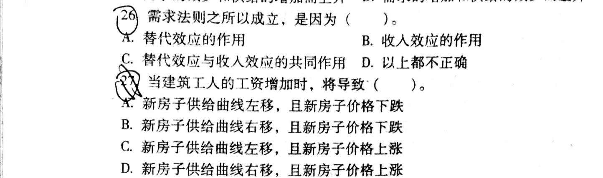
  
<em>图1：需求与需求量及其影响因素范例题</em>

**26.** 需求法则之所以成立，是因为（ ）。

* A. 替代效应的作用
* B. 收入效应的作用
* C. 替代效应与收入效应的共同作用
* D. 以上都不正确

> **【参考答案】** C

**27.** 当建筑工人的工资增加时，将导致（ ）。

* A. 新房子供给曲线左移，且新房子价格下跌
* B. 新房子供给曲线右移，且新房子价格下跌
* C. 新房子供给曲线左移，且新房子价格上涨
* D. 新房子供给曲线右移，且新房子价格上涨

> **【参考答案】** C（建筑工人工资增加导致建房成本上升，新房供给减少，供给曲线向左移动，均衡价格上涨）

### （2）消费效用最大化均衡条件与消费决策的调整

  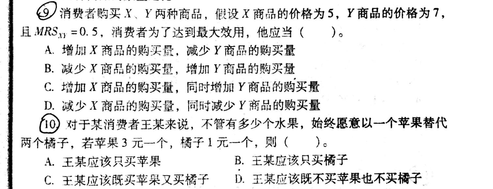
  
<em>图2：消费效用最大化均衡条件与消费决策调整范例题</em>

**9.** 消费者购买 $X$、$Y$ 两种商品，假设 $X$ 商品的价格为 $5$，$Y$ 商品的价格为 $7$，且 $MRS_{XY} = 0.5$，消费者为了达到最大效用，他应当（ ）。

* A. 增加 $X$ 商品的购买量，减少 $Y$ 商品的购买量
* B. 减少 $X$ 商品的购买量，增加 $Y$ 商品的购买量
* C. 增加 $X$ 商品的购买量，同时增加 $Y$ 商品的购买量
* D. 减少 $X$ 商品的购买量，同时减少 $Y$ 商品的购买量

> **【参考答案】** B（因为 $MRS_{XY} = 0.5 < \frac{P_X}{P_Y} = \frac{5}{7}$，即 $\frac{MU_X}{P_X} < \frac{MU_Y}{P_Y}$，应减少 $X$ 的购买量、增加 $Y$ 的购买量）

**10.** 对于某消费者王某来说，不管有多少个水果，始终愿意以一个苹果替代两个橘子，若苹果 $3$ 元一个，橘子 $1$ 元一个，则（ ）。

* A. 王某应该只买苹果
* B. 王某应该只买橘子
* C. 王某应该既买苹果又买橘子
* D. 王某应该既不买苹果也不买橘子

> **【参考答案】** B（苹果对橘子的边际替代率 $MRS = 2$，而苹果与橘子的价格之比为 $\frac{3}{1} = 3$，由于 $MRS < \frac{P_{\text{苹果}}}{P_{\text{橘子}}}$，橘子的单位货币效用更高，完全替代品下应全部购买橘子）

### （3）需求的价格弹性

  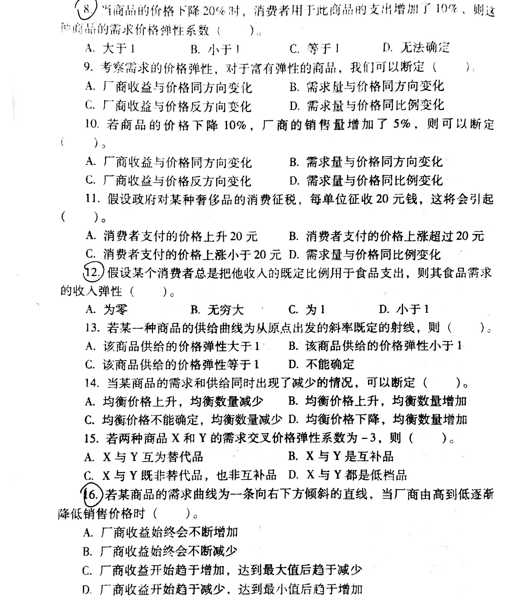
  
<em>图3：需求的价格弹性范例题</em>

**8.** 当商品的价格下降 $20\%$ 时，消费者用于此商品的支出增加了 $10\%$，则这种商品的需求价格弹性系数（ ）。

* A. 大于 $1$
* B. 小于 $1$
* C. 等于 $1$
* D. 无法确定

> **【参考答案】** A（价格下降导致消费者支出即厂商总收益增加，说明该商品富有弹性，$E_d > 1$）

**9.** 考察需求的价格弹性，对于富有弹性的商品，我们可以断定（ ）。

* A. 厂商收益与价格同方向变化
* B. 需求量与价格同方向变化
* C. 厂商收益与价格反方向变化
* D. 需求量与价格同比例变化

> **【参考答案】** C

**10.** 若商品的价格下降 $10\%$，厂商的销售量增加了 $5\%$，则可以断定（ ）。

* A. 厂商收益与价格同方向变化
* B. 需求量与价格同方向变化
* C. 厂商收益与价格反方向变化
* D. 需求量与价格同比例变化

> **【参考答案】** A（此时 $E_d = \frac{5\%}{10\%} = 0.5 < 1$，商品缺乏弹性，厂商收益与价格同方向变化）

**11.** 假设政府对某种奢侈品的消费征税，每单位征收 $20$ 元钱，这将会引起（ ）。

* A. 消费者支付的价格上升 $20$ 元
* B. 消费者支付的价格上涨超过 $20$ 元
* C. 消费者支付的价格上涨小于 $20$ 元
* D. 需求量与价格同比例变化

> **【参考答案】** C（税负由消费者和生产者共同分担，故消费者支付价格的上涨幅度小于 $20$ 元）

**12.** 假设某个消费者总是把他收入的既定比例用于食品支出，则其食品需求的收入弹性（ ）。

* A. 为零
* B. 无穷大
* C. 为 $1$
* D. 小于 $1$

> **【参考答案】** C（食品支出占收入比例恒定，意味着收入增加百分比等于食品需求增加百分比，收入弹性为 $1$）

**13.** 若某一种商品的供给曲线为从原点出发的斜率既定的射线，则（ ）。

* A. 该商品供给的价格弹性大于 $1$
* B. 该商品供给的价格弹性小于 $1$
* C. 该商品供给的价格弹性等于 $1$
* D. 不能确定

> **【参考答案】** C

**14.** 当某商品的需求和供给同时出现了减少的情况，可以断定（ ）。

* A. 均衡价格上升，均衡数量减少
* B. 均衡价格上升，均衡数量增加
* C. 均衡价格不能确定，均衡数量减少
* D. 均衡价格下降，均衡数量增加

> **【参考答案】** C

**15.** 若两种商品 $X$ 和 $Y$ 的需求交叉价格弹性系数为 $-3$，则（ ）。

* A. $X$ 与 $Y$ 互为替代品
* B. $X$ 与 $Y$ 是互补品
* C. $X$ 与 $Y$ 既非替代品，也非互补品
* D. $X$ 与 $Y$ 都是低档品

> **【参考答案】** B（交叉价格弹性为负值，说明两种商品是互补品）

**16.** 若某商品的需求曲线为一条向右下方倾斜的直线，当厂商由高到低逐渐降低销售价格时（ ）。

* A. 厂商收益始终会不断增加
* B. 厂商收益始终会不断减少
* C. 厂商收益开始趋于增加，达到最大值后趋于减少
* D. 厂商收益开始趋于减少，达到最小值后趋于增加

> **【参考答案】** C（线性需求曲线上半段 $E_d > 1$，降价使收益增加；中点 $E_d = 1$，收益达最大；下半段 $E_d < 1$，继续降价使收益减少）

### （4）IC、EC、PC 曲线的区别

  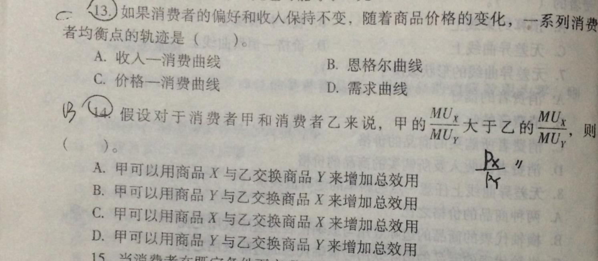
  
<em>图4：IC、EC、PC 曲线的区别范例题</em>

**13.** 如果消费者的偏好和收入保持不变，随着商品价格的变化，一系列消费者均衡点的轨迹是（ ）。

* A. 收入—消费曲线
* B. 恩格尔曲线
* C. 价格—消费曲线
* D. 需求曲线

> **【参考答案】** C（原图手写批注：C）

**14.** 假设对于消费者甲和消费者乙来说，甲的 $\frac{MU_X}{MU_Y}$ 大于乙的 $\frac{MU_X}{MU_Y}$，则（ ）。

* A. 甲可以用商品 $X$ 与乙交换商品 $Y$ 来增加总效用
* B. 甲可以用商品 $Y$ 与乙交换商品 $X$ 来增加总效用
* C. 甲可以用商品 $X$ 与乙交换商品 $X$ 来增加总效用
* D. 甲可以用商品 $Y$ 与乙交换商品 $Y$ 来增加总效用

> **【参考答案】** B（原图手写批注：B，$\frac{P_X}{P_Y}$。甲对 $X$ 的主观评价高于乙，因此甲应当用商品 $Y$ 向乙换取商品 $X$）

### （5）规模报酬

  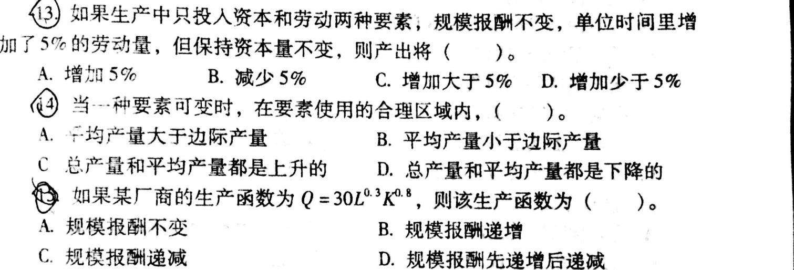
  
<em>图5：规模报酬范例题</em>

**13.** 如果生产中只投入资本和劳动两种要素，规模报酬不变，单位时间里增加了 $5\%$ 的劳动量，但保持资本量不变，则产出将（ ）。

* A. 增加 $5\%$
* B. 减少 $5\%$
* C. 增加大于 $5\%$
* D. 增加少于 $5\%$

> **【参考答案】** D（若劳动和资本同时增加 $5\%$，规模报酬不变下产出增加 $5\%$；现资本保持不变，仅劳动增加 $5\%$，故产出增加少于 $5\%$）

**14.** 当一种要素可变时，在要素使用的合理区域内，（ ）。

* A. 平均产量大于边际产量
* B. 平均产量小于边际产量
* C. 总产量和平均产量都是上升的
* D. 总产量和平均产量都是下降的

> **【参考答案】** A（短期生产第二阶段即合理区域内，$AP_L > MP_L \ge 0$，平均产量递减、总产量递增）

**15.** 如果某厂商的生产函数为 $Q = 30 L^{0.3} K^{0.8}$，则该生产函数为（ ）。

* A. 规模报酬不变
* B. 规模报酬递增
* C. 规模报酬递减
* D. 规模报酬先递增后递减

> **【参考答案】** B（柯布—道格拉斯生产函数中 $\alpha + \beta = 0.3 + 0.8 = 1.1 > 1$，故为规模报酬递增）

### （6）成本变化情况下的长期供给曲线与成本概念

  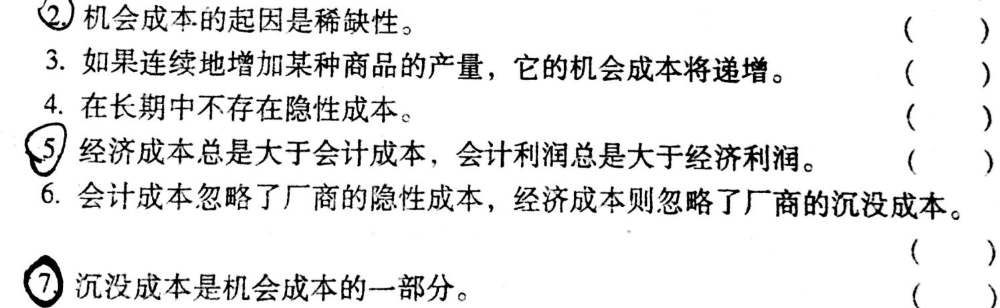
  
<em>图6：成本概念判断题范例</em>

- **2.** 机会成本的起因是稀缺性。 `( √ )`
- **3.** 如果连续地增加某种商品的产量，它的机会成本将递增。 `( √ )`
- **4.** 在长期中不存在隐性成本。 `( × )`
- **5.** 经济成本总是大于会计成本，会计利润总是大于经济利润。 `( √ )`
- **6.** 会计成本忽略了厂商的隐性成本，经济成本则忽略了厂商的沉没成本。 `( √ )`
- **7.** 沉没成本是机会成本的一部分。 `( × )`

  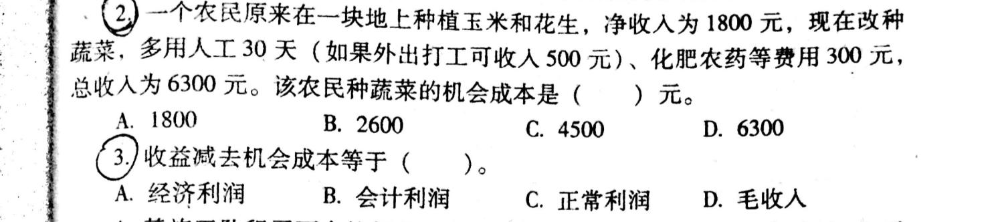
  
<em>图7：机会成本与经济利润选择题范例</em>

**2.** 一个农民原来在一块地上种植玉米和花生，净收入为 $1800$ 元，现在改种蔬菜，多用人工 $30$ 天（如果外出打工可收入 $500$ 元）、化肥农药等费用 $300$ 元，总收入为 $6300$ 元。该农民种蔬菜的机会成本是（ ）元。

* A. $1800$
* B. $2600$
* C. $4500$
* D. $6300$

> **【参考答案】** B（放弃种玉米和花生的净收入 $1800$ 元 $+$ 多用人工放弃的外出打工收入 $500$ 元 $+$ 化肥农药资金用于其他用途放弃的收益 $300$ 元 $= 2600$ 元）

**3.** 收益减去机会成本等于（ ）。

* A. 经济利润
* B. 会计利润
* C. 正常利润
* D. 毛收入

> **【参考答案】** A

### （7）四种市场短长期均衡条件的比较分析

  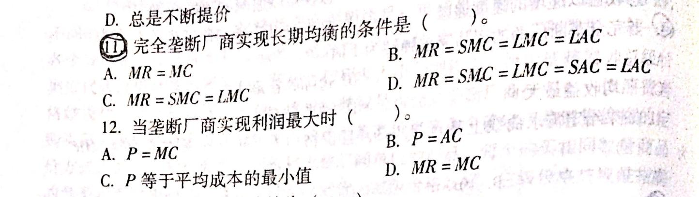
  
<em>图8：完全垄断厂商均衡条件范例题</em>

**11.** 完全垄断厂商实现长期均衡的条件是（ ）。

* A. $MR = MC$
* B. $MR = SMC = LMC = LAC$
* C. $MR = SMC = LMC$
* D. $MR = SMC = LMC = SAC = LAC$

> **【参考答案】** C

**12.** 当垄断厂商实现利润最大时（ ）。

* A. $P = MC$
* B. $P = AC$
* C. $P$ 等于平均成本的最小值
* D. $MR = MC$

> **【参考答案】** D

  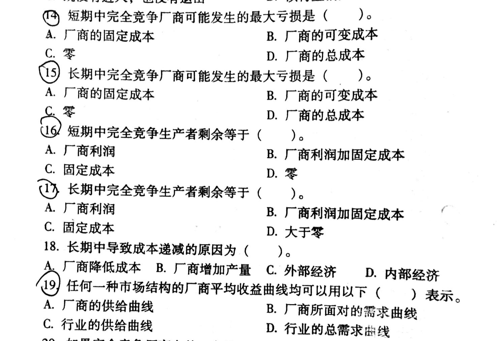
  
<em>图9：完全竞争市场均衡与生产者剩余范例题</em>

**14.** 短期中完全竞争厂商可能发生的最大亏损是（ ）。

* A. 厂商的固定成本
* B. 厂商的可变成本
* C. 零
* D. 厂商的总成本

> **【参考答案】** A（当价格低于停止营业点时，厂商停产，最大亏损为全部固定成本）

**15.** 长期中完全竞争厂商可能发生的最大亏损是（ ）。

* A. 厂商的固定成本
* B. 厂商的可变成本
* C. 零
* D. 厂商的总成本

> **【参考答案】** C（长期中若发生亏损厂商会退出该行业，故最大亏损为零）

**16.** 短期中完全竞争生产者剩余等于（ ）。

* A. 厂商利润
* B. 厂商利润加固定成本
* C. 固定成本
* D. 零

> **【参考答案】** B

**17.** 长期中完全竞争生产者剩余等于（ ）。

* A. 厂商利润
* B. 厂商利润加固定成本
* C. 固定成本
* D. 大于零

> **【参考答案】** A

**18.** 长期中导致成本递减的原因为（ ）。

* A. 厂商降低成本
* B. 厂商增加产量
* C. 外部经济
* D. 内部经济

> **【参考答案】** C（行业长期供给曲线向右下方倾斜即成本递减行业的原因是外在经济/外部经济）

**19.** 任何一种市场结构的厂商平均收益曲线均可以用以下（ ）表示。

* A. 厂商的供给曲线
* B. 厂商所面对的需求曲线
* C. 行业的供给曲线
* D. 行业的总需求曲线

> **【参考答案】** B（因为 $AR = \frac{TR}{Q} = \frac{P \cdot Q}{Q} = P$，故厂商的平均收益曲线总是与其所面临的需求曲线重合）

## 三、名词解释复习清单

* **机会成本**：把既定的稀缺资源用于某种特定生产时，必须放弃的该资源用于其他用途能够获得的最大收益。
* **沉没成本**：已经发生且无法收回或补偿的成本，其机会成本为零，不影响厂商当前的经济决策。
* **范围经济**：指由同一家厂商同时生产两种或两种以上产品的总成本，低于由不同厂商分别生产这些产品的成本之和的现象。
* **成本递增行业**：指行业产量增加所引起的生产要素需求的增加，会导致生产要素价格上升，从而使厂商长期平均成本最低点随行业规模扩大而上升的行业，其长期供给曲线向右上方倾斜。
* **生产者剩余**：厂商生产并销售一定数量的商品时，按照市场价格获得的总收入与其生产这些商品每一单位边际成本总和（或愿意接受的最低总支付）之间的差额。
* **自然垄断**：面对一定规模的市场需求，由于显著的规模经济或成本函数的次可加性，由一家厂商提供全部产品和服务的成本比由两家或更多厂商提供的成本更低而形成的垄断。
* **一级/二级/三级价格歧视**：
    - 一级价格歧视（完全价格歧视）：垄断厂商按照每一位消费者购买每一单位商品所愿意并能够支付的最高价格（保留价格）来逐个确定销售价格，攫取全部消费者剩余。
    - 二级价格歧视（非线性定价）：垄断厂商根据消费者购买商品的不同数量段收取不同的价格，购买相同数量商品的消费者支付相同的价格（如批量打折、阶梯电价）。
    - 三级价格歧视：垄断厂商将消费者划分为具有不同需求价格弹性的若干个分市场，对不同分市场制定不同的销售价格（在弹性小的市场定高价，在弹性大的市场定低价）。
* **主观/客观需求曲线**：垄断竞争市场上的两条需求曲线。主观需求曲线（$d$ 曲线）表示当某垄断竞争厂商改变产品价格，而集团内其他厂商保持价格不变时，该厂商的产品价格与销售量之间的关系；客观需求曲线（$D$ 曲线，又称实际需求曲线或市场份额需求曲线）表示当该厂商改变价格，且集团内其他所有厂商也同时同幅度改变价格时，该厂商的产品价格与销售量之间的关系。
* **纳什均衡**：在博弈中，给定其他参与人所选择的战略，每一个参与人所选择的战略都是针对其他参与人战略的最优反应，没有任何一个参与人有动机单方面改变自己的战略。
* **占优均衡（占优策略均衡）**：如果博弈中某参与人的最优战略不依赖于其他参与人的战略选择（不论其他参与人选择什么战略，该战略都是唯一最优的），则称为占优战略；当所有参与人都存在占优战略时，由各参与人占优战略构成的组合即为占优策略均衡。
* **边际产量价值**：完全竞争产品市场中，厂商增加一单位可变要素投入所增加的产量的市场价值，等于要素的边际产量乘以产品价格，即 $VMP_L = MP_L \cdot P$。
* **欧拉定理（产品分配净尽定理）**：在规模报酬不变和完全竞争的条件下，如果全部生产要素都按照各自的边际产量获得报酬，则全部产品正好被分配净尽，没有剩余也不存在亏空，即 $Q = L \cdot \frac{\partial Q}{\partial L} + K \cdot \frac{\partial Q}{\partial K}$。
* **经济租金**：为生产要素所支付的实际报酬总额与为得到或使用该要素所必须支付的最小金额（转移收入/机会成本）之间的差额。
* **需求的价格弹性**：表示在一定时期内，一种商品的需求量变动对该商品自身价格变动的反应程度或敏感程度，弹性系数 $E_d$ 等于需求量变动的百分比与价格变动的百分比之比。
* **帕累托改进**：如果既定的资源配置状态的改变使得至少有一个人的境况变好，而没有任何人的境况变坏，则这种资源配置状态的改变称为帕累托改进。

## 四、简答题各章复习要求与典型例题

### 第七章 市场结构理论：完全竞争市场

* **教学目的与要求**：掌握完全竞争市场的特征，厂商所面临的需求曲线和收益曲线，掌握完全竞争厂商的短期均衡和长期均衡，掌握完全竞争厂商的短期和长期供给曲线，完全竞争市场的短期与长期供给曲线，掌握生产者剩余的含义；理解市场类型的划分与特征，理解完全竞争厂商的最优决策，理解市场效率的分析；了解市场的含义。
* **教学重点与难点**：
    - 重点：完全竞争厂商的长短期均衡，推导完全竞争厂商的长短期供给曲线。
    - 难点：完全竞争行业的长期供给曲线、利用消费者剩余和生产者剩余总和的变化来评判政策的效果。
* **典型简答例题**：简述完全竞争厂商的短期均衡？企业何时选择停工？成本递减行业的长期供给曲线为何向下倾斜？税收如何导致消费者剩余与生产者剩余变化？

### 第八章 市场结构理论：完全垄断市场

* **教学目的与要求**：掌握完全垄断市场的特征，完全垄断厂商的需求曲线和收益曲线，掌握完全垄断市场的短期和长期均衡条件，掌握价格歧视的含义和类型；理解垄断厂商的边际收益、价格和需求的价格弹性之间的关系，理解垄断市场的低效率及垄断的管制手段；了解自然垄断的含义及形成。
* **教学重点与难点**：
    - 重点：完全垄断市场在单一价格和价格歧视条件下的价格与产量的决策、垄断的低效率。
    - 难点：三级价格歧视。
* **典型简答例题**：简述完全垄断市场的特征？什么是价格歧视，举例说明？垄断厂商为何不会在 $E_d < 1$ 处实现利润最大化？

### 第九章 市场结构理论：垄断竞争与寡头垄断市场

* **教学目的与要求**：掌握垄断竞争市场的短期与长期均衡，掌握寡头垄断市场下古诺模型、卡特尔和斯塔克尔伯格模型，掌握不同市场结构下经济效率的比较；理解垄断竞争市场的特点及厂商面临的需求曲线，理解寡头垄断市场的特点及伯特兰模型、价格领导模型和斯威齐模型；了解非价格竞争，张伯伦模型。
* **教学重点与难点**：
    - 重点：垄断竞争市场的短期均衡与长期均衡、古诺模型、卡特尔模型。
    - 难点：四种市场经济效率的比较。
* **典型简答例题**：卡特尔为何是不稳固的？

### 第十二章 一般均衡和经济效率

* **教学目的与要求**：掌握一般均衡的含义，掌握帕累托最优状态的标准及实现帕累托最优状态的条件；掌握福利经济学第一、二定理的含义，掌握生产可能性曲线及效用可能性边界的含义；理解公平与效率的关系，理解瓦尔拉斯一般均衡的思想；了解社会福利函数及阿罗不可能定理。
* **教学重点与难点**：
    - 重点：帕累托最优状态的标准、帕累托效率的标准、完全竞争市场与帕累托效率。
    - 难点：一般均衡的含义。
* **典型简答例题**：为什么完全竞争市场可以实现帕累托效率？如何用埃奇沃思盒表述配置的效率？

### 第十三章 市场失灵与微观经济政策

* **教学目的与要求**：掌握外部性、公共物品和信息不对称的含义及市场失灵的原因，掌握外部性、公共物品和信息不对称下市场失灵的解决办法；理解公共物品的有效供给，理解委托代理问题；了解公共选择理论。
* **教学重点与难点**：
    - 重点：外部性对资源配置的影响及解决办法，科斯定理、逆向选择、道德风险。
    - 难点：外部性对资源配置的影响、公共物品的有效供给。
* **典型简答例题**：政府矫正外部性的对策有哪些？公共物品为何存在供给障碍？

## 五、计算题要点范例

### （1）三级价格歧视

  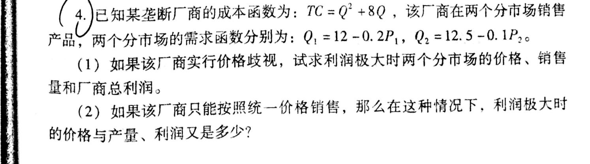
  
<em>图10：三级价格歧视计算范例题</em>

**4.** 已知某垄断厂商的成本函数为：$TC = Q^2 + 8Q$，该厂商在两个分市场销售产品，两个分市场的需求函数分别为：$Q_1 = 12 - 0.2 P_1$，$Q_2 = 12.5 - 0.1 P_2$。

- （1）如果该厂商实行价格歧视，试求利润极大时两个分市场的价格、销售量和厂商总利润。
- （2）如果该厂商只能按照统一价格销售，那么在这种情况下，利润极大时的价格与产量、利润又是多少？

> **【参考答案与解析】**
>
> **（1）实行三级价格歧视时**：
> 由两个分市场的需求函数求出反需求函数：
>
> $$
> P_1 = 60 - 5Q_1, \quad P_2 = 125 - 10Q_2
> $$
>
> 两个分市场的总收益与边际收益分别为：
>
> $$
> TR_1 = P_1 Q_1 = 60Q_1 - 5Q_1^2 \implies MR_1 = 60 - 10Q_1
> $$
>
> $$
> TR_2 = P_2 Q_2 = 125Q_2 - 10Q_2^2 \implies MR_2 = 125 - 20Q_2
> $$
>
> 厂商的总产量为 $Q = Q_1 + Q_2$，总成本函数为 $TC = Q^2 + 8Q$，故边际成本为：
>
> $$
> MC = \frac{dTC}{dQ} = 2Q + 8 = 2(Q_1 + Q_2) + 8
> $$
>
> 根据三级价格歧视利润最大化条件 $MR_1 = MR_2 = MC$，列出方程组：
>
> $$
> \begin{cases}
> 60 - 10Q_1 = 2(Q_1 + Q_2) + 8 \\
> 125 - 20Q_2 = 2(Q_1 + Q_2) + 8
> \end{cases}
> \implies
> \begin{cases}
> 12Q_1 + 2Q_2 = 52 \\
> 2Q_1 + 22Q_2 = 117
> \end{cases}
> $$
>
> 联立求解得：
>
> $$
> Q_1 = 3.5, \quad Q_2 = 5, \quad Q = Q_1 + Q_2 = 8.5
> $$
>
> 代入反需求函数得两个分市场的均衡价格：
>
> $$
> P_1 = 60 - 5 \times 3.5 = 42.5, \quad P_2 = 125 - 10 \times 5 = 75
> $$
>
> 厂商总利润为：
>
> $$
> \pi = P_1 Q_1 + P_2 Q_2 - TC(Q) = 42.5 \times 3.5 + 75 \times 5 - (8.5^2 + 8 \times 8.5) = 148.75 + 375 - 140.25 = 383.5
> $$
>
> **（2）实行统一价格销售时**：
> 令 $P_1 = P_2 = P$，当 $P \le 60$ 时，市场总需求函数为两分市场需求之和：
>
> $$
> Q = Q_1 + Q_2 = (12 - 0.2P) + (12.5 - 0.1P) = 24.5 - 0.3P
> $$
>
> 反需求函数为：
>
> $$
> P = \frac{24.5 - Q}{0.3} = \frac{245 - 10Q}{3}
> $$
>
> 边际收益为：
>
> $$
> MR = \frac{245 - 20Q}{3}
> $$
>
> 由利润最大化条件 $MR = MC$，得：
>
> $$
> \frac{245 - 20Q}{3} = 2Q + 8 \implies 245 - 20Q = 6Q + 24 \implies 26Q = 221 \implies Q = 8.5
> $$
>
> 代入反需求函数得统一销售价格：
>
> $$
> P = \frac{245 - 10 \times 8.5}{3} = \frac{160}{3} \approx 53.33\text{（满足 } P \le 60\text{）}
> $$
>
> 此时厂商总利润为：
>
> $$
> \pi = P \cdot Q - (Q^2 + 8Q) = \frac{160}{3} \times 8.5 - 140.25 = \frac{1360}{3} - \frac{561}{4} = \frac{3757}{12} \approx 313.08
> $$

### （2）古诺均衡、卡特尔与斯塔克尔伯格模型

  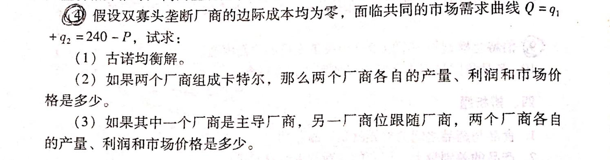
  
<em>图11：古诺均衡、卡特尔与斯塔克尔伯格模型计算范例题</em>

**4.** 假设双寡头垄断厂商的边际成本均为零，面临共同的市场需求曲线 $Q = q_1 + q_2 = 240 - P$，试求：

- （1）古诺均衡解。
- （2）如果两个厂商组成卡特尔，那么两个厂商各自的产量、利润和市场价格是多少。
- （3）如果其中一个厂商是主导厂商，另一厂商为跟随厂商，两个厂商各自的产量、利润和市场价格是多少。

> **【参考答案与解析】**
>
> **（1）古诺均衡解**：
> 已知反需求函数为 $P = 240 - Q = 240 - (q_1 + q_2)$，且边际成本 $MC_1 = MC_2 = 0$（设固定成本为零，则 $TC_1 = TC_2 = 0$）。
> 厂商 $1$ 的利润函数为：
>
> $$
> \pi_1 = P \cdot q_1 = (240 - q_1 - q_2)q_1 = 240q_1 - q_1^2 - q_1 q_2
> $$
>
> 由一阶条件 $\frac{\partial \pi_1}{\partial q_1} = 240 - 2q_1 - q_2 = 0$，得厂商 $1$ 的反应函数：
>
> $$
> q_1 = 120 - 0.5 q_2
> $$
>
> 同理，由对称性可得厂商 $2$ 的反应函数：
>
> $$
> q_2 = 120 - 0.5 q_1
> $$
>
> 联立两反应函数解得古诺均衡产量、市场价格和各自利润为：
>
> $$
> q_1 = q_2 = 80, \quad Q = 160, \quad P = 240 - 160 = 80, \quad \pi_1 = \pi_2 = 80 \times 80 = 6400
> $$
>
> **（2）组成卡特尔（共谋垄断）**：
> 卡特尔追求联合总利润最大化，总利润函数为：
>
> $$
> \pi = (240 - Q)Q = 240Q - Q^2
> $$
>
> 令 $MR = 240 - 2Q = MC = 0$，得卡特尔总产量和市场价格：
>
> $$
> Q = 120, \quad P = 240 - 120 = 120
> $$
>
> 因两厂商成本相同（对称平分产量），各自产量与利润为：
>
> $$
> q_1 = q_2 = 60, \quad \pi_1 = \pi_2 = 120 \times 60 = 7200
> $$
>
> **（3）斯塔克尔伯格模型（设厂商 $1$ 为主导厂商，厂商 $2$ 为跟随厂商）**：
> 主导厂商 $1$ 预测到跟随厂商 $2$ 会按反应函数 $q_2 = 120 - 0.5 q_1$ 决策，将其代入厂商 $1$ 的利润函数：
>
> $$
> \pi_1 = \left[240 - q_1 - (120 - 0.5 q_1)\right] q_1 = (120 - 0.5 q_1) q_1 = 120q_1 - 0.5q_1^2
> $$
>
> 令 $\frac{d\pi_1}{dq_1} = 120 - q_1 = 0$，解得主导厂商 $1$ 的最优产量：
>
> $$
> q_1 = 120
> $$
>
> 代入厂商 $2$ 的反应函数得跟随厂商 $2$ 的产量：
>
> $$
> q_2 = 120 - 0.5 \times 120 = 60
> $$
>
> 此时行业总产量为 $Q = 120 + 60 = 180$，市场均衡价格与两厂商各自的利润分别为：
>
> $$
> P = 240 - 180 = 60, \quad \pi_1 = 60 \times 120 = 7200, \quad \pi_2 = 60 \times 60 = 3600
> $$

## 六、论述题要点

- **（1）四种市场经济效率比较？（第 9 章）**
    - 比较完全竞争、垄断竞争、寡头垄断、完全垄断四种市场在长期均衡时的产量、价格、长期平均成本（是否位于 $LAC$ 最低点）、价格与长期边际成本的关系（是否满足 $P = LMC$）、消费者与生产者福利总和（是否存在无谓损失）以及技术进步和产品多样性。结论：市场竞争程度越高，经济效率越高；垄断程度越高，经济效率越低。
- **（2）为什么说市场机制是好的？（第 12 章）**
    - 结合一般均衡与福利经济学第一定理：在完全竞争市场条件下，每个消费者和厂商都是价格接受者并面临相同的市场价格，消费者追求效用最大化使得 $MRS_{XY}^A = MRS_{XY}^B = \frac{P_X}{P_Y}$（满足交换的帕累托最优条件），生产者追求成本最小化使得 $MRTS_{LK}^C = MRTS_{LK}^D = \frac{w}{r}$（满足生产的帕累托最优条件），厂商追求利润最大化使得 $P_X = MC_X, P_Y = MC_Y$，从而 $MRT_{XY} = \frac{MC_X}{MC_Y} = \frac{P_X}{P_Y} = MRS_{XY}$（满足生产与交换的帕累托最优条件）。因此，完全竞争市场机制能够自动引导资源配置达到帕累托最优状态。
