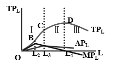

# 微观经济学重点整理（知识点汇总）

## 第一章 导言

* **稀缺性**：经济资源以及用经济资源生产的物品总是不能满足人类无穷无尽欲望的事实。
* **微观经济学研究的中心问题**：资源配置问题。
* **经济学的基本问题**：资源配置问题、资源利用问题、经济体制问题。

## 第二章 需求、供给与均衡价格

### 1. 需求与需求量的基本概念

* **需求**：是指在一定时期内，对应于某种商品各种可能的价格，消费者愿意并且能够购买的该商品的数量。
* **需求量**：是指消费者在某一价格下愿意购买的某种商品的数量。
* **需求的变化**：在商品自身价格不变的条件下，由于其他因素变动而引起的对商品需求数量的变化（表现为整条需求曲线的位移）。
* **需求量的变化**：在影响需求的其他因素保持不变的情况下，由于商品自身价格变动所引起的对该商品需求量的变动（表现为沿着同一条需求曲线的移动）。

### 2. 供求规律

- （1）在供给不变的情况下，需求增加导致均衡价格上升和均衡数量增加，需求减少导致均衡价格下降和均衡数量减少。
- （2）在需求不变的情况下，供给增加导致均衡价格下降和均衡数量增加，供给减少导致均衡价格上升和均衡数量减少。
- （3）当供给和需求同时增加或减少时，均衡数量同方向变化，均衡价格不确定。
- （4）当供需反方向变动时，均衡价格与需求同方向变化，均衡数量不确定。

### 3. 需求的价格弹性

* **需求的价格弹性**：表示在一定时期内，一种商品的需求量对该商品价格变化的反应程度或敏感程度。需求价格弹性系数 $E_d$ 等于需求量变化的百分比除以价格变化的百分比：

$$
E_d = \frac{\Delta Q / Q}{\Delta P / P} = \frac{\Delta Q}{\Delta P} \cdot \frac{P}{Q}
$$

### 4. 点弹性的几何意义与类型

* **点弹性的几何意义**：需求曲线上任意一点的点弹性系数的值，等于这一点沿着需求曲线到横轴的距离比上其沿着需求曲线到纵轴的距离。在同一条线性需求曲线上（设纵轴截距为 $A$，横轴截距为 $B$，中点为 $C$），位于上半段的点，需求的价格弹性大于 $1$；位于下半段上的点，需求的价格弹性小于 $1$。
* **点弹性的五种类型**：
    - （1）$AC$ 段：$E_d > 1$，富有弹性。
    - （2）$CB$ 段：$E_d < 1$，缺乏弹性。
    - （3）$C$ 点：$E_d = 1$，单位弹性。
    - （4）$A$ 点：$E_d \to \infty$，完全有弹性。
    - （5）$B$ 点：$E_d = 0$，完全无弹性。

### 5. 需求的交叉价格弹性

- （1）**概念**：表示在一定时期内，一种商品的需求量变动对其相关商品价格变动的反应程度或敏感程度。
- （2）**公式**：其弹性系数等于商品需求量的变化率与引起这种变化的另一种商品价格变化率的比值，表示为：

$$
E_{XY} = \frac{\Delta Q_X / Q_X}{\Delta P_Y / P_Y} = \frac{\Delta Q_X}{\Delta P_Y} \cdot \frac{P_Y}{Q_X}
$$

- （3）**经济含义**：如果两种商品互为替代品，则一种商品的需求量与其替代品的价格之间呈同方向运动，需求的交叉弹性系数是正值（$E_{XY} > 0$）；如果两种商品是互补品，则一种商品的需求量与其互补品的价格之间呈反方向变动，需求的交叉弹性系数是负值（$E_{XY} < 0$）；如果两种商品之间不存在任何关系，则其中任何一种商品的需求量都不会对另一种商品的价格作出反应，需求的交叉弹性系数为零（$E_{XY} = 0$）。

### 6. 需求价格弹性与厂商收益的关系

厂商总收益变动与价格变动的关系为 $\frac{\Delta R}{\Delta P} = Q(1 - E_d)$：

- （1）当 $E_d > 1$ 时，$Q(1 - E_d) < 0$，即 $\Delta R$ 与 $\Delta P$ 异号。说明这种富有弹性的商品，其销售收益与价格反方向变化，即降价可以增加收益，涨价会减少收益。厂商应采取“薄利多销”策略。
- （2）当 $0 < E_d < 1$ 时，$Q(1 - E_d) > 0$，即 $\Delta R$ 与 $\Delta P$ 同号。说明这种缺乏弹性的商品，销售收益与价格同方向变化，即涨价会增加收益，降价反而会减少收益。
- （3）当 $E_d = 1$ 时，$Q(1 - E_d) = 0$，即 $\Delta R = 0$。说明单位弹性的商品，厂商无论涨价还是降价，其销售收入始终不变。
- （4）对于 $E_d \to \infty$ 的完全有弹性的商品，其在既定价格之下收益可以随需求量无限增加。若降价会使收益减少，若涨价会造成需求量减少为零、收益变为零。完全有弹性的商品既不适合降价也不适合涨价。
- （5）对于 $E_d = 0$ 的完全无弹性的商品，由于价格任何变化都不会引起需求量的变化，即在 $R = P \cdot Q$ 公式中，$P$ 的任何变化下 $Q$ 都固定不变，因此收益与价格同方向同比例变化。

### 7. 价格管制与税收

* **价格管制**：支持价格（价格下限，高于均衡价格，常用于保护农业生产者）、限制价格（价格上限，低于均衡价格，常用于抑制生活必需品价格过快上涨）。
* **税收对均衡价格的影响**：
    - a）对生产者征税：供给曲线向左上方平移（上移单位税额 $t$），均衡价格上升，均衡数量减少。
    - b）对消费者征税：需求曲线向左下方平移（下移单位税额 $t$），消费者支付的价格上升，生产者实际得到的价格下降，均衡数量减少。无论对生产者还是对消费者征税，最终税负分担取决于需求弹性和供给弹性的相对大小（弹性小的一方承担更多税负）。

## 第三章 消费者行为理论

### 1. 商品的边际替代率与消费者均衡

* **商品的边际替代率**：在保持消费者满足水平不变的前提下，$1$ 单位的商品 $X$ 能够代替的商品 $Y$ 的数量，这个比率叫做边际替代率，记作 $MRS_{XY} = -\frac{\Delta Y}{\Delta X}$。
* **边际替代率递减规律**：由于随着商品 $X$ 数量的不断增加，其边际效用 $MU_X$ 递减；随着商品 $Y$ 数量的不断减少，其边际效用 $MU_Y$ 递增，所以这两者的比值 $\frac{MU_X}{MU_Y}$ 就越来越小。

$$
MRS_{XY} = \frac{MU_X}{MU_Y} = -\frac{\Delta Y}{\Delta X} = \frac{P_X}{P_Y}
$$

* **消费者均衡的条件**：商品的边际替代率等于商品的价格之比，即 $MRS_{XY} = \frac{P_X}{P_Y}$（或 $\frac{MU_X}{P_X} = \frac{MU_Y}{P_Y}$）。
* **消费者剩余**：是消费者在购买商品时，愿意付出的代价与其实际付出的代价的差额。

### 2. 收入效应、替代效应与希克斯分解

* **收入效应**：是指由于商品价格的变化引起消费者实际收入变动对需求数量产生的影响。
* **替代效应**：是指由于商品价格变化引起相对价格变化对需求数量产生的影响。
* **价格效应（总效应）**：商品的价格变化所引起的消费者对其需求量的改变。
* **希克斯分解**：
    - （1）设 $X$ 商品降价，预算线由 $AB$ 旋转至 $AB'$。作一条平行于新预算线 $AB'$ 并且与原无差异曲线 $U$ 相切的补偿预算线 $CD$（切点为 $E''$，原均衡点为 $E$，新均衡点为 $E'$）。补偿预算线 $CD$ 与 $AB'$ 平行，表明 $X$ 商品价格下降改变了两种商品的相对价格 $\frac{P_X}{P_Y}$，预算线变平坦了；补偿预算线 $CD$ 与原来的无差异曲线 $U$ 相切，表明消费者仍然维持在原来的效用水平上，这就是希克斯定义的实际收入不变。在 $X$ 商品降价后，必须把消费者的货币收入相应调整（减少或剔除一部分），以保持实际收入水平不变。如果用 $Y$ 轴代表货币量，表示消费者除了用于 $X$ 商品之外的剩余货币，剔除的货币收入就是 $CD$ 与 $AB'$ 之间的垂直距离 $AC$。替代效应为：

$$
\Delta X^s = X'' - X
$$

    - （2）将补偿预算线 $CD$ 平移到 $AB'$，意味着保持相对价格不变，把刚才剔除的由于价格下降而增加的货币收入再补偿上，均衡点由 $E''$ 移动至 $E'$。$X$ 商品的需求量由 $X''$ 增加到 $X'$，是消费者实际收入水平提高的结果，这就是收入效应：

$$
\Delta X^m = X' - X''
$$

    - （3）价格效应等于替代效应加收入效应：

$$
\Delta X = X' - X = (X'' - X) + (X' - X'') = \Delta X^s + \Delta X^m
$$

### 3. 恩格尔曲线、低档品与吉芬商品

* **恩格尔曲线（收入—需求曲线）**：由收入—消费曲线（收入扩展线）推导而来，表示一种商品的均衡购买量与消费者收入水平之间的关系。
* **一般的低档品**：收入效应与价格同方向变动，但影响程度小于替代效应的情况。当价格下降时，替代效应引起的对商品 $X$ 需求的增加量 $\Delta X^s = X'' - X$，大于收入效应引起的对商品 $X$ 需求的减少量 $\vert \Delta X^m \vert = \vert X' - X'' \vert$。因此，价格效应 $\Delta X = \Delta X^s + \Delta X^m$ 仍然为正（需求量随价格下降而增加，收入效应与替代效应方向相反，且收入效应的影响程度小于替代效应的影响程度）。
* **吉芬商品**：收入效应与价格同方向变动，且其影响程度超过替代效应的情况。当价格下降时，替代效应引起的 $X$ 商品需求量的增加量 $\Delta X^s = X'' - X$，小于收入效应引起的 $X$ 商品需求量的减少量 $\vert \Delta X^m \vert = \vert X' - X'' \vert$，因此价格效应 $\Delta X = \Delta X^s + \Delta X^m$ 最终为负（需求量随价格下降反而减少，收入效应与替代效应方向相反，且收入效应的影响程度大于替代效应的影响程度）。

## 第五章 生产理论

### 1. 边际技术替代率与生产者均衡

* **边际技术替代率**：是指在保持产量水平不变的前提下，用一种投入替代另一种投入的比率。边际技术替代率反映了厂商为保持原有的产量水平不变，增加一单位要素的使用量与放弃另一种要素之间的数量比例关系：

$$
MRTS_{LK} = -\frac{\Delta K}{\Delta L}, \quad \text{当 } \Delta L \to 0 \text{ 时，} MRTS_{LK} = -\frac{dK}{dL}
$$

* **生产者均衡的条件**：两种要素的边际技术替代率等于两种要素的价格之比：

$$
MRTS_{LK} = \frac{MP_L}{MP_K} = \frac{w}{r} \quad \text{或} \quad \frac{MP_L}{w} = \frac{MP_K}{r}
$$

* **既定产量下的成本最小化要素组合**：设 $AB$、$A_1B_1$、$A_2B_2$ 三条等成本线有相同的斜率，$AB$ 与等产量线 $Q_0$ 相切，切点 $E$ 是生产者均衡点。它表示在既定产量下，生产者选择 $E$ 点的要素组合 $(L_0, K_0)$，可以实现成本最小化。$A_2B_2$ 虽然代表的成本水平较低，但其与既定等产量线 $Q_0$ 既无交点也无切点，无法实现 $Q_0$ 代表的产量；$A_1B_1$ 虽与 $Q_0$ 相交（设交点为 $a$、$b$），但花费的成本高于 $AB$ 代表的成本水平。从 $a$、$b$ 点沿 $Q_0$ 向 $E$ 点移动，都可以获得相同的产量水平并使成本下降。只有在 $E$ 点，才能满足既可以实现既定产量，又可以使成本水平降到最低，所以 $E$ 点是生产者均衡点。

### 2. 边际报酬递减规律与短期生产三个阶段

* **边际报酬（产量）递减规律**：是指在一定技术水平下，在其他投入要素不变时，随着一种可变要素的增加，其边际产量增加到一定点后最终会趋于递减。（在连续等量地追加一种可变要素到其他固定要素上去的过程中，起初该要素的边际产量是增加的，但达到一定点后，再增加可变要素的投入，其边际产量是递减的。）
* **短期生产三个阶段的划分**：

  
  
<em>图1：总产量、平均产量与边际产量及短期生产三阶段划分</em>

* **边际产量曲线与平均产量曲线的关系**：当边际产量曲线在平均产量曲线上方时，平均产量曲线是上升的；当边际产量曲线与平均产量曲线相交时，平均产量曲线达到最高点；当边际产量曲线在平均产量曲线下方时，平均产量曲线是下降的。
* **第 $\text{I}$ 阶段**：劳动的平均产量上升，边际产量大于平均产量，劳动总产量增加。相对于固定投入而言，可变投入不足，可变投入的增加可以使固定投入得到更加充分的利用，生产者增加要素投入量就可以增加总产量。
* **第 $\text{III}$ 阶段**：边际产量变为负值，总产量开始下降。意味着可变要素使用数量越多，总产量就越少。生产者要减少可变要素投入量，改变总产量减少的趋势，使生产过程过渡到第 $\text{II}$ 阶段。
* **第 $\text{II}$ 阶段（合理投入区）**：劳动的边际产量小于平均产量，劳动的平均产量开始递减，但边际产量依然大于 $0$。厂商应将生产安排到第 $\text{II}$ 阶段进行，具体安排在哪一点取决于厂商的目标：若追求平均产量最大，生产将安排在平均产量最高点处；若追求产量最大，生产将安排在总产量最大处；在利润最大化的假设下，生产的安排取决于成本与收益的比较。

### 3. 长期规模报酬的类型与判定

* **长期规模报酬的类型**：
    - （1）如果产出增加的比例超过了投入要素增加的比例，生产规模报酬递增：$f(tL, tK) > t f(L, K)$（其中 $t > 1$）。
    - （2）如果投入与产出的比例相同，则规模报酬不变：$f(tL, tK) = t f(L, K)$。
    - （3）如果产量增加的比例小于投入要素增加的比例，生产的规模报酬递减：$f(tL, tK) < t f(L, K)$。
* **长期规模报酬类型的判定**：
    - （1）对于生产函数 $Q = F(X_1, X_2, X_3, \dots, X_n)$，如果所有投入要素都增加 $\alpha$ 倍，产量增加 $\beta$ 倍，即 $\beta Q = F(\alpha X_1, \alpha X_2, \alpha X_3, \dots, \alpha X_n)$：若 $\beta > \alpha$，则规模报酬递增；若 $\beta = \alpha$，则规模报酬不变；若 $\beta < \alpha$，则规模报酬递减（注：原讲义将符号方向误记为 $\alpha > \beta$，此处以产出倍数 $\beta$ 与投入倍数 $\alpha$ 的比较为准）。
    - （2）对于生产函数 $Q = f(L, K)$，如果 $\lambda^n \cdot Q = f(\lambda L, \lambda K)$，其中 $n$ 为任意常数，$\lambda > 1$ 为正实数，那么该生产函数为 $n$ 次齐次生产函数：若 $n > 1$，则规模报酬递增；若 $n = 1$，则规模报酬不变；若 $n < 1$，则规模报酬递减。
    - （3）柯布—道格拉斯生产函数规模报酬的判定：设 $Q = A L^\alpha K^\beta$，则：

$$
A(\lambda L)^\alpha (\lambda K)^\beta = \lambda^{\alpha + \beta} A L^\alpha K^\beta = \lambda^{\alpha + \beta} Q
$$

若 $\alpha + \beta > 1$，则规模报酬递增；若 $\alpha + \beta = 1$，则规模报酬不变；若 $\alpha + \beta < 1$，则规模报酬递减（注：原讲义将判别阈值误写为 $0$，标准理论阈值为 $1$）。

## 第六章 成本、收益理论

### 1. 机会成本与成本概念

* **机会成本**：是指把既定的稀缺资源用于某种特定生产时，必须放弃的该资源用于其他用途能够获得的最大收益。机会成本是一种隐性成本，沉没成本因为无法收回而不是机会成本；机会成本指向现在与未来的决策，而会计成本是显性成本，是历史成本。

### 2. 短期成本曲线及其关系

* **短期成本函数的构成**：
    - 短期总成本：$STC(Q) = VC(Q) + FC = \Phi(Q) + b$
    - 可变成本：$VC(Q) = \Phi(Q)$（机会成本）
    - 固定成本：$FC = b$（非机会成本/短期沉没）
    - 平均固定成本：$AFC(Q) = \frac{FC}{Q} = \frac{b}{Q}$
    - 平均可变成本：$AVC(Q) = \frac{VC(Q)}{Q}$
    - 短期平均成本：$SAC(Q) = AVC(Q) + AFC(Q)$
    - 短期边际成本：

$$
SMC(Q) = \frac{\Delta STC(Q)}{\Delta Q} = \frac{\Delta VC(Q)}{\Delta Q}, \quad \text{当 } \Delta Q \to 0 \text{ 时，} SMC(Q) = \frac{dSTC(Q)}{dQ} = \frac{dVC(Q)}{dQ}
$$

* **短期成本曲线的关系**：
    - （1）固定成本线是一条水平线，表示其不随产量变化而变化。
    - （2）可变成本曲线从原点出发，表明产量为 $0$ 时可变成本也为 $0$；随产量的增加，可变成本也相应增加。可变成本曲线的形状主要取决于可变投入要素的边际生产力。
    - （3）当可变要素的边际产量上升时，产量增加的速度快于可变要素增加的速度，即产量的增加快于可变成本的增加，可变成本以递减的增长率上升；当可变要素的边际产量递减时，产量增加的速度慢于可变要素增加的速度，即产量的增加慢于可变成本的增加，可变成本便以递增的增长率上升。
* **短期成本变化的原因**：短期总成本是固定成本和可变成本之和，短期总成本曲线的形状与可变成本曲线的形状完全一致，它是由可变成本曲线向上平行移动一段相当于 $FC = b$ 的距离而得到的。总成本曲线上升速度和可变成本曲线上升速度之间存在对应关系。
* **长期成本曲线变化的原因**：长期总成本曲线是无数短期总成本曲线的包络线，即每条短期总成本曲线都与长期总成本曲线相切，切点的高度代表厂商在所有要素投入都可变的情况下，为生产既定的产量所实现的最低总成本。

### 3. 利润最大化原则与收益曲线

* **利润最大化的产量决策原则**：厂商获得利润最大化的原则是边际收益等于边际成本（$MR = MC$），满足此条件的产量就是厂商的最优产量。在不同市场条件下，收益变动的规律也不同，厂商对利润最大化的追求受到不同市场条件的限制。
* **总收益、平均收益、边际收益及需求价格点弹性之间的关系**：
    - （1）总收益曲线 $TR$ 先递增，达到最大值后递减；边际收益曲线 $MR$ 和平均收益曲线 $AR$ 始终是递减的，且边际收益曲线 $MR$ 位于平均收益曲线 $AR$ 的下方，$MR$ 比 $AR$ 下降的速率快。当边际收益大于 $0$ 时，总收益递增；当边际收益等于 $0$ 时，总收益达到最大；当边际收益小于 $0$ 时，总收益递减。
    - （2）结合需求价格点弹性 $E_d = -\frac{dQ}{dP} \cdot \frac{P}{Q}$：当 $E_d > 1$ 时，$MR > 0$，$TR$ 曲线斜率为正，表示厂商总收益 $TR$ 随销售量 $Q$ 的增加而增加；当 $E_d < 1$ 时，$MR < 0$，$TR$ 曲线斜率为负，表示厂商总收益 $TR$ 随销售量 $Q$ 的增加而减少；当 $E_d = 1$ 时，$MR = 0$，$TR$ 曲线斜率为 $0$，表示厂商总收益 $TR$ 达到最大值。（需求价格点弹性表示当商品需求曲线上的两点之间的变化量趋于无穷小时，需求曲线上某一点的需求变化量对于价格变化的反应敏感程度。）

## 第七章 市场结构理论：完全竞争市场

### 1. 完全竞争厂商的需求曲线与短期均衡

* **完全竞争厂商面对的需求曲线**：厂商面对的需求曲线指的是厂商制定的价格与销售量之间的关系。在完全竞争市场中，由于厂商是既定市场价格的接受者，因此完全竞争厂商面对的需求曲线是一条由既定市场价格出发的水平线。
* **三线合一**：由于完全竞争厂商需求曲线 $d$ 是水平线，则其平均收益曲线 $AR$ 与边际收益曲线 $MR$ 也均为水平线且相互重合（$P = AR = MR$）。
* **完全竞争厂商的利润最大化产量决策原则**：边际成本 $MC =$ 边际收益 $MR =$ 市场价格 $P$。
* **盈亏平衡点（收支相抵点）**：短期平均成本 $SAC$ 的最低点（此时 $P = SAC$，经济利润为零）。
* **停止营业点（关闭点）**：短期平均可变成本 $AVC$ 的最低点。根据 $P = MC$ 的条件，当价格降至 $AVC = P_4 < AC_4$ 时，即使厂商继续生产，也仅能收回可变成本，而固定成本将全部无法收回；如果价格继续下降（$P < \min AVC$），则厂商不仅要亏损全部固定成本，可变成本也会亏损一部分。所以当价格处于 $AVC$ 最低点 $E$ 所表示的状况时，厂商处于生产与停产的临界点，$E$ 为停止营业点。
* **完全竞争厂商的短期供给曲线**：根据 $P = MC$ 的原则，对于任何给定的价格，只要大于或等于平均可变成本的最低点，满足均衡条件的均衡点必然位于边际成本曲线上。因此，完全竞争厂商的短期供给曲线（即在不同价格下愿意提供的产量），由该厂商短期边际成本曲线 $SMC$ 位于平均可变成本曲线 $AVC$ 最低点以上的部分来表示。

### 2. 完全竞争厂商的长期均衡与生产者剩余

* **长期均衡的条件**：

$$
P = MR = LMC = SMC = LAC = SAC
$$

完全竞争厂商长期均衡时经济利润为零。

* **零利润的含义**：经济利润为零并不意味着行业的消失，而是意味着该行业不存在额外的超额纯利润来吸引新要素进入，已有厂商也没有理由从市场上离开（厂商已获得正常利润）。在经济利润为零的情况下，一切生产要素均以市场价格得到合理支付。利润为零的长期均衡行业是成熟的行业，在一个自由竞争的行业中，正是这种谋求经济利润的动机使得经济利润最终趋向于零。
* **生产者剩余**：是指厂商销售一定数量的商品，按照市场价格获得的总收入与其生产这些商品每一单位边际成本总和的差额。生产者剩余与厂商利润是有区别的：从短期来看，生产者剩余等于厂商利润加上固定成本（$PS = \pi + FC = TR - TVC$）；从长期来看，生产者剩余就是厂商利润。

## 第八章 市场结构理论：完全垄断市场

### 1. 勒纳指数与垄断定价

* **边际收益与价格弹性的关系及勒纳指数**：
  因为边际收益满足：

$$
MR(Q) = P\left(1 - \frac{1}{E_d}\right)
$$

  结合利润最大化条件 $MR = MC$，可得垄断厂商的加成定价公式：

$$
P = \frac{MC(Q)}{1 - \frac{1}{E_d}}
$$

  即市场价格等于边际成本加成，加成数为 $\frac{1}{1 - 1/E_d}$，取决于需求的价格弹性，因此垄断市场无法实现 $P = MC$。由上式变形还可得**勒纳指数**：

$$
L = \frac{P - MC}{P} = \frac{1}{E_d}
$$

  如果 $P = MC$，则需求弹性 $E_d \to \infty$，该市场是完全竞争市场；对于存在垄断势力的市场，必然存在 $P > MC$。
* **垄断厂商经营的弹性范围**：由于 $MC > 0$，要使 $MR = P\left(1 - \frac{1}{E_d}\right) = MC > 0$，必有 $1 - \frac{1}{E_d} > 0$，即 $E_d > 1$。因此，垄断厂商一定在需求曲线富有弹性（$E_d > 1$）的范围内经营。

### 2. 价格歧视的类型

* **一级价格歧视**：是指完全垄断厂商按照每一位消费者购买每一单位商品愿意并能够支付的最高价格来逐个确定产品销售价格的定价方式，也被称为完全价格歧视。此时厂商总收益等于需求曲线下方的曲边梯形 $AOQ_3E$ 的面积，消费者剩余全部转化为垄断厂商的利润。
* **二级价格歧视**：垄断厂商按不同价格出售不同数量段的产品，每个购买相同数量商品的消费者支付相同的价格。二级价格歧视也称为非线性定价，最普遍的情形是批量打折。总收益为分段矩形面积之和：$TR = P_1 \times Q_1 + P_2 \times (Q_2 - Q_1) + P_3 \times (Q_3 - Q_2)$。
* **三级价格歧视**：是指垄断厂商把消费者分组，按不同组别的分市场制定差别价格的方式（满足 $MR_1 = MR_2 = MC$，在需求价格弹性小的市场索取高价，在需求价格弹性大的市场索取低价）。

### 3. 垄断的低效率的原因

边际成本 $MC$ 与市场需求曲线 $D$ 交于 $E_c$ 点，此时满足 $P = MC$，故该点为竞争均衡点，由此决定的均衡价格为 $P_c$，均衡产量为 $Q_c$。边际收益曲线 $MR$ 与边际成本曲线 $MC$ 交于 $E_m$，由此决定的垄断均衡价格为 $P_m$，产量为 $Q_m$。完全垄断的均衡价格 $P_m$ 高于完全竞争的均衡价格 $P_c$，而完全垄断的均衡产量 $Q_m$ 低于完全竞争的均衡产量 $Q_c$。由于需求曲线度量消费者的支付意愿，边际成本曲线度量生产者的生产成本，因此垄断均衡价格高于竞争价格、产量低于竞争产量会导致一部分社会福利的净损失（无谓损失，如阴影三角形 $AE_mE_c$ 部分所示）。

## 第九章 市场结构理论：垄断竞争与寡头垄断市场

### 1. 各市场结构的长期均衡条件与比较

* **垄断竞争市场**：是以竞争为基础，又兼有垄断成分的市场结构。
* **三种市场长期均衡条件对比**：
    - 完全竞争市场长期均衡的条件：$P = MR = LMC = SMC = LAC = SAC$
    - 完全垄断市场长期均衡的条件：$MR = LMC = SMC$
    - 垄断竞争市场长期均衡的条件：$MR = LMC = SMC$，且 $AR = LAC = SAC$（即 $P = LAC = SAC$）
* **四种市场结构的大致比较**：

| 比较维度 | 完全竞争 | 垄断竞争 | 寡头垄断 | 完全垄断 |
| :--- | :--- | :--- | :--- | :--- |
| **厂商数目** | 非常多 | 很多 | 几个 | 一个 |
| **产品差别程度** | 无（同质） | 有差异 | 有差异或无差异 | 唯一产品，无相近替代品 |
| **对价格控制程度** | 不能控制 | 一定程度 | 较大程度 | 很大程度，但经常受到管制 |
| **资源配置效率** | 最有效率 | 次之 | 较差 | 最差 |
| **进入或退出难易程度** | 完全自由，无壁垒 | 比较容易，壁垒较低 | 较困难，存在进入壁垒 | 相当困难，几乎不可能 |
| **市场价格角色** | 接受者 | 影响者 | 寻求者（搜寻者） | 制定者 |

### 2. 古诺模型

* **核心内容**：分析相互依存的两个双寡头厂商在不发生相互勾结的情况下，如何调整其产量以实现利润的最大化。
* **基本假设**：两个厂商生产完全相同的产品；产品的边际成本为常数（常设为零）；两厂商分享市场，总需求是线性的，且两厂商均知晓总需求的状况；每一厂商都根据对方的行动做出自己的决策，同时他们都认为不管自己的销量如何变化，对方都维持现状（产量天真假设）。在双寡头古诺均衡下，每个厂商提供潜在市场容量的 $\frac{1}{3}$，行业总产量为潜在市场容量的 $\frac{2}{3}$。

## 第十章 博弈论

* **占优策略均衡**：是指参与人的最优战略不依赖于其他参与人的战略选择，不论其他参与人选择什么战略，它的最优战略是唯一的，这个最优战略称为占优战略。如果博弈参与人存在占优战略，参与人将首选占优战略。在一个博弈中，如果所有参与人都有占优战略，那么所有参与人的占优战略组合就是该博弈的唯一均衡解，叫做占优战略均衡。
* **纳什均衡与占优均衡的区别举例**：占优策略均衡一定是纳什均衡，但纳什均衡不一定是占优策略均衡。例如“囚徒困境”既是占优策略均衡也是纳什均衡；“智猪博弈”中大猪无占优策略、小猪有占优策略（等待），最终形成重复剔除占优策略均衡（纳什均衡）；“性别战（夫妻博弈）”中双方均无占优策略，但存在两个纯策略纳什均衡。

## 第十一章 要素市场的均衡

### 1. 要素市场核心概念

* **边际产量价值（$VMP_L$）**：完全竞争产品市场中，厂商增加一单位投入要素所增加的产量的价值，等于增加一单位要素（$L$）所增加的产量（$MP_L$）乘以产品价格（$P$）：

$$
VMP_L = MP_L \times P
$$

* **边际收益产量（$MRP_L$）**：厂商增加使用一单位要素（$L$）所增加的总收益：

$$
MRP_L = \frac{dR(Q)}{dL} = \frac{dR}{dQ} \cdot \frac{dQ}{dL} = MP_L \times MR
$$

* **边际要素成本（$MFC_L$）**：厂商增加一单位要素投入（$L$）所增加的总成本：

$$
MFC_L = \frac{dC(L)}{dL}
$$

### 2. 要素使用原则与产量决策原则的一致性

在短期中，一种要素（劳动 $L$，工资水平为 $w$）可变时，完全竞争厂商利润最大化的要素使用原则与产量决策原则是完全一致的：

- （1）完全竞争下的要素使用规则要求厂商应该在 $MRP_L = VMP_L = w$ 时雇佣劳动，由于 $P \cdot MP_L = w$，所以也可写作 $P = \frac{w}{MP_L}$。
- （2）完全竞争厂商的产量选择规则要求厂商应该在 $P = MC$ 时选择产量水平。因为短期中增加一单位产量的边际成本 $MC = \frac{w}{MP_L}$，所以 $P = MC = \frac{w}{MP_L}$。
- （3）由此可见，要素使用规则暗含地决定了产量水平，要素使用规则与产量选择规则对厂商应该生产多少产量给出了完全相同的答案，因而两大规则是一致的。

### 3. 工资变化时劳动供给的变化（替代效应和收入效应）

工资率的变化就是闲暇价格（闲暇的机会成本）的变化：

- （1）**替代效应**：假定闲暇是一种正常商品，工资率上升时，闲暇价格提高了，闲暇变得昂贵，导致人们对闲暇的需求减少，转而用工作（收入）替代闲暇。因此工资率上升的替代效应鼓励多工作、少闲暇，即劳动供给量增加。
- （2）**收入效应**：工资率的提高增加了消费者的实际收入。根据收入效应，由于闲暇是正常商品，收入增加会使人们购买更多的闲暇，对闲暇的需求增加，于是劳动供给量减少。
- （3）**总效应与向后弯曲的劳动供给曲线**：工资率上升带来的替代效应和收入效应的作用方向是相反的。工资率的提高究竟是增加还是减少劳动供给，取决于替代效应和收入效应的相对强度。一般情况下，在工资率比较低的阶段，替代效应大于收入效应，因为低工资带来的收入变化不会太大，所以劳动供给随着工资率的上升而增加（曲线向右上方倾斜）；但当工资率达到一定水平后，工资进一步提高带来的收入效应占了上风，劳动者觉得收入已经颇为可观，宁可少工作、多休闲，所以劳动供给随工资率上升而下降（劳动供给曲线向后弯曲）。

## 第十二章 一般均衡和经济效率

* **帕累托改进**：帕累托价值判断的标准是，只有当在一种状态 $S_1$ 下没有任何人的境况比在另一种状态 $S_2$ 下更差，而且其中有些人或起码有一个人的境况比在另一状态下更好，才可以说从社会角度这一状态 $S_1$ 比另一状态 $S_2$ 更好。由状态 $S_2$ 向状态 $S_1$ 的转化叫做帕累托改进。
* **帕累托最优状态**：如果对于既定的资源配置状态，帕累托改进不存在，即在该状态上，任何改变都不可能使至少有一个人的状况变好而又不使任何人的状况变坏，则这种资源配置状态称为帕累托最优状态（常被称为“有帕累托效率的”或“帕累托有效的”）。
* **生产可能性曲线**：也称产品转换曲线，表示既定数量的生产要素所能生产的商品 $X$ 和 $Y$ 的最大数量组合。
* **边际转换率（$MRT$）**：生产可能性曲线 $PP$ 斜率的绝对值表示增加一单位 $X$ 产品所必须放弃的 $Y$ 产品的数量，叫做 $X$ 代替 $Y$ 的边际转换率。边际转换率等于两种产品的边际成本之比：

$$
MRT_{XY} = -\frac{\Delta Y}{\Delta X} = -\frac{dY}{dX} = \frac{MC_X}{MC_Y}
$$

* **埃奇沃思框图和契约曲线**：利用埃奇沃思盒状图推导交换契约线（消费者无差异曲线切点轨迹）与生产契约线（生产者等产量曲线切点轨迹）。
* **帕累托效率的三个条件**：
    - （1）交换的帕累托效率：$MRS_{XY}^A = MRS_{XY}^B$
    - （2）生产的帕累托效率：$MRTS_{LK}^C = MRTS_{LK}^D$
    - （3）生产和交换共同的帕累托效率：$MRT_{XY} = MRS_{XY}^A = MRS_{XY}^B$
* **福利经济学**：从福利观点或最大化原则出发对经济体系运行予以社会评价的经济学，主张以社会目标和福利理论为依据，制定经济政策方案。

## 第十三章 市场失灵与微观经济政策

* **外部性及其对策**：指一个经济主体的行为对另一个经济主体的福利产生了影响，而施加这种影响的主体却没有为此付出代价或因此而获得补偿。
    - 外部性的矫正对策：① 政府矫正政策：数量控制（直接管制）；② 政府矫正政策：税收和补贴；③ 政府与市场的结合：排污权交易；④ 市场解决：企业合并（外部性内部化）；⑤ 产权方式及科斯定理。
* **外部性对资源配置的影响及效率**：外部性是市场失灵的重要根源。在有外部性的情况下，市场价格机制不能正常运作，社会资源配置无法达到帕累托最优状态。在正外部性情况下，生产者在生产时不必考虑外溢的社会收益（私人收益小于社会收益），从而导致正外部性产品的供给不足，使整个社会福利受损；在负外部性情况下，生产者在生产时不必考虑外溢的社会成本（私人成本小于社会成本），从而导致负外部性产品的过度供给，使整个社会的福利受损。
* **“庇古税”**：为矫正负外部性所征收的税收，遵循“污染者付费”原则，对排污者征税，数额等于负外部性造成的边际外部成本，也称其为“排放费”或“排污收费”。
* **科斯定理**：如果产权得到明确界定，且协商或谈判等活动发生的交易成本为零或很小，那么在有外部性效应的市场上，无论所涉及资源的初始产权属于哪一方，交易双方总能通过自愿协商谈判达到资源配置的有效率状态（帕累托最优）。
* **公共物品与私人物品**：公共物品具有**非排他性**和**非竞争性**；私人物品具有**排他性**和**竞争性**。
* **“搭便车”**：由于公共物品的非排他性，每个人都倾向于隐瞒或向政府错误地传达自己对公共物品的真实需求或边际利益信息，以使得自己被分配承担的支付（通常以税收的形式）降至最小甚至不付费而坐享他人提供公共物品的利益。
* **“公地悲剧”含义及解决方法**：对于具有竞争性但无排他性的公共资源（如公共牧场、公海渔业），由于产权不明晰，每个人都从个人利益最大化出发过度使用资源，导致私人使用成本小于社会成本，最终造成公共资源枯竭。解决方法包括明确界定产权（私有化）、政府征税或配额管制、社区自治协商等。
* **逆向选择**：指契约实施前（事前）的信息不对称导致的问题，即在买卖双方信息不对称的情况下，低质量的商品会将高质量的商品挤出市场（如旧车“柠檬市场”、保险市场高风险人群驱逐低风险人群）。
* **道德风险**：指契约签订后（事后）的信息不对称问题，即从事经济活动的人在最大限度地增进自身效用时，利用对方无法完全监督而做出不利于他人的隐藏行动。
* **委托—代理问题含义及解决方法**：由于委托人（如股东/雇主）与代理人（如经理/雇员）的目标函数不一致且存在信息不对称，代理人可能偏离委托人利益最大化目标。要求交易双方通过事先订立有效的激励相容合同（如股权激励、绩效分成、效率工资）和监督约束机制加以克服。

## 论述题专题：完全竞争市场与垄断竞争市场的比较

* **1. 市场特征**：
    - 完全竞争市场的特征：市场中买者与卖者数量众多，均为既定市场价格的接受者；所有卖者出售的产品均为同质无差别产品；市场中不存在进入与退出壁垒（资源完全自由流动）；信息完备对称。
    - 垄断竞争市场的特征：市场中厂商数目众多；各厂商生产的产品存在差异（但互为密切替代品）；市场进入与退出壁垒较低；厂商对自身产品价格具有一定程度的影响力。
* **2. 需求曲线**：
    - 完全竞争厂商面对的需求曲线是一条由既定市场价格出发的水平线（$P = AR = MR$）。
    - 垄断竞争厂商面临两条向右下方倾斜的独立需求曲线：主观需求曲线 $d$（较平坦，弹性较大）和客观（实际/市场份额）需求曲线 $D$（较陡峭，弹性较小）。
* **3. 短期均衡**：
    - 完全竞争厂商的短期均衡条件：$MR = SMC$（即 $P = SMC$）。
    - 垄断竞争厂商的短期均衡条件：$MR = SMC$，且在均衡价格处主观需求曲线 $d$ 与客观需求曲线 $D$ 相交（主观预期销量等于实际市场份额销量）。
* **4. 长期均衡**：
    - 完全竞争厂商的长期均衡条件：$P = MR = LMC = SMC = LAC = SAC$，均衡点位于长期平均成本曲线 $LAC$ 的最低点，经济利润为零，资源配置达到帕累托最优。
    - 垄断竞争厂商的长期均衡条件：$MR = LMC = SMC$，且 $AR = LAC = SAC$（主观需求曲线 $d$ 与 $LAC$ 曲线相切，同时 $D$ 曲线与 $d$ 曲线交于切点），经济利润同样为零，但由于切点位于 $LAC$ 最低点的左侧（$P > LMC$），存在一定的过剩生产能力，同时也为消费者提供了产品多样性。
